# Changelog

What changed in the live prototype (`main`), for the developers who build the
real product. Each change is one numbered entry (CL-###) that says exactly what
to build and how to check it is done, and links to its Jira ticket.

| CL | Change | In the prototype | Jira | Production |
| --- | --- | --- | --- | --- |
| [CL-048](#cl-048-buttons-drawn-from-the-design-system-everywhere) | Buttons drawn from the design system everywhere | 24 Nov 2026 | Not created yet | Not started |
| [CL-047](#cl-047-settings-home-your-account-first-then-where-you-stand) | Settings home: your account first, then where you stand | 24 Nov 2026 | Not created yet | Not started |
| [CL-046](#cl-046-deactivate-or-delete-your-account-and-signing-in-makes-it-active-again) | Deactivate or delete your account, and signing in makes it active again | 24 Nov 2026 | Not created yet | Not started |
| [CL-045](#cl-045-small-web-fixes-found-while-matching-the-phone) | Small web fixes found while matching the phone | 24 Nov 2026 | Not created yet | Not started |
| [CL-044](#cl-044-a-profiles-activity-is-only-for-its-owner) | A profile's Activity is only for its owner | 24 Nov 2026 | Not created yet | Not started |
| [CL-043](#cl-043-the-project-question-after-an-ai-idea-several-products-start-a-new-project) | The project question after an AI idea: several products start a new project | 24 Nov 2026 | Not created yet | Not started |
| [CL-042](#cl-042-the-free-plans-ai-credits-come-once) | The Free plan's AI credits come once | 24 Nov 2026 | Not created yet | Not started |
| [CL-041](#cl-041-share-any-project-or-product-on-the-marketplace) | Share any project or product on the Marketplace | 24 Nov 2026 | Not created yet | Not started |
| [CL-040](#cl-040-mobile-app-the-same-as-the-website-a-to-z) | Mobile app: the same as the website, A to Z | 24 Nov 2026 | Not created yet | Not started |
| [CL-039](#cl-039-earn--sell-every-tile-says-which-nft-it-is) | Earn › Sell: every tile says which NFT it is | 19 Nov 2026 | Not created yet | Not started |
| [CL-038](#cl-038-a-whole-project-you-bought-opens-as-your-project-with-its-purchase) | A whole project you bought opens as your project, with its Purchase | 19 Nov 2026 | Not created yet | Not started |
| [CL-037](#cl-037-my-projects--all-what-you-bought-is-there-too) | My projects › All: what you bought is there too | 19 Nov 2026 | Not created yet | Not started |
| [CL-036](#cl-036-sell-a-bought-copy-on-and-earn-for-what-you-bought) | Sell a bought copy on, and Earn for what you bought | 19 Nov 2026 | [PR-9716](https://ideeza.atlassian.net/browse/PR-9716) | Not started |
| [CL-035](#cl-035-purchased-page-the-project-you-bought-shown-by-kind-of-nft) | Purchased page: the project you bought, shown by kind of NFT | 19 Nov 2026 | [PR-9715](https://ideeza.atlassian.net/browse/PR-9715) | Not started |
| [CL-034](#cl-034-projects-per-plan-a-new-project-waits-until-theres-room) | Projects per plan: a new project waits until there's room | 18 Nov 2026 | Not created yet | Not started |
| [CL-033](#cl-033-credit-packs-new-sizes-so-builder-and-disruptor-are-the-better-buy) | Credit packs: new sizes, so Builder and Disruptor are the better buy | 18 Nov 2026 | Not created yet | Not started |
| [CL-032](#cl-032-upgrade-nudges-the-next-plan-shown-where-a-maker-runs-short) | Upgrade nudges: the next plan, shown where a maker runs short | 18 Nov 2026 | Not created yet | Not started |
| [CL-031](#cl-031-earn-from-a-product-page) | Earn from a product page | 18 Nov 2026 | [PR-9675](https://ideeza.atlassian.net/browse/PR-9675) | Not started |
| [CL-030](#cl-030-ai-videos-start-them-one-after-another-and-sell-while-they-render) | AI videos: start them one after another, and sell while they render | 18 Nov 2026 | [PR-9674](https://ideeza.atlassian.net/browse/PR-9674) | Not started |
| [CL-029](#cl-029-innovations-post-the-story-page-with-an-on-marketplace-card) | Innovations post: the story page with an On Marketplace card | 13 Oct 2026 | [PR-9662](https://ideeza.atlassian.net/browse/PR-9662) | Not started |
| [CL-028](#cl-028-earn--sell-one-board-for-everything-you-sell) | Earn › Sell: one board for everything you sell | 18 Nov 2026 | [PR-9660](https://ideeza.atlassian.net/browse/PR-9660) | Not started |
| [CL-027](#cl-027-an-inspiration-image-with-the-idea-home-and-add-a-product) | An inspiration image with the idea (Home and Add a product) | 18 Nov 2026 | [PR-9658](https://ideeza.atlassian.net/browse/PR-9658) | Not started |
| [CL-026](#cl-026-the-projects-earn-button-opens-earns-overview) | The project's Earn button opens Earn's Overview | 18 Nov 2026 | Not created yet | Not started |
| [CL-025](#cl-025-one-product-one-video) | One product, one video | 18 Nov 2026 | Not created yet | Not started |
| [CL-024](#cl-024-hackathon-page-the-final-content-the-prize-and-countdown-and-the-main-hackathon-at-hackathons) | Hackathon page: the final content, the prize and countdown, and the main hackathon at /hackathons | 17 Nov 2026 | [PR-9653](https://ideeza.atlassian.net/browse/PR-9653) (one Story for the Hackathon page) | Not started |
| [CL-023](#cl-023-sample-listings-and-demo-projects-that-are-always-there) | Sample listings and demo projects that are always there | 17 Nov 2026 | None: prototype only | Nothing to build |
| [CL-022](#cl-022-dropdown-menus-open-in-place) | Dropdown menus open in place | 17 Nov 2026 | Not created yet | Not started |
| [CL-021](#cl-021-add-a-product--build-with-ai-uses-homes-ai-chat-box) | Add a product › Build with AI uses Home's AI chat box | 17 Nov 2026 | Not created yet | Not started |
| [CL-020](#cl-020-my-projects-purchased) | My projects: Purchased | 17 Nov 2026 | Not created yet | Not started |
| [CL-019](#cl-019-explore-marketplace-asset-card-grid) | Explore marketplace: Asset Card grid | 17 Nov 2026 | Not created yet | Not started |
| [CL-018](#cl-018-marketplace-details-a-shop-page-with-one-buy-box) | Marketplace details: a shop page with one buy box | 17 Nov 2026 | [PR-9661](https://ideeza.atlassian.net/browse/PR-9661) | Not started |
| [CL-017](#cl-017-editors-no-fake-results-and-the-code-rail-by-keyboard) | Editors: no fake results, and the Code rail by keyboard | 17 Nov 2026 | Not created yet | Not started |
| [CL-016](#cl-016-marketplace-safer-auctions-and-listings) | Marketplace: safer auctions and listings | 17 Nov 2026 | Not created yet | Not started |
| [CL-015](#cl-015-product-and-project-pages-the-missing-controls) | Product and project pages: the missing controls | 17 Nov 2026 | Not created yet | Not started |
| [CL-014](#cl-014-hackathons-a-list-and-a-page-for-each-hackathon) | Hackathons: a list, and a page for each hackathon | 17 Nov 2026 | [PR-9653](https://ideeza.atlassian.net/browse/PR-9653) (one Story for the Hackathon page) | Not started |
| [CL-013](#cl-013-hackathon-page-the-hackathons-own-data-1-vs-1-matches-and-a-style-switch) | Hackathon page: the hackathon's own data, 1 vs 1 matches and a style switch | 17 Nov 2026 | [PR-9653](https://ideeza.atlassian.net/browse/PR-9653) (one Story for the Hackathon page) | Not started |
| [CL-012](#cl-012-hackathon-page-ideeza-vibe-inventing-online-hackathon) | Hackathon page: IDEEZA Vibe Inventing Online Hackathon | 16 Nov 2026 | [PR-9653](https://ideeza.atlassian.net/browse/PR-9653) (one Story for the Hackathon page) | Not started |
| [CL-011](#cl-011-redeem-a-code-for-ai-credits) | Redeem a code for AI credits | 16 Nov 2026 | [PR-9534](https://ideeza.atlassian.net/browse/PR-9534) | Ready for development |
| [CL-010](#cl-010-mobile-app-native-mobile-ux-everywhere) | Mobile app: native mobile UX everywhere | 15 Nov 2026 | None (owner: no ticket) | Not started |
| [CL-009](#cl-009-mobile-app-splash-onboarding-welcome-and-log-in) | Mobile app: splash, onboarding, Welcome and Log In | 9 Nov 2026 | Not created yet | Not started |
| [CL-008](#cl-008-mobile-app-create-flow-the-image-first-the-3d-as-the-result) | Mobile app create flow: the image first, the 3D as the result | 9 Nov 2026 | Not created yet | Not started |
| [CL-007](#cl-007-landing-page-events-section-moments-from-ideeza) | Landing page: Events section, Moments From IDEEZA | 8 Nov 2026 | [PR-9089](https://ideeza.atlassian.net/browse/PR-9089) | Ready for development |
| [CL-006](#cl-006-coupon-codes-when-buying-a-plan) | Coupon codes when buying a plan | 5 Nov 2026 | [PR-9062](https://ideeza.atlassian.net/browse/PR-9062) | Ready for development |
| [CL-005](#cl-005-each-account-has-its-own-work-a-new-account-starts-fresh) | Each account has its own work; a new account starts fresh | 4 Nov 2026 | None: prototype only | Nothing to build |
| [CL-004](#cl-004-welcome-offer-50-off-the-first-payment-for-12-hours) | Welcome offer: 50% off the first payment, for 12 hours | 4 Nov 2026 | [PR-9013](https://ideeza.atlassian.net/browse/PR-9013) | Ready for development |
| [CL-003](#cl-003-landing-page-the-way-into-ideeza) | Landing page, the way into IDEEZA | 4 Nov 2026 | [PR-9009](https://ideeza.atlassian.net/browse/PR-9009) | Ready for development |
| [CL-002](#cl-002-sign-up-and-sign-in) | Sign up and sign in | 4 Nov 2026 | [PR-9011](https://ideeza.atlassian.net/browse/PR-9011) | Ready for development |
| [CL-001](#cl-001-products-question-the-total-stays-at-the-bottom-of-the-screen) | Products question: the total stays at the bottom of the screen | 3 Nov 2026 | [PR-9012](https://ideeza.atlassian.net/browse/PR-9012) | Ready for development |

Each entry is one Story in Jira's IDEEZA-PRODUCT project (PR), under one of two
epics: [PR-9007](https://ideeza.atlassian.net/browse/PR-9007) **Landing Page, Sign
Up and Sign In** (everything before the Creator Panel) and
[PR-9008](https://ideeza.atlassian.net/browse/PR-9008) **Creator Panel**
(everything after signing in). A new entry gets its Story once its release is
approved.

Some changes exist only because the prototype keeps everything in the browser
(demo emails, demo accounts, demo data). They are marked **Prototype only**,
get no Jira ticket and have nothing to build; a line inside an entry that is a
demo stand-in says so.

<!--
How to add an entry: write it in the same merge that brings a change to main,
newest first, and add its row to the table. Each entry has: the title; the
prototype date, Jira link (a Story under its epic) and production status; Screen (where it is in the
app); What to build (a checklist of acceptance criteria: exact copy, every
state, mobile); Design (DS components and tokens); Before → After screenshots.
No code: no file names, functions or commit hashes. Screenshots go in
docs/changelog/ as <date>-<short-name>-before.png / -after.png.
-->

---

## CL-048 Buttons drawn from the design system everywhere

**In the prototype:** 24 November 2026 · **Jira:** not created yet · **Production:** Not started

**Screen:** History (`/history`, both tabs and its page numbers), Innovations (`/innovations`: the search field, Saved and Following when empty, the feed when it can't load), Home › **Build manually**, and every link that is drawn as a button (Settings › Account › **Edit profile**, your profile's **Back to your view**, Get paid's **Back to your project**, the parts library's **Browse the library**, the editors' **View project**, the blog's project picker, the hackathon join dialog). Web.

Every button is the design system's button (A01), with nothing drawn by hand. A link that looks like a button looks exactly like the button.

### What to build

**A link drawn as a button**

- [ ] A **secondary** link button has the secondary button's 1.5 px stroke, and an **outline brand** one (Account › **Edit profile**) its brand stroke, exactly like a button of the same kind (Account's **Edit** buttons beside it).
- [ ] An icon-only link button keeps its icon at the button's icon size (16 px in a 32 px button).

**History**

- [ ] Prompts, empty: **Open Home** is a primary button, MD.
- [ ] Builds: each row's **View** is a primary button, MD, with the eye icon; a failed build's **Try again** is a secondary button, MD, with the refresh icon.
- [ ] Page numbers: the current page is a primary button, the other pages ghost buttons, the arrows secondary icon-only buttons, all MD (36 px).

**Innovations**

- [ ] **Search** inside the search field is a primary button, MD.
- [ ] Saved and Following, when empty: **Discover projects** and **Discover creators** are primary buttons, MD.
- [ ] The feed when it can't load: **Retry** is a primary button, MD.

**Home**

- [ ] **Build manually**: **Create Project** is a primary button, XL (44 px), with the arrow after the words.

### Design

- A01 Button only: primary, secondary, ghost by place; MD everywhere except **Create Project** (XL). No palette colours (violet-600 and the like), no hand-set font size or weight.

### Screenshots

A fix to pages that were never built, so there is no before.

| After |
| --- |
| 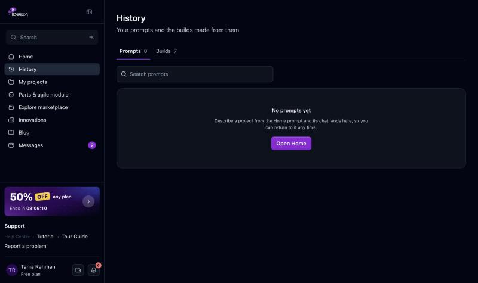 |

---

## CL-047 Settings home: your account first, then where you stand

**In the prototype:** 24 November 2026 · **Jira:** not created yet · **Production:** Not started

**Screen:** Settings (`/settings`). Web.

Settings opens on whose settings these are, with the search right there, and then four short cards that say where the maker stands, each with the one thing to do there.

### What to build

**Your account**

- [ ] At the top, one box: the maker's photo, their name (a link to their profile), a **Free plan** badge (the plan's name), and under the name the email they are signed in with, then *· @handle* when they have a handle.
- [ ] **Edit profile** on the right opens their profile with the Edit profile dialog open. On a phone it drops under the name.
- [ ] **Find a setting** is in the same box, under the name. Typing lists the matching settings under it (the setting, then its page and a line of help, with an arrow); Enter opens the first. No match: *No setting matches "…". Try one word, like "theme", "messages" or "backup".*
- [ ] On a phone the page list (**All settings**) comes next; on a wider screen it is the side list.

**Where you stand**

- [ ] Four cards, two side by side when the page is 900 px or wider, one under the other below that. Cards side by side have their buttons on one line.
- [ ] Each card's head: the icon of its Settings page, the card's title, and an arrow on the right that opens that page (*Open Plan & pricing* for assistive tech).
- [ ] **Plan and credits** (opens Plan & pricing): *Plan* (Free), *Renewal* (*No renewal on Free*, *Renews 8 Dec 2026* or *Ends 8 Dec 2026*), *Credits left* (18, with a *Running low* badge at the maker's low mark). Button: **Buy credits**.
- [ ] **Get paid** (opens Get paid), only once something of the maker's is listed or sold: *Available to withdraw* ($822.65), *Withdrawn so far* ($0.00), *Withdrawal methods* (the number, or *None yet* with *Asked at your first withdrawal* under the words). Button: **Withdraw**, and on the right *In dollars at demo rates.*
- [ ] **This browser** (opens AI & your data): *Everything you make is kept in this browser only. Clearing its data, or opening IDEEZA in another browser, starts empty unless you restore a backup.* *Last backup* (a date, or *Never* in warning colour with the warning icon), *The browser keeps it* (*Until you clear it* or *Until space runs low*, when the browser says). Buttons: **Download a backup** (the primary button while there has never been a backup) and **Restore**.
- [ ] **Privacy at a glance** (opens Privacy & safety): *Your profile* (*Open to everyone* or *Locked*), *Who can message you* (*Anyone*, *People you work with* or *No one new*), *Location and local time* (*Shown* or *Hidden*), and *Taking a break* (*Until …*) while a break is on. Button: **View as public**.
- [ ] While a value loads it shows a skeleton bone, never a made-up value.

### Design

- The account box is drawn as a Settings card (radius xl, 1 px border, surface fill, 16 px padding). A16 Avatar LG, A17 Badge brand, name in H4 (20 px semibold).
- The cards are the Settings card with a foot for its buttons. Rows: term in Body/SM secondary, value Body/SM medium, 1 px border between rows.
- Buttons: A01 MD, **tonal** for each card's button and **Edit profile**, **primary** for **Download a backup** while never backed up, **ghost** for **Restore**, ghost icon-only SM for the arrow.

### Screenshots

A page that was never built, so there is no before.

| After |
| --- |
| 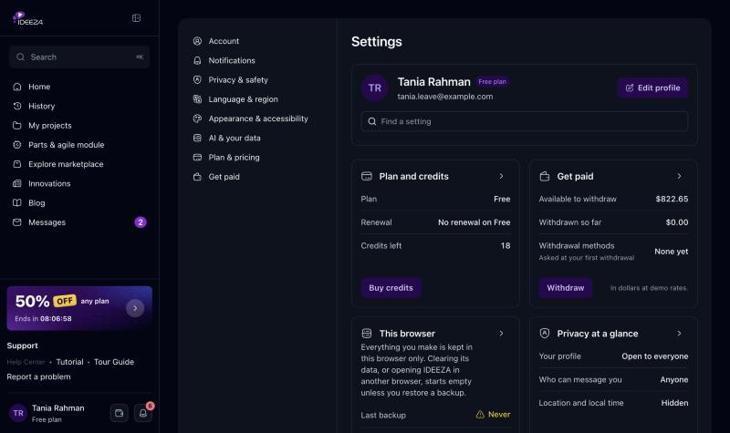 |

---

## CL-046 Deactivate or delete your account, and signing in makes it active again

**In the prototype:** 24 November 2026 · **Jira:** not created yet · **Production:** Not started

**Screen:** Settings › Account › **Sign-in and security** (`/settings/account`), its **Deactivate account** and **Delete account** dialogs, Sign in (`/sign-in`) right after leaving, the first page after signing back in. The mobile app: Settings › **Sign-in & security**, `/m/settings/deactivate`, `/m/settings/delete`, the screen after leaving (`/m/left`) and the note after Log In (`/m/restore`). Web and the mobile app.

A maker can step away for a while (Deactivate, no time limit) or leave for good (Delete, after 30 days). Either way, signing in again makes the account active again, with everything where it was.

### What to build

**Where it is**

- [ ] Settings › Account › **Sign-in and security**: *Signed in as* the email, **Download your information**, then two rows: **Deactivate account** (*Hide your account for now. Sign in any time to come back.*) and **Delete account** in red (*You have 30 days to change your mind.*). Each row opens its dialog. There is no **Sign out** here; it is in the sidebar's account menu.
- [ ] Settings search finds both rows (deactivate, pause, close account; delete, remove, erase account).
- [ ] Mobile app: the same two rows in Settings › **Sign-in & security**, with *Log In* in place of *Sign in*.

**Deactivate account**

- [ ] One step. Under the title: *Sign in any time and it's active again. There's no time limit.*
- [ ] *What happens*: *Your profile* — *Hidden, with your projects, shares and comments*; *On sale* — *7 hidden · back when you sign in* (only when something is on sale); *Messages* — *Kept · here when you sign in*; a paid plan — *Builder won't renew · ends 8 Dec 2026*; *Your money* — *Stays · withdraw it any time you're back* (only when there is money or IDZ).
- [ ] *Confirm it's you*: the password. A wrong one: *That's not your password.* An account made with Google or Facebook has no password: *You joined with Google or Facebook, so we'll send a code to tania@example.com.* with **Send code**, then the code, then *Verified. It's you.*
- [ ] *Want to leave for good? Delete account* switches to the Delete dialog.
- [ ] **Cancel** and **Deactivate account** (primary, unavailable until the maker is confirmed).
- [ ] An auction someone has bid on stops it: *Close your auction first* — *Someone bid on it. Close it once it ends, then deactivate.*, with a link to the auction.

**Delete account, in three steps**

- [ ] The line under the title says the step: *Step 1 of 3: Why you're leaving*, *Step 2 of 3: What you'll lose*, *Step 3 of 3: Confirm it's you*.
- [ ] Step 1 (optional): *Optional. It helps us make IDEEZA better.*; one of *I don't use it any more*, *I have another account*, *Privacy worries*, *It's hard to use on a phone*, *Something else*; *Tell us more (optional)*, up to 500 characters with a counter; *Need a pause? Deactivate instead*. **Cancel**, **Continue**.
- [ ] Step 2: *After 24 Dec 2026 this can't be undone.* Then *Projects* (*6 · 2 shared*), *Minted NFTs* (*5 · stay with holders*), *On sale* (*7 · hidden now*), *Plan & credits* (*18 credits*, or *Builder won't renew · ends 8 Dec 2026 · 18 credits*), *Available balance*, *IDZ balance* (when there are any), *Messages* (*Stay with the people you sent them to*), *Comments* (*Deleted with your account*). With money left: *After 24 Dec 2026 your available balance is gone with your account.* and *Withdraw money first* (Get paid). **Back**, **Cancel**, **Continue**.
- [ ] Step 2 stops at money that is still moving or an auction someone bid on: *Finish these first* — *Money that's still moving has to settle before you can delete.*, with a link to each; **Continue** is unavailable.
- [ ] Step 3: *Confirm it's you* as in Deactivate, then *Deleted on 24 Dec 2026* — *Sign in before then and it's active again.* Footer: **Back**, **Download your information** right beside **Delete account** (red). After the download: **Download again**, and the file's progress shows above.
- [ ] Offline: *You're offline. Try again when you're back online.* A failed write: *Couldn't delete your account. Nothing changed. Try again.* (*Couldn't deactivate …* for Deactivate).
- [ ] Mobile app: the same in full screens; Delete's three steps with **Download your information** in the bottom bar beside **Delete account**.

**What leaving does**

- [ ] Confirming signs the maker out at once.
- [ ] Nothing they made changes: projects, listings, copies, messages and settings are hidden with the account and come back as they were. Listings are not taken down.
- [ ] A paid plan stops renewing; it runs to the end of the period already paid.
- [ ] Sign in then says what happens now. Deactivated: *Your account is deactivated* — *Sign in any time and it's active again.*, with *Now: Hidden, with everything you made*, *Any time: Sign in and it's active again*, *Time limit: None*. Deleting: *Your account will be deleted on 24 Dec 2026* — *Sign in before then and it's active again. After that it's deleted for good.*, with *Now*, *Until 24 Dec 2026*, *After 24 Dec 2026: Deleted for good*. Then *Sign in to come back*.
- [ ] Mobile app: the same on its own screen (`/m/left`), with **Done**.

**Coming back**

- [ ] Every way in makes the account active again: password, Google or Facebook, and a password reset. On the mobile app with 2-step sign-in, only after the right code.
- [ ] Once, after that sign-in: *Your account is active again* — *You deactivated it on 24 Nov 2026. Everything is where you left it.* or *You asked to delete it on 24 Nov 2026. Signing in cancelled that, so it won't be deleted. Everything is where you left it.* With a stopped plan: *Builder won't renew. It ends on 8 Dec 2026 unless you keep it in Plan & pricing.* On the mobile app *Logging in* in place of *Signing in*, with *Wasn't you? Change your password* when the account has a password.
- [ ] 30 days after Delete the account and its work are deleted for good (checked whenever IDEEZA opens). Signing in then: *This account was deleted* — *It was deleted for good 30 days after you asked. You can create a new account with this email.*

### Design

- Both dialogs are the M11 Confirm Dialog: the intent badge in the header's icon row (Delete account: danger, trash icon; Deactivate account: info, pause icon), the title, the line under it, then A01 MD buttons in the footer (**Delete account** danger, **Deactivate account** primary, **Download your information** secondary, **Back** ghost on the left).
- Fact rows in a 1 px bordered box with rows between; reasons as Radio rows (44 px); Textarea; Banner info for *Deleted on …*, Banner error for what stops leaving.
- Account rows are Settings rows with a chevron; **Delete account** in the error ink.
- Mobile app: full screens, one primary in the bottom bar.

### Screenshots

A new feature, so there is no before.

| After |
| --- |
| 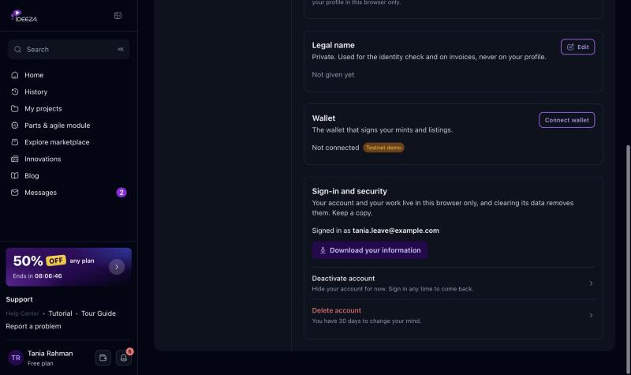 |
| 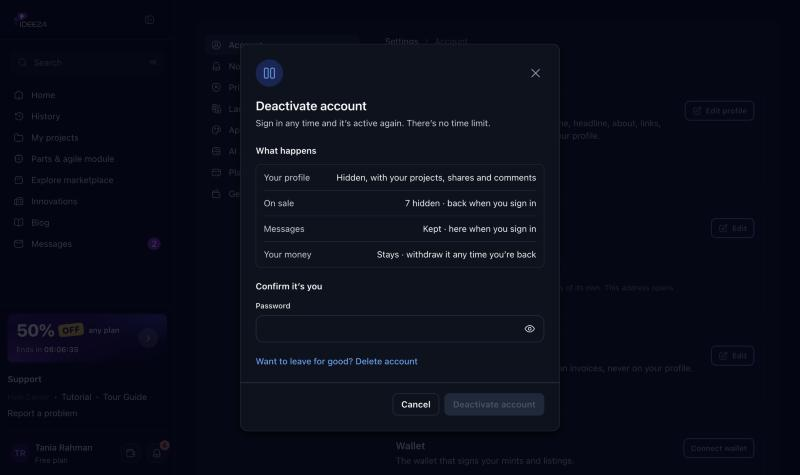 |
| 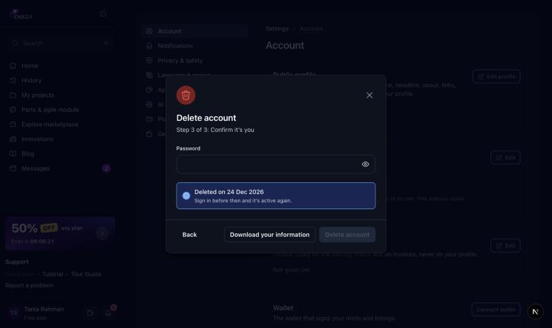 |

---

## CL-045 Small web fixes found while matching the phone

**In the prototype:** 24 November 2026 · **Jira:** not created yet · **Production:** Not started

**Screen:** the AI chat's concept canvas (its **Network** section); Settings › **Get paid** (`/settings/get-paid`), its **Withdraw** dialog and the statement download; the words about build prices in Help (FAQ), Tutorials, **Buy credits** and the Plan & pricing FAQ; the **Tour Guide**. Web.

While the phone app was checked against the website screen by screen (CL-040), a few places on the website itself turned out wrong or out of step. These are those fixes.

### What to build

**A project of one product has no Network in the AI flow**

- [ ] With one product, the concept canvas shows no **Network** section, and saving the build writes no network for the project.
- [ ] With two or more products the Network section shows as before. When none of the products link to each other, it shows the main product's app or cloud link.
- [ ] A one-product project's app or cloud link is set on the project's own **Network** tab only.

**One IDZ price for payouts**

- [ ] IDZ is paid out at the one demo IDZ price the Balance page and credits already use: *1 IDZ ≈ $0.025* (it was *1 IDZ = $1*).
- [ ] Get paid's rates line: *Sales in test coins count at fixed demo rates: 1 ETH or WETH = $3,750.00, 1 MATIC = $0.50; USDT and USDC = $1.00; 1 IDZ ≈ $0.025. Withdrawals are recorded here and no coins move.*
- [ ] The IDZ choice's hint: *IDEEZA's token, at the demo rate 1 IDZ ≈ $0.025*.
- [ ] Withdraw: **You receive** shows the coins, *≈ 398.96 IDZ* for $10.00 (USDT stays *10 USDT*); the line under it: *Paid in IDZ at the demo rate 1 IDZ ≈ $0.025. You sign it in the demo wallet.* The receipt and the statement download show the same IDZ amount.

**What a build costs, in words**

- [ ] Every sentence that says what a build costs says *5, 8 or 11 credits per product, by its Quality* (Low, Medium or High), *less when you pick fewer pieces*. No text says "4 credits per product" any more. Places: Help FAQ (*What does a credit pay for?*), Tutorials (*book a build*, *AI credits*), the Buy credits dialog's line and the Plan & pricing FAQ.
- [ ] The five pieces are named as the editors name them: *the PCB, Code, 3D Module, Assembly and Wiring, with a free Parts list*.
- [ ] Help FAQ on identity checks: *Level 1 asks your legal name and your country.*

**The Tour Guide counts only your own projects**

- [ ] The sample projects every new account starts with do not count for the guide. A step such as *Mint it* or *Share it* is done only when one of the maker's own projects did it.

### Design

- No new components. Words only, in the places' existing styles.

### Screenshots

A fix to pages that were never built, so there is no before.

| After |
| --- |
| 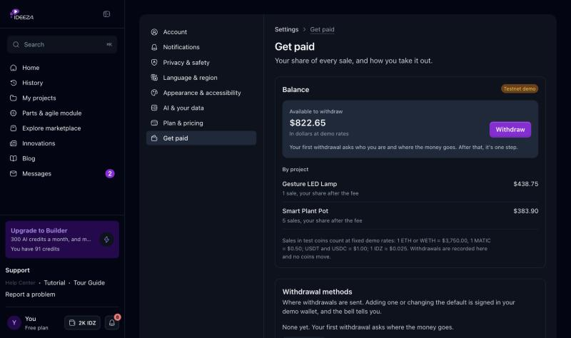 |

---

## CL-044 A profile's Activity is only for its owner

**In the prototype:** 24 November 2026 · **Jira:** not created yet · **Production:** Not started

**Screen:** a creator's profile (`/creators/<handle>`, and your own at `/creators/me`) on the web, and the profile in the mobile app (`/m/creators/<handle>`, `/m/creators/me`). Settings › Privacy › **Lock your profile**.

A profile's **Activity** tab (the updates the maker logs on their projects) is for the maker. Other people see the maker's projects, not their activity.

### What to build

- [ ] Someone else's profile shows **Projects** only, with no tab strip (web). On the phone it shows **Timeline · Projects**.
- [ ] Your own profile as others see it (**View as public**) shows the same: no Activity.
- [ ] A link to someone's `?tab=activity` opens their Projects.
- [ ] Your own profile keeps the **Activity** tab, and the tab opens with the line *Only you see your Activity.* Like every profile tab, it shows only when it has something in it.
- [ ] A locked profile's card says *Only people who work with Tomas on a project can see their projects.* (no "and activity").
- [ ] Settings › Privacy › **Lock your profile**: *Only your project teams see your projects*.

### Design

- The line *Only you see your Activity.*: `text-sm`, `text-tertiary`, above the first entry.
- Without the tab strip, the projects grid starts right under the Featured project (web).

### Screenshots

A new rule for a profile page that was never built, so there is no before.

| After |
| --- |
| 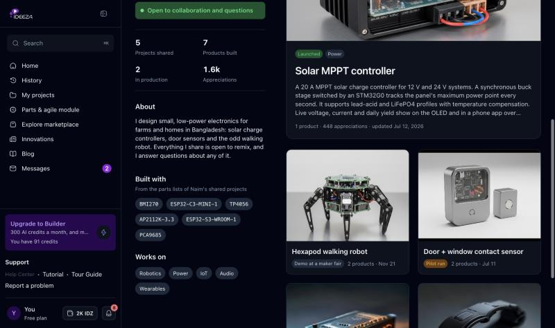 |

---

## CL-043 The project question after an AI idea: several products start a new project

**In the prototype:** 24 November 2026 · **Jira:** not created yet · **Production:** Not started

**Screen:** the AI chat's **Project** question (`/chat/<id>`, opened from Home's **Generate with AI**), and the build gate (**Build this product?** / **Build 2 products?**). The same question in the mobile app's AI tab (`/m/ai/chat/<id>`), as a sheet. This changes [CL-034](#cl-034-projects-per-plan-a-new-project-waits-until-theres-room).

When the AI's answer has several products, they belong together, so they always start one new project: the maker only names it. Only a single product can go into a project the maker already has, and that choice is two clear cards.

### What to build

**Several products**

- [ ] The question is *What should the project be called?* with *2 products belong together, so they start one new project.* and one field, **Project name**. There is no list of the maker's projects.
- [ ] **Start drawing** stays off with *Name the project first* until there is a name.
- [ ] The build gate never offers **Use a project I have** for several products. When every project on the plan is in use, its card offers the bigger plan and *Make room in My projects*, as CL-034.
- [ ] A chat started from a project's **Add a product** keeps that project, as before (*Which project are these for?* with that project chosen).

**One product**

- [ ] With no project yet: *What should the project be called?* · *This product starts a new project.* and **Project name**.
- [ ] With projects: *Which project is this for?* · *Start a new project with it, or add it to one you have.* and two radio cards:
  - **New project** · *This product starts it.*, picked first, with **New project name** inside the card. When every project on the plan is in use, CL-034's card takes the field's place inside this card.
  - **A project I have** · *Add it to one of your 7 projects.*, with the project list inside the card (*Choose a project*).
- [ ] The arrow keys move between the two cards. No "+ Start a new project" row and no bare list.
- [ ] **Start drawing** stays off with *Name the project first* (New project) or *Pick a project first* (A project I have).

**Save**

- [ ] Saving is unchanged: a build that was paid for always saves. An older chat in which several products were already pointed at a project still saves there.

**Mobile app**

- [ ] The same rules in a sheet. Several products: *What should the project be called?*, the line, a **Products · 2** row (the names, **Change** ›), **New project name**, and **Start drawing** with its credit cost in the foot, off with *Name the project first*.
- [ ] One product with projects: the same two radio cards, **New project** (name inside) and **A project I have** (list inside).

### Design

- Radio cards: the DS Radio inside a card (radius `xl`, 1 px `border`; picked: `border-brand`; hover on the other: `bg-subtle`), title `text-md` semibold, line `text-sm` `text-tertiary`; the field or the list opens inside the picked card.
- Everything else as CL-034.

### Screenshots

A change to a question that was never built (CL-034 has no ticket yet: build this one), so there is no before.

| After |
| --- |
| 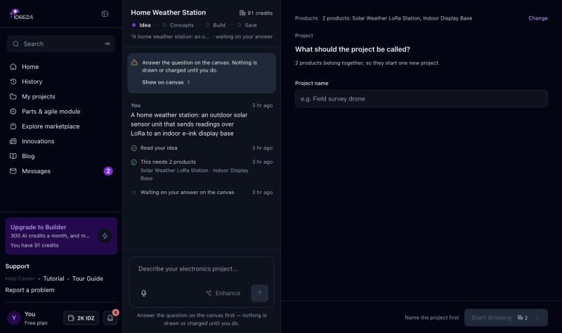 |
| 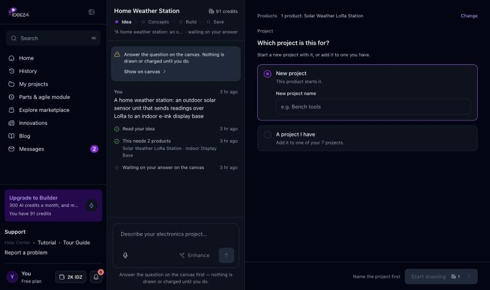 |
| 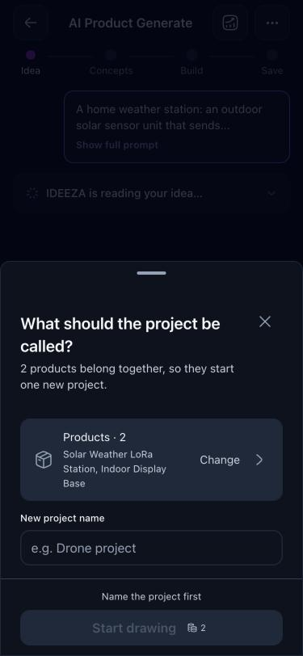 |

---

## CL-042 The Free plan's AI credits come once

**In the prototype:** 24 November 2026 · **Jira:** not created yet · **Production:** Not started

**Screen:** Settings › **Plan & pricing** (`/settings/plan`: the plan cards, **Compare plans**, the FAQ), the sidebar's **Upgrade** card, the *You're out of credits* line (Home and the concept chat), the bell's notices, Help and Tutorials. In the mobile app: Profile › Plan & pricing row, **Current credit** (`/m/plans/credits`), **Compare plans**, Plans and Billing. This changes [CL-032](#cl-032-upgrade-nudges-the-next-plan-shown-where-a-maker-runs-short).

Free gives its 10 AI credits once, when the account starts, and they never expire. There is no refill on Free. Paid plans add their credits every monthly period, as before.

### What to build

**The rule**

- [ ] A Free account gets its 10 plan credits once in its life. They never expire. Moving from Free to a paid plan and back does not give them again.
- [ ] Tinkerer, Builder and Disruptor add their credits at the start of every monthly period, as before.
- [ ] Moving from a paid plan to Free lists what gets smaller as *Monthly AI credits: 300 → none*.

**Where Free says it**

- [ ] Plan cards: *AI credits: 10 once* on Free; *AI credits: 300 / month* on the paid plans.
- [ ] **Compare plans**: the row is named *AI credits* (10, 50, 300, 1,200) and a new row under it, *AI credits given*: **Once** · **Monthly** · **Monthly** · **Monthly**.
- [ ] FAQ: *When do I get my plan's credits?* · *Free gives its credits once, when your account starts, and they never expire. A paid plan adds its credits at the start of each monthly period, and they last until the period ends. Credits you buy last 12 months. The credits that expire first are spent first.* The general answer: *Both, kept simple. Free gives its AI credits once; a paid plan adds AI credits every month. …*
- [ ] Help and Tutorials say *Free is $0 with 10 AI credits, once.* and *Free gives its credits once; paid plans add credits every month.*

**No refill day on Free**

- [ ] Sidebar Upgrade card, third line: *You have 31 credits* on Free. A paid plan that stays paid adds the day: *You have 18 credits · refills 8 Dec*.
- [ ] Out of credits on Free: *You're out of credits.* (no *They refill on …*). On a paid plan that stays paid: *You're out of credits. They refill on 8 Dec.*
- [ ] A plan that ends at the period's end (moving to Free) shows no refill day either.
- [ ] The bell sends no *Your free credits are back* notice. A paid plan still gets *Your 300 credits for this month are here*. The low-credits notice names a refill day only on a paid plan.

**Mobile app**

- [ ] Profile › Plan & pricing row, the out-of-credits row and the *Running low* notice: no *refills* on Free.
- [ ] Current credit: the plan's part is headed *Free credits* with **Given once · Used · Remaining** and no end date (a paid plan: *This month* with its allowance and end date).
- [ ] Compare plans, the plan card and Billing: Free reads *10 once*.

### Design

- No new components: the compare row is a row like the others; *Once* and *Monthly* in the table's value style.

### Screenshots

A change to plan pages that were never built (CL-032 has no ticket yet: build this one), so there is no before.

| After |
| --- |
| 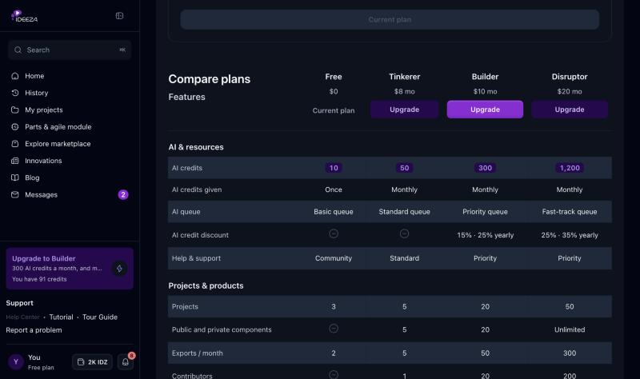 |
| 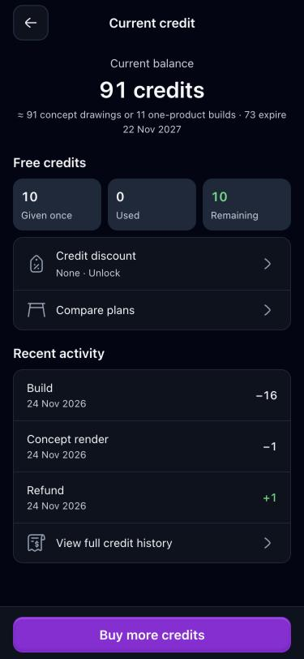 |

---

## CL-041 Share any project or product on the Marketplace

**In the prototype:** 24 November 2026 · **Jira:** not created yet · **Production:** Not started

**Screen:** web: a marketplace page (`/marketplace/<id>`, a sample's shop page and your own listing), a product's marketplace page, your own product page, the Innovations post page's **Share** menu, and **Innovations › Shared by you**. Mobile app: the same pages' **Share** icon, the profile's **Timeline** (`/m/creators/me`) and the Feed.

Anyone can share any project or product that is on Innovations or the Marketplace, anyone's or their own, bought or not, the way a re-share works on Facebook: the sharer's words on top, the original under them with its creator. A private project can never be shared.

### What to build

**Who can share what**

- [ ] Any project, or one product of it, that is live on Innovations or on the Marketplace can be shared by anyone signed in, whether they bought it or not, their own included.
- [ ] A private project (not on Innovations, nothing on sale) has no share.
- [ ] A share is never a copy of the item and never the creator's own post: posting your own project (**⋯ › Share to Innovations** on the web, **⋯ › Share to Feed** on the phone) stays as it is.

**Web: the Share button**

- [ ] A quiet secondary **Share** button beside the page's title (never inside the buy box): on a sample's shop page, your own listing's page, a product's marketplace page and your own product page.
- [ ] It opens the Share menu: **Share to Innovations** first, then **Copy link** and **Share on Facebook**, **Share on LinkedIn**, **Share on X**, **Share on WhatsApp**. The link is the page's own address.
- [ ] The Innovations post page's Share menu gets **Share to Innovations** too.

**Web: Share to Innovations**

- [ ] A dialog **Share to Innovations**: the sharer (avatar and name) with the audience picker (**Public** or **Only me**), the field *Say something about this project…* (*…product…*), and under it the original as a framed card: picture, title, *by Tomas Berg*. One button, **Share now**.
- [ ] After sharing, a toast *Shared to Innovations* (*Shared to Innovations. Only you can see it.* for Only me) with **View**.

**Web: Innovations › Shared by you**

- [ ] Every share shows as a card: *You shared Diego Alvarez's project* (*…product*), how long ago, *Only me* when only you see it, the words, then the original framed with its creator, picture, title and stage.
- [ ] **⋯ › Remove from Innovations** takes the share off, with **Undo** in the toast.
- [ ] When the item has left the Marketplace the share stays and shows it as it is now. When the item is gone: *This project is no longer available.*

**Mobile app**

- [ ] A **Share** icon in the top bar of a sample's project and product pages and of your own listing and product pages: **Share to your Feed** (someone else's item) and **Copy link**.
- [ ] Share to your Feed: a sheet with the words, the audience and the framed original, and one **Share now** button (*Share again* for an item you shared before).
- [ ] The profile opens on **Timeline**: every share and every project you shared, newest first. A share reads *Shared Diego Alvarez's project · 1 d*, the words, the original framed with its creator and a **Project** or **Product** chip, then appreciate, comments (each share has its own thread), **⋯ › Remove from your Feed** (with Undo) and save. No prices and no product list on a Timeline post.
- [ ] A share shows on the Feed while its item is on the Marketplace, as one small chip *↻ You shared* (the audience only when it isn't Public) and the words in the description's one line with *more*.
- [ ] Only me shares are hidden in **View as public** and from everyone else.

### Design

- Web Share button: A01 Button secondary md with the Share icon. The menu is the post page's Share menu (M12).
- Dialog: the DS dialog (title, ✕, one primary in the foot); audience picker as the post composer's; the framed original: 1 px `border`, radius `lg`, picture 48 px.
- Shared by you cards: the Innovations card frame; the head line `text-md` semibold, the time `text-sm` `text-tertiary`; the original framed inside, its creator as an avatar row.
- Mobile: the share sheet (M09), the Timeline post as a list card; the Feed chip is the media chip style.

### Screenshots

A new feature, so there is no before.

| After |
| --- |
| 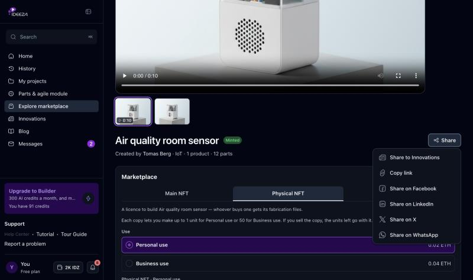 |
| 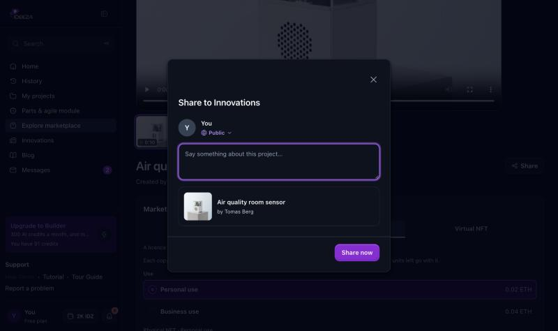 |
| 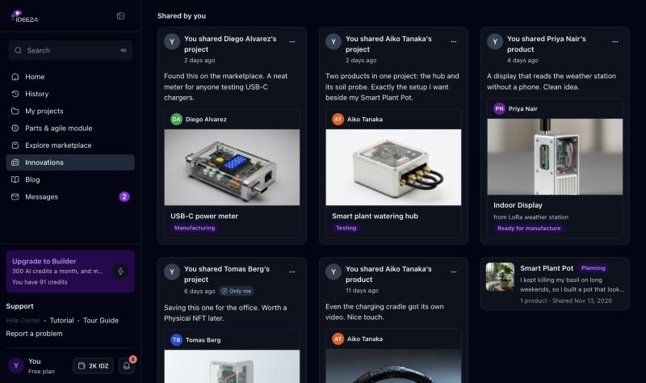 |
| 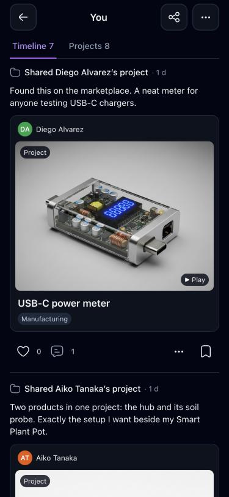 |

---

## CL-040 Mobile app: the same as the website, A to Z

**In the prototype:** 24 November 2026 · **Jira:** not created yet · **Production:** Not started

**Screen:** the mobile app at `/m`. This changes [CL-010](#cl-010-mobile-app-native-mobile-ux-everywhere).

Everything the website gained after CL-010 (CL-011 to CL-039) is now in the mobile app, in a phone's own form, and every place where the phone worked or spoke differently from the website was checked (145 differences) and matched. Two rules hold for all of it: the phone uses the website's words and rules exactly (Main NFT, Physical NFT, Virtual NFT, Personal use, Business use; never "Whole project"), and nothing the phone already had was removed.

### What to build

**Keep what the phone has**

- [ ] These stay on the phone even where the website has no twin: the sample locked profile (Tomas Berg), appreciate, save and comment on your own post, the *You've reached your limit* sheet (naming Builder), Level 1 asking a mobile number and an SMS code (in Withdraw too), and **Rebuild this piece** on a piece (with **Open chat** beside it).

**Product page (yours)**

- [ ] The bottom bar's primary is **Earn**, with one line under it about this product's copies (*Not selling copies yet*, *Physical copies on sale · 2 sold*, *Sold out · 5 sold*). It opens Earn › Sell on this product's copies (a one-product project: the project's copies).
- [ ] **⋯** in the top bar opens the product's actions: **Edit name and description**, **Preview as others see it**, **See it on the marketplace** (when listed) and **Delete product** (type the product name to confirm; the website's checks).
- [ ] Rows: **Sales** (who bought, *{n} sales to {m} people.*), **Network**, and on the 3D piece, download the model (.glb) and **Replace**.

**AI tab and Add a product**

- [ ] The prompt box keeps the mic, the picture, **Quality** (Low, Medium, High), **Enhance** and send on one row; under 320 px **Enhance** shows only its wand.
- [ ] A picture can go with the idea (inspiration image, as CL-027).
- [ ] No credits line under the box. Out of credits: a row above the box with **Buy credits**.
- [ ] **Redeem a code** as a row that opens a sheet (CL-011).
- [ ] The plan's project limit (CL-034) and the project question as CL-043, in the question sheet and in the build sheet.
- [ ] Add a product › **Build with AI** is the same box, with no cost line. **Build manually** opens *Build manually on a computer*: the editors are on the website, with the project's web address and **Copy link**.
- [ ] A project of one product has no Network card in the AI flow (CL-045).

**My projects and what you bought**

- [ ] *2 of 3 projects used* under the title (the plan's projects), then tabs **All · Draft · Minted · Listed · Sold · Purchased** with their counts.
- [ ] **All** holds what you bought, after your own projects: a card with the **Purchased** chip, *By Tomas Berg · 1 product · Bought Nov 21* and *You own 3 NFTs · 1 for sale · 1 sold ›*. A whole project bought shows once, as your project, with *Bought from Tomas Berg*.
- [ ] A purchased project opens on its own screen: the media, the **Purchased** chip, *Bought as Mira (demo creator) · last bought Nov 21, 2026*, a **You own 3 NFTs** card (Physical NFT · 2 copies, Virtual NFT · 1 copy, Paid in all, For sale, Earned selling on, **Buy another Physical NFT** ›), then the products (each opens the pieces this NFT gives), the copies (each opens its copy: use, units, *Send to manufacturing*, **Sell this copy**) and **Receipts**.
- [ ] The bottom bar: **Earn**, with a line (*1 copy for sale · 0.0525 ETH earned from 1 sold*). Earn lists the copies to sell on: set a price → sign → *For sale*; **Change price**; **Take off sale** (CL-036).

**Buying: one buy box**

- [ ] The buy page has one box with a tab per NFT on sale: **Main NFT · Physical NFT · Virtual NFT** (only the kinds on sale; one kind, no tabs). It opens on the kind the link names, else the one you hold, else the first on sale.
- [ ] Main NFT: *Main NFT* (or *Main NFT · 40% of the project*), the price large, then Listing, Share, Royalties, Minting, Chain, Collection three to a row, the royalties note, the wallet line, the activity line and *Testnet demo · shopping as Mira · Change*.
- [ ] Physical and Virtual NFTs: **Personal use** and **Business use** as radio rows with their prices (*Not on sale* or *Sold out* greyed), and copies other holders sell (**From holders**) as choices in their kind. No Buy button per row and no version sheet.
- [ ] The bottom bar names the pick and its price (*Main NFT · 0.3 ETH · 100% of the project*), **Change** while the box is scrolled away, *Ask the creator* as a chat icon, and one primary: **Buy now**, **Buy another share**, **Place bid**, **Bid again** or **Manage**.
- [ ] *You own 3 NFTs · Physical NFT ×2 · Virtual NFT ×1 · For sale ×1 · Sold ×1* with **See what you own** above the tabs when you hold some.
- [ ] The wallet names the item (*Buy Virtual NFT · Personal use*). A copy someone is paying for shows *In checkout*. The seller of an auction can **Cancel auction** while nobody has bid.
- [ ] A product row on a buy page opens the product's marketplace view, not your own product page. Holding a Physical NFT opens the product's PCB, Code and Wiring (a **You own** row, no lock).

**Videos**

- [ ] Every video is started before the maker moves on (CL-030): **Next video: {name}** on the render screen, a **Videos** button with a sheet in place of progress toasts, and what the maker signs (a listing, copies, a share) waits with *Waiting for videos* and goes live once every video is in use.
- [ ] The project video is drawn from the products and can start right away.
- [ ] *Add to marketplace*: a product's video row (**Generate AI video**, **Review**, **Try again**) opens that product's video maker, and Close comes back to the sheet.
- [ ] The mint's **Review** step, while a video isn't started, leads with *Generate your videos* · *1 of 3 started*, one line, then **Product videos** and **Project video** as rows (the project video's row is titled with the project's name, *All its products in one video · not made yet*), each with **Generate video**.
- [ ] What the maker already set folds into one closed row, **Listing details** (or **Mint details**), with a gist (*RC Car · Buy now 1 USDC · 100% of the project · nothing to pay now*). Opening it shows the products, every term, the videos already done and the cost, wallet and each-sale lines.
- [ ] The step's button names the next step, **Sign and list**, and stays off with *Start every video first: RC Car hasn't started yet.* until every video has started.
- [ ] The listing form's **Listing type** is two radio cards, **Buy now** and **Auction**, each with its line.

**Profile**

- [ ] Your profile opens on **Timeline** (CL-041), then **Projects**, and **Activity** only on your own (CL-044). Tabs show only when they have something.
- [ ] Your **Projects** tab lists every project you made: the public ones first, then the private ones marked **Private** (only you see these). Under the tiles: *8 of 13 in My projects, with what you bought* and **View all projects · 13**, which opens My projects › All (13). Others and **View as public** see the public projects only, with no button.
- [ ] Pins are public: others see your first pin as Featured with *Pinned by Naim* (you see *Pinned by you*); with no pins, the project furthest along.
- [ ] *4 projects are public* opens My projects with exactly those (*4 projects on your profile*), *4 private in My projects* opens the rest (*4 projects kept private*); each has **Show all projects**.
- [ ] The Profile tab's **Projects** row shows My projects › All's number (13).
- [ ] **Edit profile** is a secondary button under the profile's facts. On someone else's profile, **Follow** and **Message** sit side by side there too. None of them is sticky.

**Money, plans and settings**

- [ ] Buy credits asks above the maker's *Ask before a purchase over* amount. Credit packs and plan pitches as the website (CL-032, CL-033; Free pitches **Builder**). Free credits come once (CL-042). One IDZ price, *1 IDZ ≈ $0.025* (CL-045).
- [ ] Following works as on the website: your own choices, else the sample people you follow.
- [ ] Sign in with a wrong email or password: *That email and password don't match.*
- [ ] An account made with Google or Facebook finishes its details on one screen (the website's fields), once.
- [ ] **Report a problem** in the ⋯ of a project, a product, the AI chat and Earn; the report names the screen and the project or product.
- [ ] Guest prompts say *Log In to …*; a comment's **Copy link** is the post's web page link to that comment.

Demo stand-ins (prototype only): testnet money, the demo buyers (Mira, Leo, Sam), sample projects and shares.

### Design

- Mobile design system only, as CL-010: list cards and rows, bottom sheets (M09), the bottom bar with one primary, radio cards, badges (*Purchased*, *Private*), the media chip.
- No new colours or tokens; light and dark.

### Screenshots

The mobile app was never built (CL-008 to CL-010 have no ticket in development), so this is its current state, with no before.

| After | After |
| --- | --- |
| 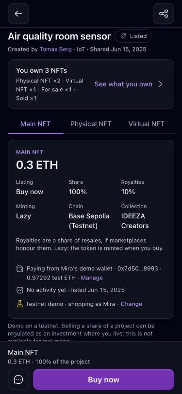 | 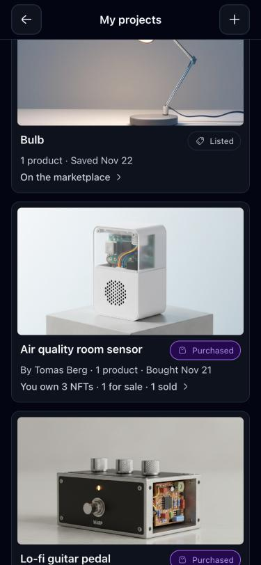 |
| 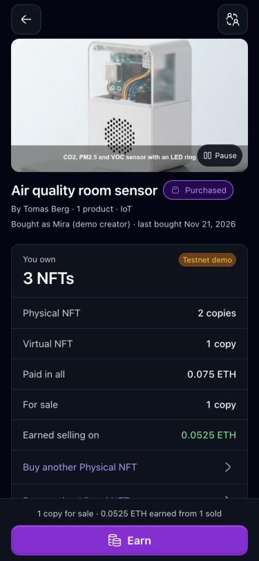 | 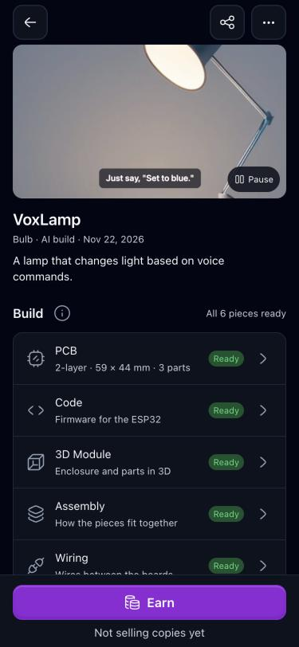 |
| 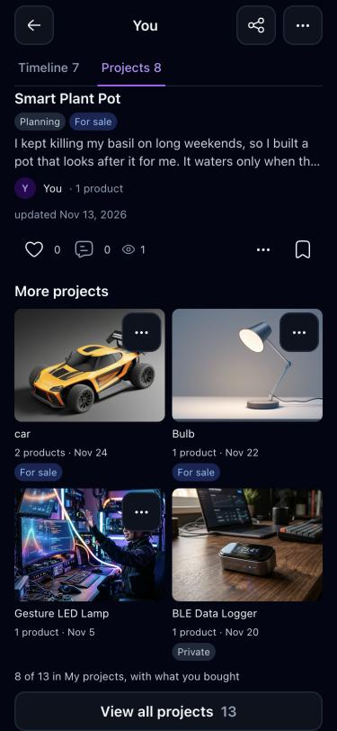 |  |

---

## CL-039 Earn › Sell: every tile says which NFT it is

**In the prototype:** 19 November 2026 · **Jira:** not created yet · **Production:** Not started

**Screen:** a project's **Earn › Sell** (`/projects/<id>/earn/sell`, web): the board's tiles, a product's Main slot, the item panel's head and the drawer. This changes [CL-028](#cl-028-earn--sell-one-board-for-everything-you-sell).

People trying the board could not tell which tile was the Main NFT, the Physical NFT or the Virtual NFT. Only the column heads at the top named them, far above a product's row, and every tile started with its status. Now every tile says what it is.

### What to build

**Tiles**

- [ ] Every tile starts with its type: an icon in a small tinted square, the type's name and one line on what it is.
  - Main NFT: crown icon, **Main NFT**, *The project itself*.
  - Physical NFT: box icon, **Physical NFT**, *A built unit you make and ship*.
  - Virtual NFT: file-download icon, **Virtual NFT**, *The design files with a licence*.
- [ ] The icons are the ones the phone app's Sell rows already use for each type.
- [ ] Under the type, one line: the price (or *No price yet*, *Not on sale*, *Mint first*) on the left and the status chip on the right.
- [ ] Then the sold bar, then one line with what sold and the use on the left (*1 of 50 sold · 2 uses*, *0% sold · Buy now*, *0 of 50 sold · Personal use*) and what it earned on the right (*0.039 ETH*), or *Set a price ›* while not selling.
- [ ] No column heads over the board: each tile says its type. **How selling works** still opens the three rule cards, and each card's name now has its type's icon instead of a dot.

**A product's Main slot**

- [ ] Where a product would have a Main NFT, a dashed slot with a grey crown icon and **No Main NFT**.
- [ ] The first product's slot says *Products sell copies only. The Main NFT is the whole project, above.* The other products' slots say *Copies only*.
- [ ] Under 480 px (tiles stacked), only the first product shows this slot.

**Item panel and drawer**

- [ ] The panel's head shows the type's icon (small) beside *Main NFT*, *Physical NFT* or *Virtual NFT*, instead of a dot.
- [ ] Below a 1024 px wide page, the drawer's line under its title starts with the same small icon: *Virtual NFT · The design files with a licence*.

**Board width**

- [ ] A row's name sits beside its three tiles from a 960 px wide board (it was 720 px); narrower, above them; under 480 px the tiles stack. On a 1600 px screen with the item panel open, the names sit above the tiles, so each tile keeps its type, price and chip on their own lines.

### Design

- Type icon: a 32 px square, radius `lg`, the icon 18 px. In the panel's head and the drawer: a 24 px square, radius `md`, the icon 14 px.
- Colours: Main `bg-brand-subtle` with `icon-brand`, Physical `bg-warning-subtle` with `icon-warning`, Virtual `bg-info-subtle` with `icon-info`. No Main NFT: `bg-subtle` with `icon-secondary`.
- Icons from the DS set (Hugeicons): Crown, Delivery Box 01, File Download.
- Type name `text-md` semibold `text-primary`, its line `text-sm` `text-tertiary`. No Main NFT's name `text-secondary`; its slot 1 px dashed `border-strong`, radius `xl`, like a tile.
- Everything else as CL-028.

### Before → After

| Before | After |
| --- | --- |
| 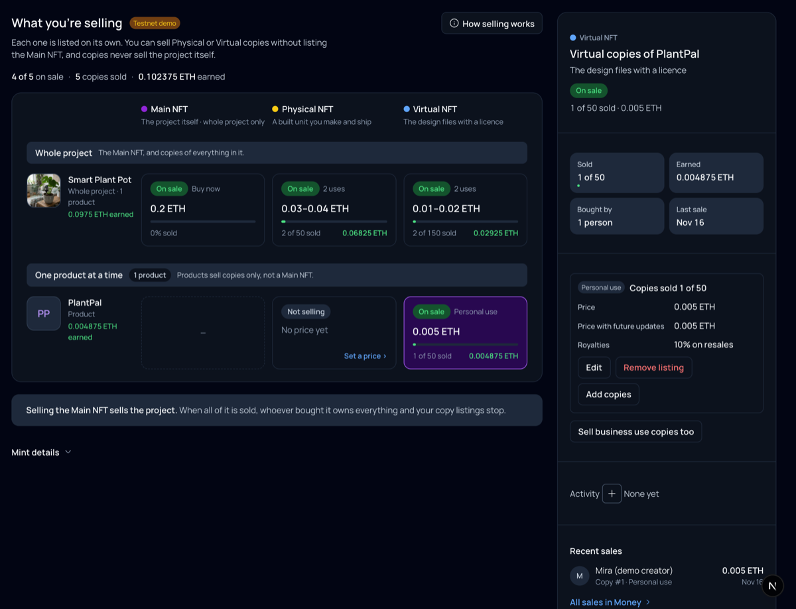 | 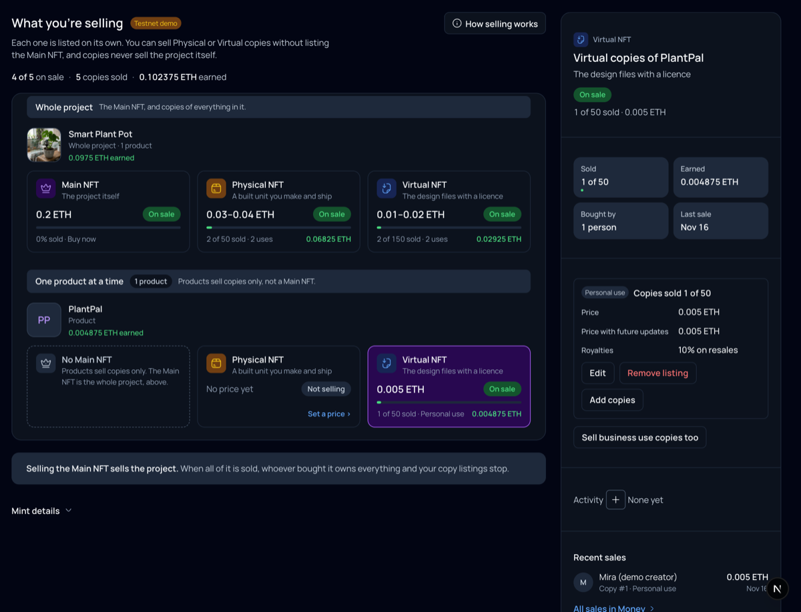 |
| 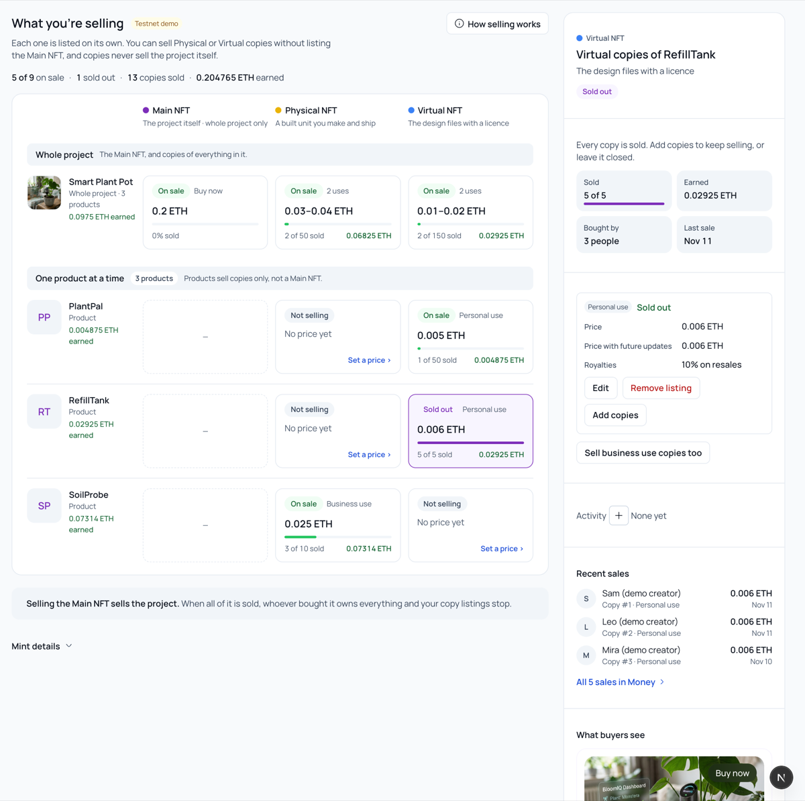 | 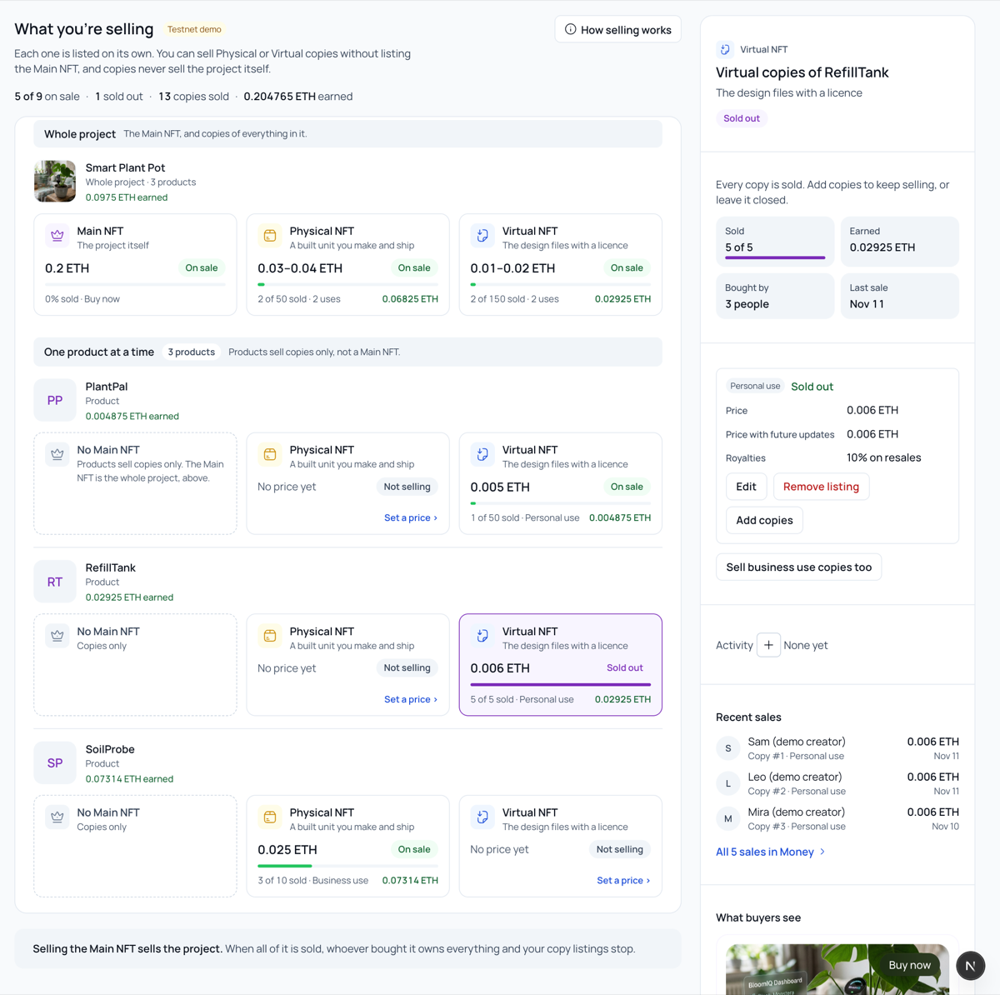 |
| | 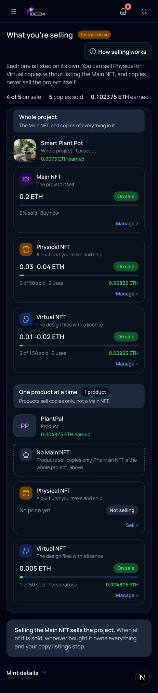 |

---

## CL-038 A whole project you bought opens as your project, with its Purchase

**In the prototype:** 19 November 2026 · **Jira:** Not created yet · **Production:** Not started

**Screens:** the project page of a project bought whole (`/projects/<id>`), and every link that leads to it. Web app only. Together with [CL-035](#cl-035-purchased-page-the-project-you-bought-shown-by-kind-of-nft): a whole project bought has no tab on the purchased page.

A creator who buys a project's Main NFT (the whole project, 100%) owns that project. It opens as one of their projects, on its normal project page, and what they paid for it sits in one block on that page. There is no purchase page in between and no **Open the project** step.

### What to build

**Every way in opens the project**

- [ ] These open the project page itself: its card in My projects › Purchased, its card in My projects › All, **See what you own ›** in the project's Marketplace box (Explore marketplace), and **Open your files** on its Innovations product page.
- [ ] An old purchased-page address of a project bought whole (`/projects/purchased/<project>`) goes straight to the project page.
- [ ] In All it shows once, as the creator's own project ([CL-037](#cl-037-my-projects--all-what-you-bought-is-there-too)).

**The project page**

- [ ] The normal project page, the same as for a project the creator made: the header (its line starts *Bought from {creator}*), Publish, Earn and ⋯, the Products, Media, Network and Team tabs, editing and building.
- [ ] The rail gets a **Purchase** block, right under Activity, with the line *You bought the whole project, so it's one of yours: open it, edit it, build it and sell it again.* and these facts:
  - *Bought from*: the creator's name, a link to the listing it was bought on;
  - *Price paid*: *0.35 ETH*;
  - *Bought on*: *Nov 13, 2026*;
  - *Your share*: *100% · Main NFT*;
  - *Token*: *#1028 · IDEEZA Creators*;
  - *Blockchain*: *Base Sepolia (Testnet)*;
  - *Transaction*: shortened (*0x6ace…25d0*), the full one on hover;
  - *Bought as*: *Mira (demo creator)* with the Testnet demo badge.
- [ ] Only the project's owner sees it; never in a preview. A project the creator made has no Purchase block.

**The purchased page, when copies are held too**

- [ ] The purchased page shows only the Physical and Virtual copies held: it has no Whole project tab.
- [ ] When the whole project is held as well, Your NFTs starts with one card, *The whole project is yours too: it opens as one of your projects.*, with **Open the project**. The rail's You own still lists *Whole project · 100%* and counts it.

Demo stand-ins (prototype only): Bought as, the Testnet demo badge, the test token and network.

### Design

- The project page as it is. The Purchase block is a rail block like About: its title, the line in `text-secondary`, then the facts list (label `text-secondary`, value `text-primary`); the creator's name as a text link (`text-link`), the transaction in Code, the DS Testnet demo badge.
- The card on the purchased page: the page's own card (radius 2xl, 1 px `border`, `bg-surface`) with the Primary link button.
- No new colours or tokens; light and dark.

### Screenshots

A new feature, so there is no before.

| |
| --- |
| 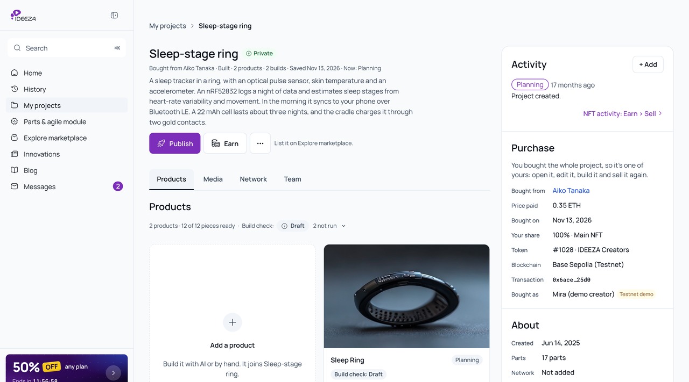 |

---

## CL-037 My projects › All: what you bought is there too

**In the prototype:** 19 November 2026 · **Jira:** Not created yet · **Production:** Not started

**Screen:** My projects › All (`/projects`). Web app only.

All holds everything a creator has: the projects they made and the projects they bought from, in one list. Purchased stays as its own tab.

### What to build

- [ ] All lists the creator's own projects and every project they bought copies of, in one list: one order, one search and one set of pages (12 a page).
- [ ] The All count is both together (*All 11*: 6 made, 5 bought from), and so is *{n} projects* above the cards.
- [ ] A whole project bought is one of the creator's own projects ([CL-038](#cl-038-a-whole-project-you-bought-opens-as-your-project-with-its-purchase)), so it shows once, as their project, never again as a purchase.
- [ ] Draft, Minted, Listed, Sold and **Shared only** keep only the creator's own projects. Purchased keeps only what was bought, with its own cards ([CL-035](#cl-035-purchased-page-the-project-you-bought-shown-by-kind-of-nft)).
- [ ] A purchase in All is drawn as the list's own card, with the same frame, cover and places as the creator's projects (a row below a 560 px wide list):
  - the chip **Purchased** (shopping bag icon) where a project's status chip goes;
  - the line *By {creator} · {n} products · Bought {date}* (the last purchase; the full date on hover);
  - the hint *You own 3 NFTs · 1 for sale · 1 sold* (for sale and sold only when there are some) with the arrow;
  - the whole card opens what was bought ([CL-035](#cl-035-purchased-page-the-project-you-bought-shown-by-kind-of-nft)).
- [ ] At phone width the line and the hint wrap to a second line instead of being cut; a date or one part of the hint never breaks across two lines.
- [ ] Search finds a purchase by its name, its creator or the names of its products.
- [ ] The sort orders both together: *Recently updated* by the last purchase or sale, *Newest to oldest* and *Oldest to newest* by the first purchase, *Name A–Z* by name.

Demo stand-ins (prototype only): what was bought is the demo creator's picked in Shopping as.

### Design

- The list's own card (the project card): radius 12, 1 px `border`, `bg-surface`, cover 16:10 in the grid, 96 × 60 in a row; title 16 medium, the line 14 `text-tertiary`, the hint 14 medium `text-secondary`.
- The chip: DS Badge in the brand tone with the shopping bag icon, the status chip's size (22 px).
- No new colours or tokens; light and dark.

### Screenshots

A new feature, so there is no before.

| |
| --- |
| 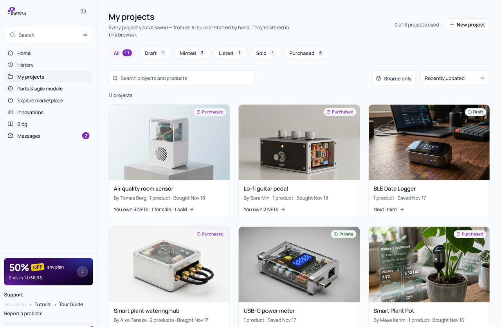 |
| 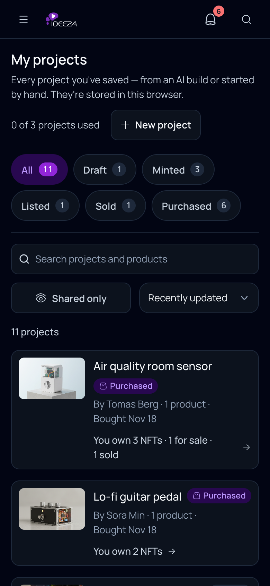 |

---

## CL-036 Sell a bought copy on, and Earn for what you bought

**In the prototype:** 19 November 2026 · **Jira:** [PR-9716](https://ideeza.atlassian.net/browse/PR-9716) · **Production:** Not started

**Screens:** a purchased project's page (`/projects/purchased/<project>`); its **Earn** (`/projects/purchased/<project>/earn`, Overview) and **Earn › Sell** (`/projects/purchased/<project>/earn/sell`); the Physical NFT and Virtual NFT tabs of a project's Marketplace box (`/marketplace/<project>`); the creator's own **Earn › Money** (`/projects/<id>/earn/money`). Web app only.

A creator who bought a Physical or Virtual copy can put it up for sale, change its price or take it off sale, and another creator can buy it from them. Each project they bought copies of has its own **Earn**, built like a project's own Earn, where they see what the copies earned and sell them.

### What to build

**The rules**

- [ ] Only Physical and Virtual copies are sold on here. The Main NFT is the whole project: whoever holds it sells it from that project's own Earn, as the maker does.
- [ ] A copy sells at one price (Buy now), in the token and on the network it was bought with. There is no auction for one copy.
- [ ] Putting a copy up for sale is a free signature. A new price is another free signature. Taking it off sale needs nothing to sign, because a listing like this has nothing on chain.
- [ ] While a copy is for sale it stays the holder's, in their wallet, and no units are made with it, so what a buyer gets can't change under them.
- [ ] A sale moves the copy (its number), its licence (the same use) and its units left. The units the seller made stay theirs (and with Business use they may still sell them).
- [ ] Out of the price come the creator's royalty (the listing's royalty, for example 10%) and IDEEZA's 2.5% fee. The rest is paid to the seller. The buyer pays the price plus the network fee.
- [ ] A copy can be sold on any number of times. It keeps its number and its units count follows it.
- [ ] The seller can't buy their own listing. A listing whose seller no longer holds the copy can't be bought ("The holder took this copy off sale.").

**Earn for a purchased project**

- [ ] The purchased page's header has an **Earn** button (coins icon, the quiet button) with one line beside it: *1 copy for sale · 0.0525 ETH earned from 1 sold*, or *Sell a copy on, set its price, see what it earned* when nothing is for sale or sold.
- [ ] Earn's header: *← {project}* back to the purchased page, the Shopping as strip, the title **Earn** and one status pill: *Not selling*, *1 copy for sale* / *{n} copies for sale*, or *Sold every copy*.
- [ ] Two tabs, **Overview** and **Sell**, drawn like a project's own Earn tabs, each with its own address.

**Overview**

- [ ] **What your copies earned** (one card):
  - *Earned from selling copies on*: the sum paid to you, per token, with *{n} sold · after royalties and fees*, or *Nothing yet*;
  - *For sale now*: *{n} copies* with *Asking {total}*, or *None*;
  - *You hold*: *{n} copies*, and *And the whole project* when held;
  - *Units made*: *{made} of {allowance}*, with *With the Physical copies you hold* (only with Physical copies held).
- [ ] Under the figures, one line and at most one button for the next step:
  - copies held, none for sale: *Put a copy up for sale: you set the price, and it stays yours until someone buys it.* with **Sell a copy**;
  - some for sale: *1 copy is for sale on Explore marketplace. Change a price or take one off sale on Sell.* with **Manage what's for sale**;
  - every copy sold: *You sold every copy you had.* with **Buy another copy** while the creator still sells copies.
- [ ] **Activity**, newest first, with the date and, where money moved, the amount (paid in grey with −, earned in green with +): *Bought #7 of 50 · Physical NFT · Business use from {creator or holder}*, *Put #1 up for sale at 0.035 ETH*, *Took #1 off sale*, *Sold #8 of 50 · Physical NFT · Business use to Sam for 0.06 ETH* (+ what it paid you), *Made 10 units with #7 of 50*. A copy you sold still shows how you got it.
- [ ] Folded at the foot: **How selling a copy on works**, the rules above in five short lines.

**Sell**

- [ ] **Your copies** with *Pick a copy to sell it, change its price or take it off sale.*
- [ ] The board groups the copies under labelled bands: *Physical NFTs · {n}* (*Each copy sells with its licence and its units left.*), *Virtual NFTs · {n}* (*Each copy sells with its licence.*), then *Sold on · {n}* (*Copies you sold, and what they paid you.*). A band with nothing in it isn't shown.
- [ ] Each copy is a tile: a chip (*Not for sale*, *For sale*, *Sold*), its use (and its product when it is a product's own copy), its number (*#7 of 50*), its price (*No price yet*, the asking price, or *Sold for 0.06 ETH to Sam*), and for a Physical copy a units bar with *10 of 50 units made · 40 left*. A tile not for sale says *Set a price ›*.
- [ ] When the whole project is held too, a dashed band above the copies says *The whole project is yours* / *It sells, with its copies, from its own Earn.* with **Open its Earn**.
- [ ] Picking a tile opens its item panel beside the board, from a 1024 px wide page; narrower, the panel opens as a side drawer and each tile says what a tap does (*Set a price ›*, *Manage ›*, *Receipt ›*). The purchased page's **Sell this copy** opens Sell on that copy (in the drawer on a narrow page).
- [ ] No copies and no whole project: a state card *No copies to sell* with **Buy a copy** while copies are on sale.

**The item panel**

- [ ] Its head: the kind and use (*Physical NFT · Business use*), the number large, the chip, *A copy of {project}.* (or *A copy of the whole project: A, B.* / *A copy of {product}, from {project}.*), and for a Physical copy its units line.
- [ ] **Not for sale: Sell this copy**
  - **Price** with the token inside the field, filled with the creator's current price for that kind and use (else what you paid). Only digits and a point can be typed. An empty or zero price says *Enter a price above 0, with up to 6 decimals.*
  - Under the field: *You paid 0.04 ETH* (*… to {holder}* when bought from one), *New copies from {creator}: 0.04 ETH* (or *… are sold out: holders are the only sellers*, or *{creator} isn't selling new copies of this kind*), and *Lowest from other holders: 0.03 ETH* when there is one.
  - The split, live as the price changes: Price, *Creator's royalty (10%)* −…, *IDEEZA fee (2.5%)* −…, **You get**.
  - *The buyer gets*: *The copy, its Business use licence and 40 units left to make.* (Virtual: *The copy and its Personal use licence.*). *Stays yours*: *The 10 units you made, and you can still sell them.*, *Nothing: you haven't made units with it.*, or for Virtual *What you made with it. You stop starting new work with it once it sells.*
  - **List for sale**, then the wallet's signature (*Sign the listing — no fee*, showing the project, the copy, the price, what you get, and the wallet). Under the button: *Listing is a free signature. The copy stays yours, and in your wallet, until someone buys it.*
- [ ] **For sale**
  - The price large, *For sale on Explore marketplace since {date}* (and *· new price {date}*), the split, what the buyer gets and what stays yours.
  - Physical: *No units are made with a copy while it's for sale, so the buyer gets exactly what this says.*
  - **Change price**: the same field and split, **Sign the new price** (a free signature) and **Keep {price}**.
  - **Take off sale**: asks *Take #1 off sale?* / *It leaves Explore marketplace at once. Nothing to sign, and you can list it again any time.* with **Take off sale** and **Keep it for sale**.
  - **See it on Explore marketplace ›** to that tab.
- [ ] **Sold: Receipt**: Sold to, On, Price, Creator's royalty, IDEEZA fee, **Paid to you**, Units handed over (Physical), Transaction; *The copy and its licence are {buyer}'s now. The payout went to your demo wallet.*

**Buying from a holder (Explore marketplace)**

- [ ] Each Physical NFT and Virtual NFT tab of a project's Marketplace box lists **From holders · {n}** under the creator's own Buy now: *Copies others bought and sell on. You get the copy, its licence and its units left; the creator still gets a royalty.* A product page's tabs list only that product's own copies.
- [ ] One row per listing, cheapest first: the number and use, *Sold by {name}* and for a Physical copy its units (*12 of 50 units made · 38 left*, or *no units left*), the price and **Buy**. The section isn't shown when nobody sells one.
- [ ] Buy opens the wallet's *Confirm purchase*: the project, the copy, *You get* (what moves), *From* (the seller), *Paying from*, and a note that the royalty and IDEEZA's fee come out of the price. Paying moves the copy to the buyer.
- [ ] Your own listing reads *Your listing* with **Manage** (to its Earn › Sell).
- [ ] *you own {n}* under a tab's price counts the copies you hold now, including ones bought from holders, not ones you sold.

**After a sale**

- [ ] The seller's purchased page: the copy leaves Your NFTs; the project stays in Purchased with what it earned (rail *Earned selling on*, the Earn line, a receipt row *Sold to Sam · …* with *+0.06 ETH*). When every copy is sold, Your NFTs says *You sold every copy* / *… someone else's now, with their licence. What they paid you is in Earn, and each sale is in the receipts below.* with **See what they earned**.
- [ ] The buyer's purchased page: the copy is in Your NFTs with *Bought from Mira {date}*, the price they paid, its units left, and its own **Sell this copy**.
- [ ] My projects › Purchased cards add the chips *For sale ×{n}* and *Sold ×{n}*.
- [ ] The seller's balance goes up by what the sale paid them, and the buyer's down by the price and the network fee.

**The creator's royalty**

- [ ] On the creator's own project, Earn › Money's **Your earnings** card adds *Royalties from resales* with the sum per token and *Paid into your demo wallet when a buyer sells a copy on*.

**Not in this change**

- Selling a share of a Main NFT below 100%, an auction for a copy, units per copy set by the creator (decision open), and the phone app.

Demo stand-ins (prototype only): the buyer and seller are the demo creators picked in Shopping as (Mira, Leo, Sam); the wallets, tokens and signatures are the testnet demo's.

### Design

- Earn: the project Earn's own frame, header, tab strip and cards (radius 2xl, 1 px `border`, `bg-surface`), H2 24 semibold; figures 20 semibold, labels 14 `text-secondary`, notes 12 `text-tertiary`.
- Sell: the Sell desk's board, bands (`bg-subtle`, kind dot, count chip), tiles (radius xl, picked: `border-brand` + `bg-brand-subtle`), the units bar (the sold meter), the item panel frame (sticky, divided) and the DS Drawer under 1024 px.
- Chips: DS Badge, *Not for sale* neutral, *For sale* brand, *Sold* success. The price field: DS Text Input xl with the token as its suffix. The split: a `bg-subtle` box, *You get* semibold above a hairline. Buttons: A01 Primary lg 44 px for the panel's one action, Secondary for the rest.
- From holders: rows in 1 px `border` radius xl, the number in Code, **Buy** Secondary md (the creator's Buy now stays the tab's one violet).
- Amounts: tabular figures; earned in `text-success` with +, paid in `text-secondary` with −. Light and dark.

### Screenshots

A new feature, so there is no before.

| |
| --- |
| 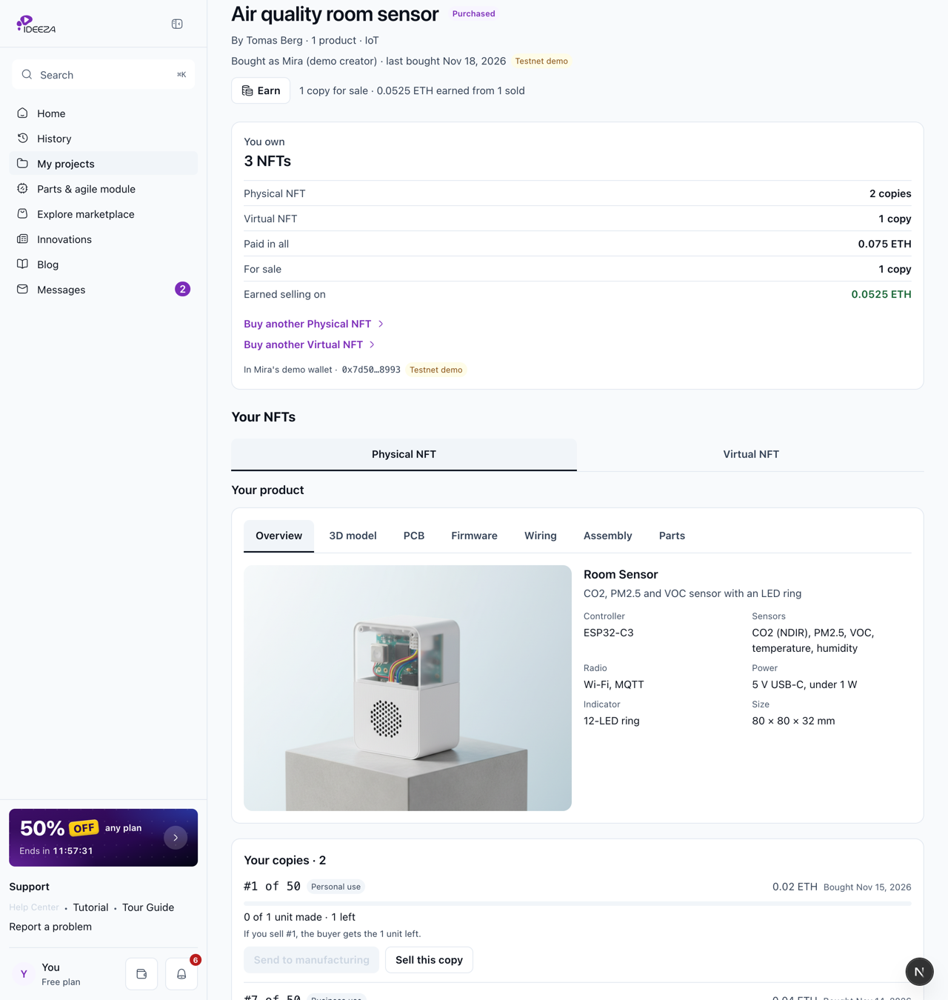 |
| 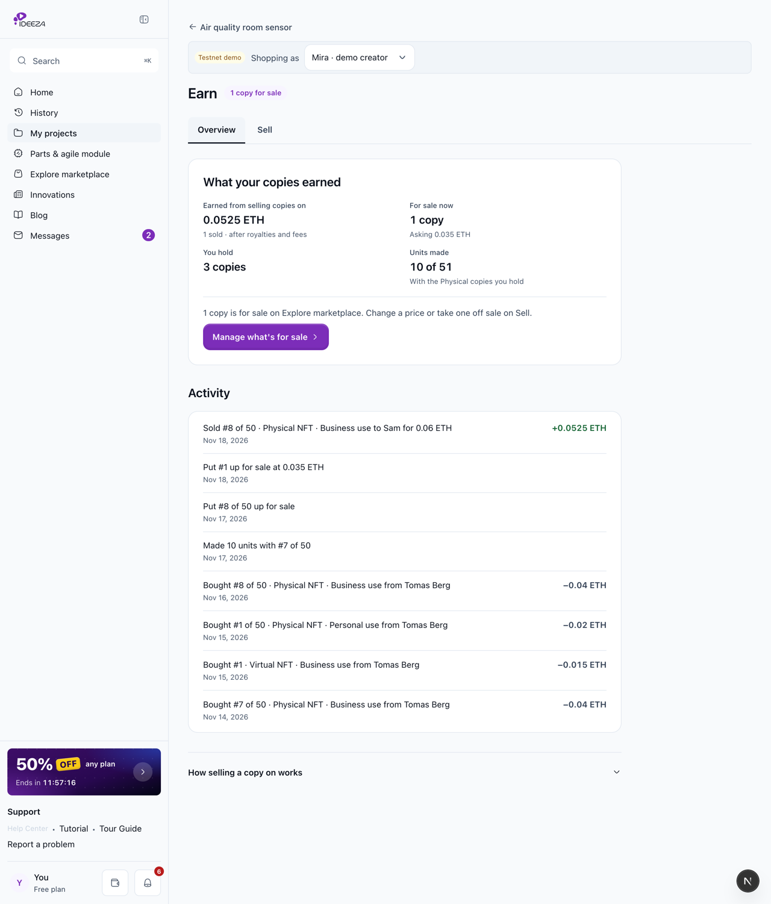 |
| 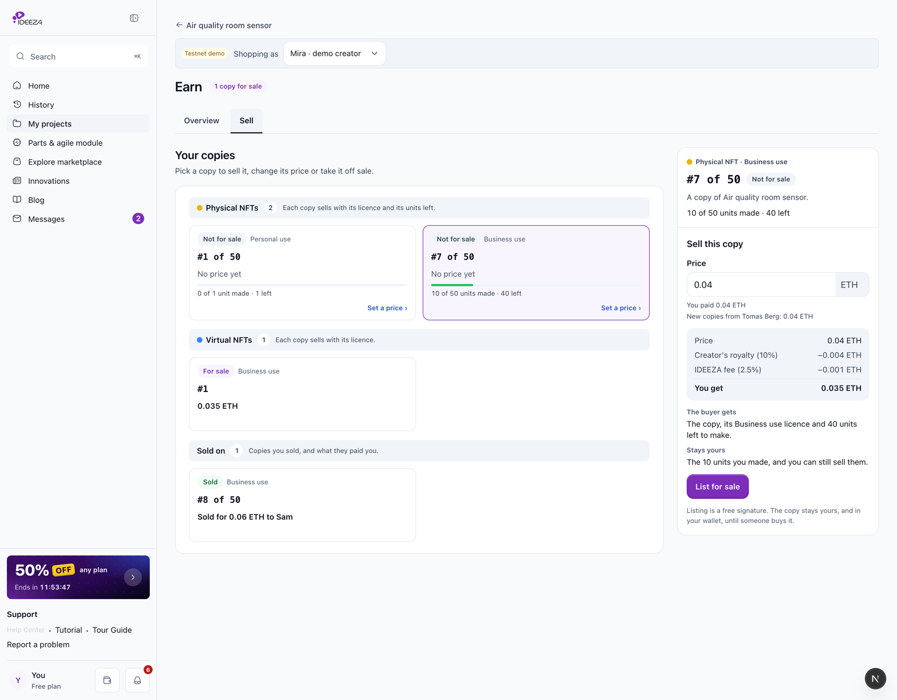 |
| 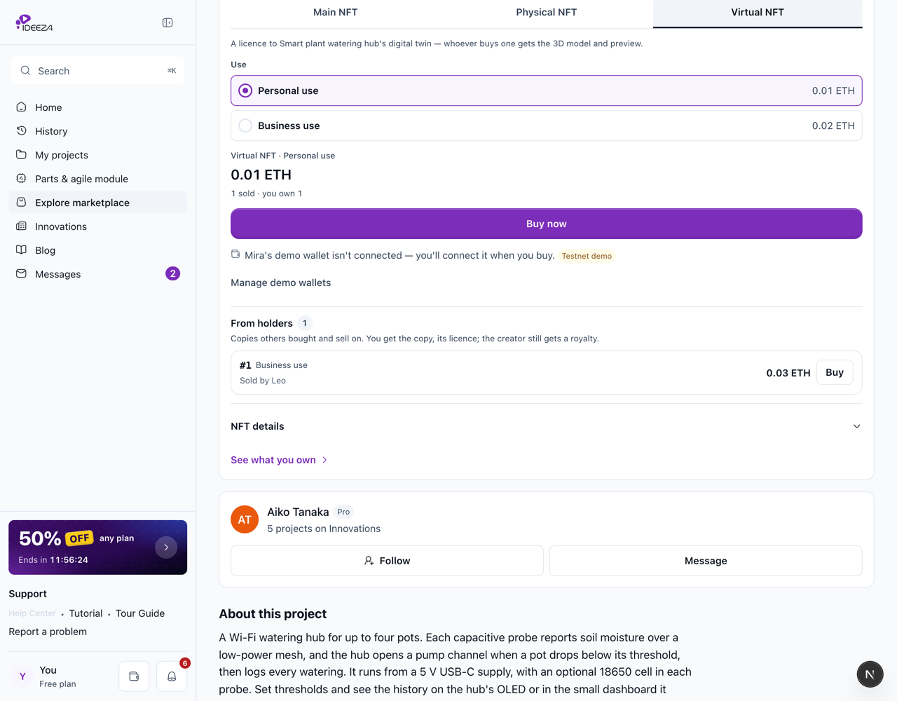 |
| 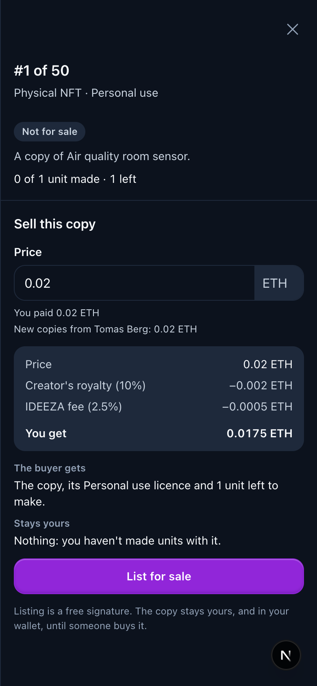 |

---

## CL-035 Purchased page: the project you bought, shown by kind of NFT

**In the prototype:** 19 November 2026 · **Jira:** [PR-9715](https://ideeza.atlassian.net/browse/PR-9715) · **Production:** Not started

**Screen:** My projects › Purchased › a project (`/projects/purchased/<project>`). Web app only. It replaces the page in [CL-020](#cl-020-my-projects-purchased), which was never built: build this one.

Each project a creator bought from has its own page. It shows the project in the marketplace page's frame and what each kind of NFT opens: the products themselves first, then the copies with their units, then the rules folded away. A whole project bought is the buyer's own project and opens as one ([CL-038](#cl-038-a-whole-project-you-bought-opens-as-your-project-with-its-purchase)).

### What to build

**The frame**

- [ ] Breadcrumb *My projects › Purchased › {project}*, then the Shopping as strip (prototype only).
- [ ] The marketplace page's media first (the videos and pictures), then the header: the name with the badge **Purchased**, *By {creator} · {n} products · {category}*, *Bought as {name} (demo creator) · last bought {date}*, then **Earn** and its line ([CL-036](#cl-036-sell-a-bought-copy-on-and-earn-for-what-you-bought)).
- [ ] When the project's Main NFT was sold to someone else: *The project was sold in full to {name}. Your copies stay yours, with their units and files.*
- [ ] The rail (from 1024 px), held in view:
  - **You own** *{n} NFTs*, a row per kind (*Physical NFT · 2 copies*, *Virtual NFT · 1 copy*, *Whole project · 100%*), *Paid in all*, *For sale* and *Earned selling on* when there are some, **Buy another {kind} ›** for each kind still on sale, and *In {name}'s demo wallet · {address}*.
  - The creator: another creator's card (Follow, Message), or for the browser's own listing *Creator* with *Questions about what you bought go to {creator}.* and **Get creator support**.
  - No Innovations stats on this page: it is about what the buyer owns.
- [ ] Narrower: You own comes right after the header; the creator comes after the receipts.

**Your NFTs**

- [ ] One tab per kind of copy held: *Physical NFT*, then *Virtual NFT*; one kind shows as a label. `?nft=physical` (or `virtual`) opens that tab.
- [ ] When the whole project is held too, one card comes first: *The whole project is yours too: it opens as one of your projects.* with **Open the project** ([CL-038](#cl-038-a-whole-project-you-bought-opens-as-your-project-with-its-purchase)).

**A Physical NFT or Virtual NFT tab, in this order**

- [ ] **Your products · {n}** (*Your product* with one): with several products, a switcher with each product's name on the right. The product picked, in one card, with tabs **Overview** and the pieces this kind opens:
  - Physical NFT: 3D model, PCB, Firmware, Wiring, Assembly, Parts.
  - Virtual NFT: 3D model, Parts.
  - Only the pieces the product's build has. Each piece tab is the project's own piece panel, with its files open to the holder.
  - Overview: the product's picture, name, summary and specs. A Virtual tab adds *Your copy licenses this product's 3D model and renders; its parts are open to everyone. Its PCB, firmware, wiring and assembly, and making units, come with a Physical NFT.*
  - A product's own copies cover that product; the whole project's copies cover every product.
- [ ] **Your copies · {n}** (*Your copy* with one), one card:
  - Copies of a whole project with several products: *Each copy covers the whole project, so one unit is one set: Watering Hub and Soil Probe.* (Virtual: *Each copy covers the whole project: Watering Hub and Soil Probe.*)
  - One row per copy: the number (*#7 of 50*), its use, *For sale · {price}* when listed, the price paid and *Bought {date}* or *Bought from {holder} {date}*.
  - A Physical copy: a units bar, *10 of 50 units made · 40 left*, and *If you sell #7, the buyer gets the 40 units left; the 10 you made stay yours.*
  - **Send to manufacturing** (Physical; waits, greyed, with *Sending a copy to manufacturing comes in the next step of the prototype. No units are made with a copy while it's for sale.*) and **Sell this copy** / **Manage the listing** ([CL-036](#cl-036-sell-a-bought-copy-on-and-earn-for-what-you-bought)).
  - Units per copy until the creator sets them when listing (decision open): Personal use 1, Business use 50.
- [ ] Folded: **What you can and can't do** (for each use held, *You can* / *You can't*):
  - Physical · Personal use: can *Make the units each copy allows, for yourself*, *Change them for your own use*, *Sell the copy; the units left go with it*; can't *Sell what you make*, *Share the files*, *Make more units than the copy has left*.
  - Physical · Business use: can *Make and sell the units each copy allows*, *Put your brand on the units*, *Sell the copy; the units left go with it*; can't *Sell or share the files themselves*, *Make more units than the copy has left*.
  - Virtual · Personal use: can *Use the model and renders in your own work*, *Show it in your portfolio*, *Sell the copy; the licence goes with it*; can't *Use it in ads or paid work*, *Share or sell the model file*, *Start new work with it after you sell the copy*.
  - Virtual · Business use: can *Use it in ads, games, product pages and client work*, *Sell the copy; the licence goes with it*; can't *Sell or share the model file itself*, *Start new work with it after you sell the copy*.
- [ ] Folded: **NFT details**: Collection, Blockchain, NFT type, Copies, Paid, Purchased from; *Each copy is one licence. Minted when you bought it.*

**A whole project bought**

- [ ] It has no tab here: it is the buyer's own project in My projects, with its products and builds, opened and edited like any of theirs, and its purchase shows on its own page ([CL-038](#cl-038-a-whole-project-you-bought-opens-as-your-project-with-its-purchase)). Its header and card say *Bought from {creator}*. It doesn't count toward the plan's projects.

**Receipts**

- [ ] A table, newest first: Date, Item (*Physical NFT · Business use*, *… · from {holder}*, *Sold to {name} · …*), Copy, Price (a sale in green with +), Transaction (shortened, the full one on hover). Numbers and prices never wrap; the table scrolls sideways inside its card when narrow.

**Elsewhere**

- [ ] A project's Marketplace box says **See what you own ›** when the buyer holds any of it: to this page, or to the project itself when it was bought whole.
- [ ] On an Innovations product page, a holder of a Physical copy or the whole project sees PCB, Firmware and Wiring open: *{piece} files are yours* with **Open your files** (to this page, or to the project for a whole project), and no lock on those tabs (not on the maker's own post).
- [ ] My projects › Purchased: each card says *By {creator} · {n} products*, and with several the product names under it (*Watering Hub · Soil Probe*). The count above the cards reads *{n} projects bought as {name} (demo creator)*.

Demo stand-ins (prototype only): Shopping as, the Testnet demo badge, test tokens; the pieces' files are the prototype's sample builds.

### Design

- The marketplace page's frame: media stage, H1 36 semibold with the brand Badge, the 360 rail cards (radius 2xl, `bg-surface`, 1 px `border`).
- Your NFTs: the Marketplace box's offer tabs. Products: the product switcher (segmented, picked `bg-brand-subtle` + `text-brand`) and the project page's tab strip; pieces in the project's own panels.
- Copies: one card, rows divided by hairlines, the number in Code, DS Badge for the use (neutral) and *For sale* (brand), the units bar 6 px (violet 500 on `bg-subtle`); buttons A01 Secondary md, 44 px at phone width.
- Folds: the Marketplace box's *NFT details* disclosure, with its title. Rules: tick in `text-success`, cross in `text-error`.
- No new colours or tokens; light and dark.

### Screenshots

A new feature, so there is no before.

| |
| --- |
| 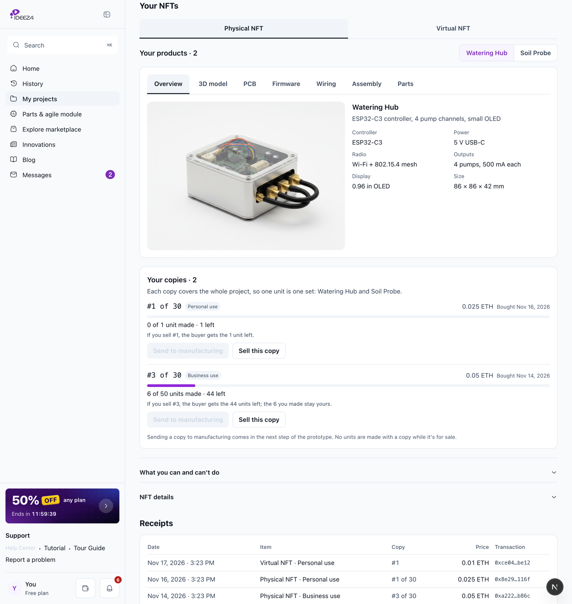 |
| 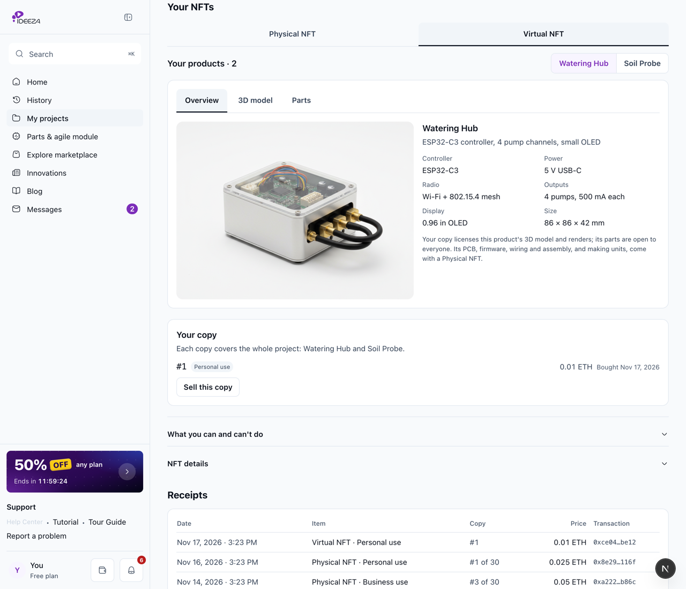 |
| 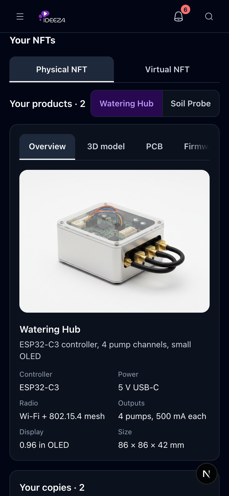 |

---

## CL-034 Projects per plan: a new project waits until there's room

**In the prototype:** 18 November 2026 · **Jira:** Not created yet · **Production:** Not started

**Changed by [CL-043](#cl-043-the-project-question-after-an-ai-idea-several-products-start-a-new-project)** (24 November 2026): several products always start a new project (the question asks only its name, and the build gate offers no *Use a project I have* for them); one product picks between two radio cards, **New project** and **A project I have**. Build the project question from CL-043; the plan's card stays as here.

**Screen:** the AI chat (`/chat/<id>`, opened from Home's **Generate with AI**): its **Project** question, and the build gate (**Build this product?**) that **Build** opens; the save dialog after a build and its saved notice; the **Project Information** dialog (Home › **Build manually** › **Create Project**, and the PCB editor's **File › New › Project**); **My projects** (`/projects`); Settings › **Plan & pricing** (`/settings/plan`). Web.

Every plan comes with a number of projects: Free 3, Tinkerer 5, Builder 20, Disruptor 50. It is the one plan amount that stops anything, and it stops only a new project. The maker hears it where a new project would start, before the build's credits move (at the project question, and again at Build), always with a way on: a bigger plan, a project they already have, or making room. A build that was paid for always saves.

### What to build

**The plan's projects**

- [ ] Projects per plan: Free **3** (was 1), Tinkerer **5**, Builder **20**, Disruptor **50** (was 200).
- [ ] Only a NEW project waits when every one is in use. Opening, changing and adding products to a project the maker has, and minting, listing and selling, never wait for it.
- [ ] The count is the projects the maker has in My projects, whatever their state (a Draft and a project sold in full count too). What they bought (My projects › Purchased) does not count.
- [ ] A project takes its place when it is saved. Answering the project question or booking a build holds nothing.
- [ ] "Every one in use" means the count has reached the plan's number. A maker can be past it (after moving to a smaller plan, or after a Save, see below): nothing is removed or locked, only a new project waits.
- [ ] The next plan named everywhere below: **Builder** from Free or Tinkerer, **Disruptor** from Builder, none on Disruptor.

**The card that takes the new project's place**

- [ ] One card, the same in the project question, the build gate and Project Information. It replaces the new project's fields. It is never a warning hung under a form.
- [ ] Its top row: one folder tile per project the plan allows (at most 5 drawn; hovering a tile shows one of the maker's project names), then a dashed tile for what the next plan adds, *+17 with Builder*, and at the row's end *3 of 3 used*.
- [ ] Heading: *All 3 of your Free projects are in use* (Tinkerer: *All 5 of your Tinkerer projects are in use*).
- [ ] The line under it: *Builder gives you 20 projects, 300 AI credits a month and your builds go first.* From Builder: *Disruptor gives you 50 projects, 1,200 AI credits a month and 720p video.* On Disruptor: *Delete one in My projects to start another.*
- [ ] One primary button: **Upgrade to Builder · $10.00 a month**. While the welcome offer runs (Free only, [CL-004](#cl-004-welcome-offer-50-off-the-first-payment-for-12-hours)): **Upgrade to Builder · $5.00 first month**. A maker who pays yearly sees the yearly price per month (**Upgrade to Builder · $8.00 a month**); from Builder, **Upgrade to Disruptor · $20.00 a month**. It opens that plan's checkout in Plan & pricing (monthly from Free, otherwise the cycle the maker pays by). On Disruptor there is no Upgrade.
- [ ] Then the secondary **Use a project I have** (only when there is a project the maker can add to), then the link **Make room in My projects** (opens My projects).
- [ ] The card looks the same in light and dark mode. At phone width the tiles, the count and the buttons wrap onto new lines, and nothing scrolls sideways.

**The project question in the AI chat**

- [ ] With every project in use, the chooser's **+ Start a new project** says so before it is picked: *3 of 3 used on Free · Builder gives you 20* (on Disruptor: *50 of 50 used on Disruptor*) in place of its usual line (*This product becomes its first.* / *These products become its first.*).
- [ ] Picking it shows the card where *New project name* would be. **Use a project I have** clears the choice and opens the project list.
- [ ] **Start drawing** waits (its grey look) and the reason takes the place of the line beside it: *Pick a project you have, or upgrade*. With no project to pick (none, or all sold in full): *Upgrade to start a new project*. Nothing is drawn or charged.
- [ ] Picking a project the maker has makes Start drawing ready, as before. When a project frees up (one deleted, a bigger plan), the card gives way to the *New project name* field.
- [ ] Several products can now go into a project the maker has. When they have projects, the question is *Which project are these for?* with *2 products belong together, so they go in one project: one you have, or a new one.* and the same chooser (**+ Start a new project** · *These products become its first.*, then *Existing projects*). Only a maker with no project to pick gets the name field as before: *What should the project be called?* · *2 products belong together, so they go in one new project.*
- [ ] A chat started from a project's **Add a product** never meets the limit: the project is never asked, and whatever it builds goes into that project.

**The build gate**

- [ ] Pressing **Build** checks the plan's projects again, because they can fill up after the question was answered (another chat saved, a project made by hand). It checks only when this build would make a new project: the question chose **+ Start a new project** (or a project that has since been deleted), and no build of this chat is in a project yet. A rebuild in a chat whose build is saved becomes that project's next version and is never checked.
- [ ] When the build would make a new project and every project is in use, the gate keeps its title (*Build this product?* / *Build 2 products?*) and its line reads *Desk Lamp would start a new project, and every project on your plan is in use. Nothing has been charged.* (several products: *WaveLight and PulseBand would start a new project, …*).
- [ ] The card takes the place of everything that leads to paying: what each product will be, what each product gets, the notes on concept images and design rule checks, the balance and time chips, and **Cancel**, **Buy credits** and **Build**. ✕, Escape and a click outside still close the gate. No credit moves.
- [ ] **Use a project I have** turns the card into *Build it into* with a project list (*Choose a project*, opening at once; each row shows the project's name and *2 products · updated Nov 18*). Picking one points this build at that project: the answered question in the chat now reads *Building 1 product in Smart Home Kit.*, and the usual gate comes back with its lines and **Build**.
- [ ] When a project frees up while the gate is open (one deleted, a bigger plan), the usual gate comes back.

**Save**

- [ ] Save never checks the plan's projects. A build that was paid for always saves, as a new project too and even past the plan's number, and so does a chat whose question was answered before the limit existed. (My projects can then read *4 of 3 projects used*; new projects wait.)
- [ ] Several products saved into a project the maker has: the dialog *Add to Smart Home Kit* · *WaveLight and PulseBand join Smart Home Kit as new products. The project's name and description stay as they are.* · **Add to project**. The saved notice's title: *WaveLight and PulseBand were added to Smart Home Kit* (one product: *WaveLight was added to Smart Home Kit*).

**Project Information (Build manually)**

- [ ] With every project in use, choosing **Create New Project** shows the card in place of the name and description fields. Its secondary button reads **Open a project I have** (only when there is a project to open): it puts the chooser back on *Choose Project* and moves focus to it.
- [ ] **Create Project** takes the disabled look of the design system's button and does nothing while the card shows, in light and dark mode. Choosing a project the maker has works as before.

**My projects**

- [ ] Beside **New project** in the header: *2 of 3 projects used*. With every project in use: *3 of 3 projects used · Builder gives you 20*, the second part a link to Builder's checkout. On Disruptor there is no link (*50 of 50 projects used*).
- [ ] At phone width the line and **New project** wrap; nothing scrolls sideways.

**Plan & pricing**

- [ ] The plan cards: *3 projects • 2 exports* (Free plan), *5 projects • 5 exports* (Tinkerer), *20 projects • 50 exports* (Builder), *50 projects • 300 exports* (Disruptor). **Compare plans** › Projects & products › Projects: 3 · 5 · 20 · 50.
- [ ] Pricing FAQs › Disruptor plan: *1,200 AI credits a month, the fast-track queue with the shortest waits, 50 projects, 720p AI video, and 25% off credits (35% yearly).*
- [ ] Plan & pricing counts the same projects as the limit: **Plan details** on a paid plan (*Create 20 projects*, *2/20 created*), and a move to a smaller plan (*You have 4. Free allows 3.*, *4/3 created* in the error colour, *Nothing is removed. Every project and contributor you have stays as it is.*).
- [ ] The phone app's plan screens show the same numbers.

**Prototype only:** the 4 demo projects every account gets ([CL-023](#cl-023-sample-listings-and-demo-projects-that-are-always-there)) take no place on the plan and are left out of every count here. Nothing to build.

**Not in this change**

- The phone app's create flow and My projects are unchanged.

### Design

- The card: `bg-surface`, 1 px `border`, radius `2xl`, padding 20, 20 between its parts. Folder tiles 40 × 40, radius `lg`, `bg-brand-subtle` with a `text-brand` folder icon (20). The next plan's tile: 40 tall, 1 px dashed `border-strong`, radius `lg`, padding 0 12, `text-md` (14) medium `text-tertiary`. The count *3 of 3 used*: `text-md` medium `text-secondary`, tabular numbers. Heading `text-lg` (16) semibold `text-primary`; its line `text-md` `text-secondary`.
- Buttons: A01 Button primary md for Upgrade (the price in regular weight at 90 % opacity) and A01 secondary md for *Use a project I have* / *Open a project I have*. *Make room in My projects*: a text link, `text-md` semibold `text-link`, hover `text-link-hover`, focus ring `border-focus`. The card uses only neutral and brand tokens, so it reads the same in both themes.
- Project question: the existing A06 dropdown (SelectMenu); the full hint is the row's muted line. Start drawing waiting: `bg-subtle` with `text-disabled`; its reason `text-sm` (12) `text-tertiary`.
- Build gate: the existing gate dialog (440 px, `bg-surface`, radius `2xl`, `shadow-3`, padding 24). *Build it into*: `text-sm` medium `text-primary` over the A06 dropdown.
- Project Information: M07 Modal (unchanged), **Create Project** A01 primary lg in its disabled state.
- My projects: the line `text-md` `text-secondary`, tabular numbers; the link semibold `text-link`; **New project** stays A01 secondary md (44 px tall at phone width).
- Plan & pricing: no new components; the usage meters are A22 Progress Bar, the value past the plan in `text-error`.

### Before → After

| Before | After |
| --- | --- |
| 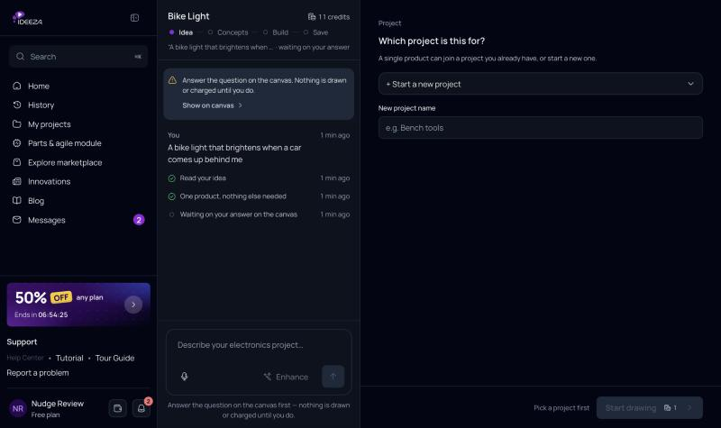 | 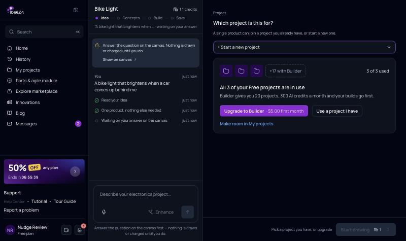 |
| 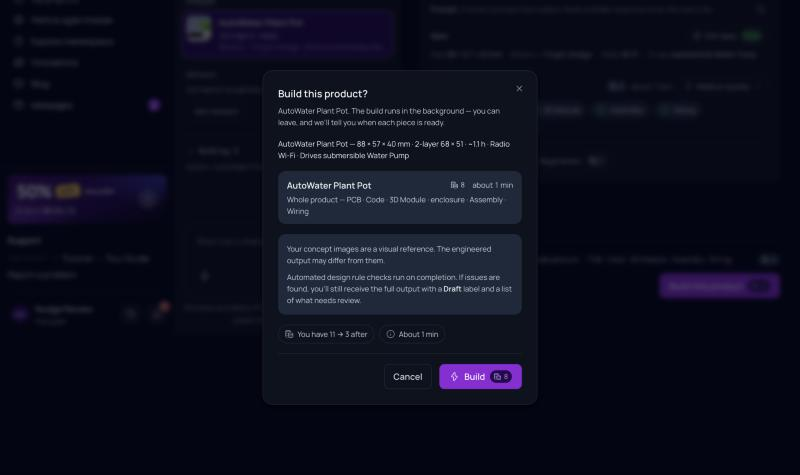 | 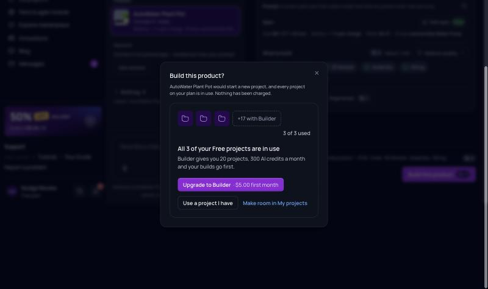 |
| 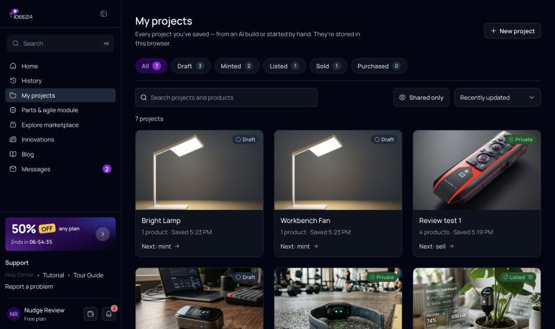 | 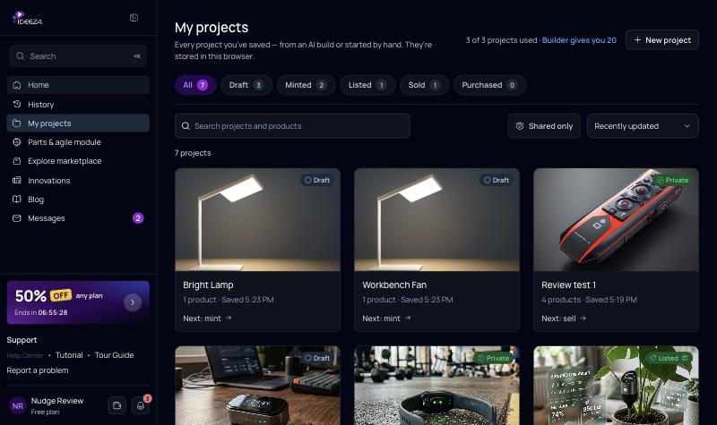 |

---

## CL-033 Credit packs: new sizes, so Builder and Disruptor are the better buy

**In the prototype:** 18 November 2026 · **Jira:** Not created yet · **Production:** Not started

**Screen:** Settings › Plan & pricing › **Credits** (`/settings/plan?tab=credits`), the **Buy credits** dialog, the pack checkout (`/settings/plan/checkout?pack=pro`), and every other place that lists the packs (web; the phone app reads the same list).

The packs gave more credits for the money than the plans did: Pro was 550 credits for $10, while the $10 Builder plan gives 300 a month, so "get a plan for more credits" wasn't true. The owner decided (upgrade plan, 8 November 2026) that Builder and Disruptor are always the better buy per credit. The pack prices stay the same; Pro and Power now give fewer credits.

### What to build

**The three packs**

- [ ] The packs, prices unchanged:

  | Pack | Price | Before | After |
  | --- | --- | --- | --- |
  | Starter | $5 | 100 credits | 100 credits (unchanged) |
  | Pro (*Most popular*) | $10 | 500 + 50 bonus = 550 credits | 180 + 20 bonus = 200 credits |
  | Power | $20 | 1,000 + 150 bonus = 1,150 credits | 400 + 50 bonus = 450 credits |

- [ ] Per credit, a pack now costs about 5¢ (Power 4.4¢). Builder is 3.3¢ ($10 for 300 a month) and Disruptor 1.7¢ ($20 for 1,200), so both are always the better buy. Before, Pro (1.8¢) and Power (1.7¢) were about as cheap as Disruptor and far cheaper than Builder.
- [ ] Pro stays *Most popular*. The custom amount is unchanged: $0.10 a credit, at least 50.
- [ ] The plan discounts on packs are unchanged: Builder 15% monthly and 25% yearly, Disruptor 25% and 35%. On Builder monthly the packs cost $4.25, $8.50 and $17.00.
- [ ] Bought credits still last 12 months.

**Everywhere the packs show** (one price list feeds all of them)

- [ ] Plan & pricing › Credits, the three pack cards: Pro reads **Base credits** *180*, **Bonus credits** *+20*, **Total credit** *200*; Power *400*, *+50*, *450*. **Purchase now**'s accessible name: *Purchase the Pro pack, 200 credits for $10.00*.
- [ ] The Buy credits dialog, *Choose a pack*: *Starter · $5.00 · 100 credits*, *Pro · $10.00 · 200 credits (180 + 20 bonus)*, *Power · $20.00 · 450 credits (400 + 50 bonus)*. From a shortfall it still chooses the smallest pack that covers it, and Power when none does: short by 300 credits, it now chooses Power (it was Pro).
- [ ] The checkout page for a pack: *Credits · Pro · 200 credits (180 + 20 bonus)*.
- [ ] **Compare plans** (*Compare credit discounts by plan*): the Pro pack's *Total credits* column reads *200*.
- [ ] Credit alerts and limits › Auto top-up, the pack choices: *Starter pack, 100 credits for $5.00*, *Pro pack, 200 credits for $10.00*, *Power pack, 450 credits for $20.00*.
- [ ] Custom amount › *Better deal available!*: 50 to 100 credits offer Starter, 101 to 200 offer Pro (*Get 180 credits (+20 bonus) for just $10.00 instead.* · **Switch to Pro pack**), 201 to 450 offer Power (*Get 400 credits (+50 bonus) for just $20.00 instead.* · **Switch to Power pack**), more than 450 none. Before, Pro was offered up to 550 and Power up to 1,150.
- [ ] Billing history and the invoice of a new purchase: *Pro pack · 200 credits*.
- [ ] Tutorials › *Plans and credits*: *Starter: 100 credits for $5.*, *Pro: 180 credits plus 20 bonus for $10.*, *Power: 400 credits plus 50 bonus for $20.*
- [ ] The phone app's credit screens (Plans › Credits, the Buy credits sheet, Compare credit discounts, Auto top-up) show the same new sizes.
- [ ] A pack bought before keeps what it gave: its credit history line, billing row and invoice still say 550 or 1,150.

**Not in this change**

- The plan row under the packs and *With Builder: $4.25* on each pack card: CL-032.

### Design

- No layout change: the pack cards and the dialog's pack choices keep their design; only the numbers change.
- Figma (User Panel V2 › AI Credit Purchase) still shows 550 and 1,150: this entry wins over it, and Figma should be updated to 200 and 450.

### Before → After

| Before | After |
| --- | --- |
| 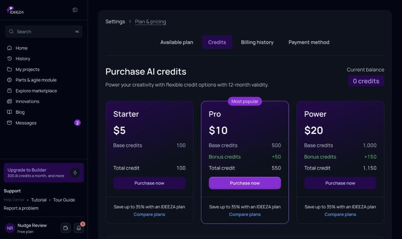 | 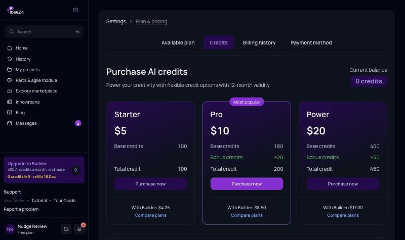 |
| 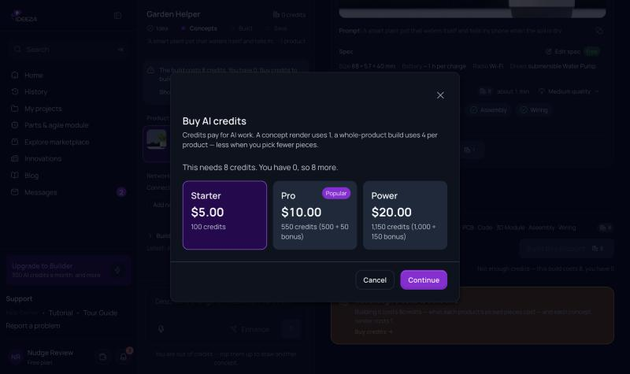 | 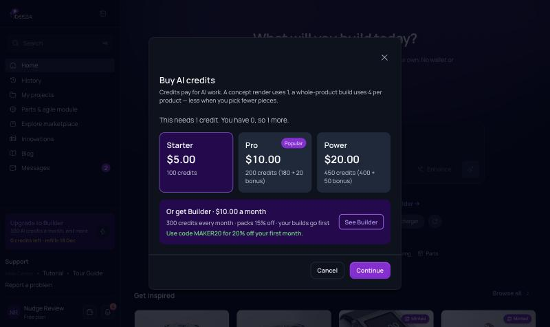 |

---

## CL-032 Upgrade nudges: the next plan, shown where a maker runs short

**In the prototype:** 18 November 2026 · **Jira:** Not created yet · **Production:** Not started

**Changed by [CL-042](#cl-042-the-free-plans-ai-credits-come-once)** (24 November 2026): Free's credits come once, so Free shows no refill day: the sidebar line is *You have 18 credits* and out of credits is *You're out of credits.*; only a paid plan that stays paid says *refills 8 Dec* and *They refill on 8 Dec.* Build those lines from CL-042.

**Screen:** the sidebar's Upgrade card and the account menu (every Creator Panel page); Home's AI box (`/`); the concept chat (`/chat/<id>`), its build bar and the finished build's review (also `/build/<jobId>`); a project's **Add a product › Build with AI** and **Team** tab (`/projects/<id>`); the **Buy credits** dialog; the video **Quality** field in Generate video and Project video; the bell; Settings › **Plan & pricing** (`/settings/plan`, Plans and Credits tabs); the PCB editor (`/pcb`). Web.

A maker who ran short of credits was only told to buy credits, and a bigger plan lived on Plan & pricing alone. Now the next plan sits beside the fix, in the maker's own numbers (their credits, the day they refill, what they spent), and only where they run short. Nothing here ever stops anyone; the one limit that is enforced, a new project past the plan's projects, is CL-034.

### What to build

**The rules for every nudge**

- [ ] The plan named is the next one up: **Builder** from Free or Tinkerer, **Disruptor** from Builder. A Disruptor maker sees no plan line, card or link anywhere.
- [ ] A plan link opens that plan's checkout (`/settings/plan/checkout?plan=builder&cycle=monthly`): monthly from Free; on a paid plan, the cycle the maker pays by.
- [ ] Every number is the maker's own (balance, refill day, spend, use) or the plan's real offer: Builder $10.00 a month, 300 credits, packs 15% off, builds go first; Disruptor $20.00 a month, 1,200 credits, packs 25% off, 720p video. Nothing is invented.
- [ ] The fix comes first and the plan sits beside it, quieter: Buy credits stays the main way out.
- [ ] No plan talk in Mint, Publish, Sell, Earn (Splits included), Innovations, Explore marketplace, while a build runs, or on the pay step and the checkout.
- [ ] A card the app shows on its own (in this change: the first ready build card) is one a day across the app. Once one has shown today, any other waits for tomorrow; the one that showed keeps showing for the rest of that day. ✕ on such a card hides it for 7 days. Remembered per account.
- [ ] The lines inside a moment where the maker is short (out of credits, the Buy credits dialog, the locked 720p) don't count as that card.

**The sidebar's Upgrade card**

- [ ] Under *Upgrade to Builder* and *300 AI credits a month, and more*, a third line with the maker's credits and the day this month's plan credits come back: *You have 18 credits · refills 8 Dec*.
- [ ] At or under the maker's **Running low at** number (Plan & pricing › Credits › Credit alerts and limits, 8 by default) it turns semibold in the warning colour: *4 credits left · refills 8 Dec* (*1 credit left*, *0 credits left*).
- [ ] Not shown while the balance is being read, in the collapsed sidebar (the icon only), or while the welcome offer's card stands in the Upgrade card's place (CL-004). The card stays away on Disruptor, as before.

**The account menu**

- [ ] Under the maker's name: *Free plan · Upgrade to Builder* (*Tinkerer plan · Upgrade to Builder*, *Builder plan · Upgrade to Disruptor*). The link opens that plan's checkout and closes the menu. On Disruptor only *Disruptor plan*.

**Out of credits: Home, the chat, Add a product**

- [ ] When the balance can't pay for one concept (1 credit), a centred line goes under Home's AI box (in Generate with AI) and under the concept chat's composer: *You're out of credits. They refill on 8 Dec.*, and under it, side by side, **Buy credits** (opens the Buy credits dialog in place, Starter chosen) and *Or get 300 credits every month with Builder →*.
- [ ] In the chat it replaces *You are out of credits — top them up to draw another concept.* The send button stays off, as before.
- [ ] On Disruptor: *You're out of credits. They refill on 8 Dec.* and **Buy credits** only.
- [ ] Add a product › Build with AI keeps *You need 1 credit to start. You have 0.* Under it, one row in one link style: **Buy credits** (it was *Top up credits*; it opens Plan & pricing › Credits) and *Or get 300 credits every month with Builder →*.

**The build bar, short of credits**

- [ ] With every concept drawn and a build the balance can't pay for, the yellow box under the bar (*Not enough credits to build this*) is gone, and so is the red *· you have 4* in the bar.
- [ ] The bar itself turns: **Buy credits** is its one filled button, beside **Build 2 products** (off, still showing its 8-credit badge). Buy credits opens the Buy credits dialog in place with the smallest pack that covers the shortfall chosen.
- [ ] Under the buttons, one line across the bar with a warning icon: *This build costs 8 credits. You have 4, so 4 more.* and, on the right, *Or get 300 credits every month with Builder →* (no plan link on Disruptor).
- [ ] The rail's next step (*The build costs 8 credits. You have 4. Buy credits to build.*) rings and focuses **Buy credits**.
- [ ] Once the credits cover the build, the bar is as before: Build is live, Buy credits and the line are gone.
- [ ] While a concept is still drawing, the bar keeps its usual line on the right (*Not enough credits — this build costs 8, you have 4*) and shows no Buy credits.
- [ ] At phone width the two buttons stack full width, **Buy credits** on top.

**The Buy credits dialog**

- [ ] On *Choose a pack*, under the three packs, a row for the next plan: *Or get Builder · $10.00 a month*, then *300 credits every month · packs 15% off · your builds go first*, and **See Builder** on the right. From Builder: *Or get Disruptor · $20.00 a month* (*$16.00 a month, billed yearly* when the maker pays yearly), *1,200 credits every month · packs 25% off · 720p video*, **See Disruptor**. Not on Disruptor; not on the pay step.
- [ ] The packs stay the quick fix: the covering pack is still chosen and **Continue** still goes on to pay for it.
- [ ] On Free or Tinkerer, when this calendar month has 2 or more credit purchases that add up to at least the plan's monthly price (for example two Starter packs), the row adds: *You've spent $10.00 on credits this month. Builder is $10.00 with 300 credits every month.* Never shown when it isn't true.
- [ ] When the maker's welcome offer (CL-004) ended without being used, the row adds, in green: *Use code MAKER20 for 20% off your first month.* At most once in 30 days; on the day it shows, it shows each time the dialog opens. MAKER20 is a plan coupon (CL-006): 20% off, every paid plan, until 31 Dec 2027.
- [ ] At phone width the row stacks and **See Builder** goes under the text, full width.

**720p video**

- [ ] In Generate video and Project video, the locked 720p option's note reads *720p comes with the Disruptor plan.* **Get Disruptor** (it was **See plans**, to Plan & pricing). It opens Disruptor's checkout. Not shown on Disruptor, as before.

**The bell**

- [ ] The low-credits notice (*You have 4 credits left*, at or under the Running low at number) now says *Your low mark is 8. They refill on Dec 8. Need more now? Buy credits, or get Builder for 300 a month.* On Disruptor: *Your low mark is 8. They refill on Dec 8. Need more now? Buy credits.* It opens Plan & pricing › Credits, as before.
- [ ] New: each month's plan credits get a notice for 7 days after they arrive, except the account's very first month. On Free: *Your 10 free credits are back* · *Want 300 a month? See Builder.*, opening Plan & pricing. On a paid plan: *Your 300 credits for this month are here*, opening Plan & pricing › Credits. Tag *Coin · Credits*.
- [ ] New: in the welcome offer's last hour, one notice: *Your 50% off ends in less than an hour* · *Half off your first payment on any plan.*, tag *Coin · Plan*, opening Plan & pricing. It goes when the offer ends or is used.

**The first ready build (Free only, once)**

- [ ] On the review of the maker's first finished build, above the footer with Save: a card with *Your first build is ready.* (semibold) *You have 4 credits left. Builder gives 300 a month for $10.00.*, **See Builder** (Builder's checkout, monthly) and ✕ (*Close*).
- [ ] Only on Free, only while that build is the maker's one ready build, never while a build runs. It shows once in the account's life: it stays for the day it first shows, then never again; ✕ closes it for good. It is the day's one card (rules above).

**Plan & pricing**

- [ ] Plans tab, under the lead: *Last 30 days: 12 credits · 2 projects. Tinkerer fits you.* Credits are those spent on concepts and builds in the last 30 days, less refunds; projects are the projects the maker has now (the plans' project allowances: CL-034). The plan named is the smallest whose monthly credits and projects both cover that; Disruptor when none does.
- [ ] That plan's card gets a *Fits you* badge beside *Most popular*, only when it is above the maker's plan. When the maker's own plan covers it: *Your Free plan covers that.* and no badge. Never a plan below the maker's. With nothing used and no project, the line is left out.
- [ ] Credits tab: on a plan without a credit discount (Free, Tinkerer), each pack card's footer reads its price with Builder, *With Builder: $4.25* (Starter), *$8.50* (Pro), *$17.00* (Power), above **Compare plans**. It was *Save up to 35% with an IDEEZA plan*. With a discount it still reads *You're saving 15% with your Builder plan*.

**Exports: counted, never stopped**

- [ ] Each plan's exports a month are counted: Free 2, Tinkerer 5, Builder 50, Disruptor 300. One export is one action: files written together (within 3 seconds, like Design files' schematic, PCB and 3D) count once. The month is the plan's credit month, so exports come back the day the credits do.
- [ ] Every file the PCB editor downloads counts (Gerber zip, KiCad board, netlist, pictures, design files), and so does the Assembly editor's 3D download.
- [ ] After each export the PCB editor's toast says *Exported. 1 of 2 exports left this month.* With none left: *Exported. You've used this month's 2 exports; they come back on 8 Dec. Builder gives 50 a month.* (on Builder *Disruptor gives 300 a month.*; on Disruptor no plan sentence). Exports made before the editor opened don't toast.
- [ ] An export is never stopped or delayed, however many were made.

**Contributors, on the project's Team tab**

- [ ] For the maker who can add people, on Free: under **Open Splits** in the *Just you so far* card, or under *Add people or change shares in Splits* when people are there: *Contributors come with Tinkerer (1) and Builder (20).* **See Builder**.
- [ ] On Tinkerer with 1 person or more: *Your Tinkerer plan includes 1 contributor. Builder has 20.* **See Builder**. On Builder with 20 or more: *Your Builder plan includes 20 contributors. Disruptor has 200.* **See Disruptor**. Otherwise, and on Disruptor, nothing.
- [ ] Soft: adding people in Earn › Money › Splits works as before, and Splits says nothing about plans.

**Light, dark and phone width**

- [ ] Every part above uses theme tokens and looks the same in light and dark; the build bar has no yellow box any more (it turned mustard in dark mode).
- [ ] At phone width nothing scrolls sideways: the out-of-credits links wrap, the plan row and the first-build card stack, the build bar's buttons stack.

**Not in this change**

- The phone app (`/m`) has none of these yet.
- The new pack sizes: CL-033. The project limit (the only enforced limit): CL-034.

### Design

- Plan row in the Buy credits dialog and the first-build card: `bg-brand-subtle`, radius `xl`, padding 16 (the card 16/12). Row title 16 semibold `text-primary`; perks 14 `text-secondary`; the spend line 14 `text-primary`; the coupon line 14 semibold `text-success`. **See Builder** is A01 Button Outline Brand md (36 px); the card's ✕ is A02 Icon Button sm with a 16 px icon.
- Plan links (*Or get 300 credits every month with Builder →*, *Upgrade to Builder*, *See Builder*, *Get Disruptor*): 14 semibold `text-link`, hover `text-link-hover`, focus ring `border-focus`; 12 in the account menu.
- Out-of-credits line: centred, 14 `text-secondary`, its two links 16 px apart.
- Build bar: **Buy credits** is A01 Button Primary lg (40 px); Build keeps its disabled look (`bg-subtle`, `text-disabled`); the line is 14 `text-primary` with the alert icon (16) in `icon-warning`.
- Sidebar card's new line: 12 `text-secondary`; at the low mark semibold `text-warning`.
- *Fits you*: A17 Badge success, 8 px left of the A17 Badge brand-solid *Most popular*, top right of the plan card. The usage line 14 `text-secondary`, its verdict semibold `text-primary`.
- Bell notices: the bell's existing notice rows. Export toast: the PCB editor's existing toast.
- No new colours or tokens. Text: body 14, captions 12.

### Before → After

| Before | After |
| --- | --- |
| 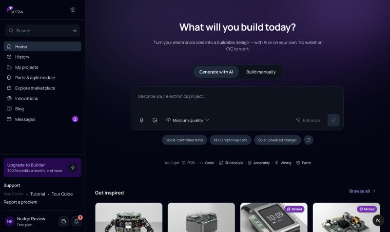 | 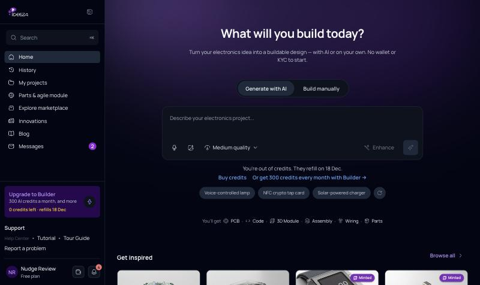 |
| 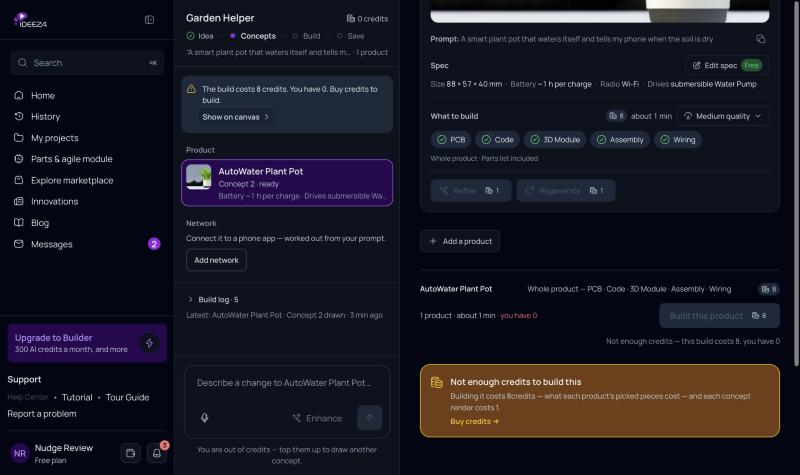 |  |
|  |  |
|  |  |
|  |  |

---

## CL-031 Earn from a product page

**In the prototype:** 18 November 2026 · **Jira:** [PR-9675](https://ideeza.atlassian.net/browse/PR-9675) · **Production:** Not started

**Screen:** a product's page (`/projects/<id>/products/<product>`, web), its header; it leads to **Earn › Sell** (`/projects/<id>/earn/sell`).

A product's page had no way to earning: the maker had to go back to the project and open Earn from there. Now the product's header has its own **Earn**, which opens the product's copies on Earn › Sell, with one line saying how they sell.

### What to build

**The button**

- [ ] The product header's buttons are **Open in editor**, **Earn** and ⋯, in that order. Earn has the coins icon, like the project page's Earn.
- [ ] Open in editor stays the page's one violet button, so Earn is the quiet button. When the product's editor can't be opened (a project sold in full), Earn is the violet one.
- [ ] Only the owner sees it, on their own project. It is not on the product page in Explore marketplace, on an Innovations post or in Preview as others see it.
- [ ] While the page is leaving for Earn (or for the editor), both buttons wait, so a second click does nothing.

**The line under it**

- [ ] One line under the buttons says how this product's copies sell (a product sells Physical and Virtual copies only; the Main NFT is the whole project's):
  - *Not selling copies yet*
  - *Physical copies on sale*, *Virtual copies on sale* or *Physical and Virtual copies on sale*, with *· 3 sold* once some have sold
  - *Sold out · 50 sold* when every listed copy has sold
  - *1 copy sold* or *4 copies sold* when nothing is on sale any more
  - *Copies wait for videos* when a copies listing of this product is signed and waits for its videos (CL-030)
  - *Sold in full* once the project is sold in full
- [ ] In a project with one product, the whole project's copies are that product's, so they count in its line.
- [ ] The button's accessible description is that line.

**Where it goes**

- [ ] Earn opens **Earn › Sell** on this product's row, and the item panel opens on its copies (Physical first; Virtual when Physical can't be sold), for example *Physical copies of RC Car* with **Sell physical copies** or that listing's controls.
- [ ] In a project with one product (which has no product row on the board), it opens on the whole project's copies, which are that product's.
- [ ] Below a 1024 px wide page the board scrolls to the product's row and a tap on a tile opens the panel as a drawer, as on Earn › Sell today (CL-028).

**Layout**

- [ ] Beside the title (from a 720 px wide header) the buttons sit on the right and the line under them is right-aligned. Narrower, the buttons come under the description with the line beside them; at phone width the buttons share one row, 44 px tall, and the line goes under them. The page never scrolls sideways.

**Not in this change**

- The phone app's product page is unchanged.

### Design

- The project header's own action group and button: 40 px tall beside the title, 44 px at phone width. Earn is the quiet header button (`bg-surface`, 1 px `border`, `text-primary`, hover `bg-surface-raised`) with the coins icon (16), the same as the project page's Earn; the violet one is the primary header button. ⋯ is the existing menu button.
- The line: `text-sm` (14), `text-secondary`, with the same spacing as the project header's line under its buttons.

### Before → After

| Before | After |
| --- | --- |
|  |  |
| |  |
| |  |

---

## CL-030 AI videos: start them one after another, and sell while they render

**In the prototype:** 18 November 2026 · **Jira:** [PR-9674](https://ideeza.atlassian.net/browse/PR-9674) · **Production:** Not started

**Screen:** a project's **Media** tab, **Generate video** and **Project video**; every place a maker sells or shares (Add to marketplace, the mint with Sell, Sell copies, Relist, Share to Innovations, Earn › Overview); **Earn › Sell**; the project header; the My projects card; the **Videos** button in the bottom-right corner of every page (web).

One AI video takes minutes, and a project with 5 products needs 6 of them (one per product, plus the project video). The maker no longer waits for any render: they start every video one after another, keep working, and can sell or share as soon as every video is started. What they sign waits off Explore marketplace and Innovations, and goes live by itself once every video has **Use this video**.

### What to build

**One video after another**

- [ ] Every video is still made storyboard first: **Generate AI video** → the form → *Drafting your storyboard…* → *Review your storyboard* → **Generate video**. There is no button that makes all videos in one press, and nothing starts a video by itself.
- [ ] The render screen keeps the progress (*Take 1 · Stage 2 of 5 · Drafting visual sequences*, *under a minute left*) and *You can close this — the render keeps running, and its progress shows in the corner.* Under it the switch *Notify me on this browser · for every video*.
- [ ] Its buttons: **Cancel render**, **Close** and, while another video of this project has not started, **Next video: WaveLight** (the primary button) with *PlantPal keeps rendering while you set up the next one.* under it. Next video closes this screen and opens that video's form: the next product without a started video (in the products' order, after this one, then from the top), then the project video.
- [ ] When every video of the project has started: **Close** is the primary button and the line reads *Every video of this project has started.*
- [ ] The project video's render screen works the same way (*The project video keeps rendering while you set up the next one.*).

**The project video never waits for the product videos**

- [ ] Media › Project video says *Made from your products’ prompts and specs*. With none yet: *No project video yet · it can start now* and **Make project video**, right away. *Opens when every product has a video* is gone.
- [ ] The Project video dialog: *Smart Home Kit · drafted from your 3 products’ prompts and specs*. The storyboard: **Intro** (2 s: the project's name and the first sentence of its description), one scene per product (5 s, *from its prompt and spec*: the product's concept image, its name, and one line from its prompt, the first sentence up to 60 characters), **Outro** (2 s, *Built with IDEEZA*). The order, the names and the lines can be changed as before. **Generate project video** makes it from the products' images and lines; no product video is needed.
- [ ] After the products change: *The products changed. You can update the project video now.*
- [ ] Only a project with 2 or more products has a project video (CL-025).

**Every video must be started before moving on**

- [ ] A video is started when it is rendering or waiting for review. It is not started when it has no video yet or its last render failed; the project video also when it is not made yet or out of date.
- [ ] Wherever the maker sells or shares, the button stays shut while a video it needs has not started: **Continue to listing** (Add to marketplace), **Sign and list** (the mint with Sell), **Sign and sell** (Sell copies), **Relist**, **Share to Innovations**, and Overview's **Choose what to sell**. The line under it names what is missing: *Start every video first: PulseBand hasn't started yet.* or *Start every video first: WaveLight, LogTag and the project video haven't started yet.*
- [ ] The dialog's lead says the rule: *Start every video first. You don't wait for them to finish: the listing stays off Explore marketplace until they're ready.* For a post: *The post needs your story, and every video has to be started. You don't wait for them to finish: the post stays off Innovations until they're ready.* For copies of one product: *Start PlantPal's video first. You don't wait for it to finish: these wait off Explore marketplace until it's ready.* Each video's row has its own **Generate AI video** or **Try again**.
- [ ] Copies of one product need only that product's video. Selling, sharing or relisting the whole project needs every product's video and the project video.

**Sign now, go live later: Waiting for videos**

- [ ] Once every video it needs has started, the button opens, even while the videos render or wait for review. The dialog adds *You don't have to wait. It stays off Explore marketplace until all 4 videos are ready, then goes live by itself. We'll tell you when it does.* and, under the button, *Goes live when all 4 videos are ready · 2 of 4 now* (one video: *Goes live when the video is ready · 0 of 1 now*).
- [ ] The maker fills in and signs as before. What they signed waits: it is not on Explore marketplace or Innovations, and nobody can see or buy it. The signed lines: *Signed. It goes on Explore marketplace when every video is ready — we'll tell you.*; copies: *Signed: 20 Physical copies of Smart Home Kit. They go on Explore marketplace when every video is ready.*; a relist: *Signed. It goes back on Explore marketplace when every video is ready.*; a post: *Your post goes on Innovations when every video is ready.*
- [ ] A video is ready when the maker has pressed **Use this video** on it (the review stays as before). When every video an item waits for is ready, the item goes live by itself, whatever page the maker is on: the Main NFT listing on Explore marketplace (listed at that moment), the copies on sale, the paused listing back on sale, the post on Innovations.
- [ ] When it goes live: a toast *Now on Explore marketplace* (or *Now on Innovations*) with the project's name; a bell notice *Smart Home Kit is live on Explore marketplace* · *Every video is ready, so it went live by itself.* that opens Earn › Sell (a post opens the project); and a browser notification when the switch is on and the tab is in the background.
- [ ] A failed render keeps it waiting. A product added later keeps it waiting until that product's video is ready too.
- [ ] **Cancel listing** (or **Cancel the post**) asks *Cancel this listing? Nothing of it was live.* with **Keep it** and **Cancel listing**. Deleting the project drops what waits. Signing the same thing again replaces what waited.

**Where a waiting item shows**

- [ ] The project header: the chip **Waiting for videos**, and in the warning colour *Main NFT listing · goes live when all 4 videos are ready · 2 of 4 ·* **Review videos** (opens the Videos panel at this project).
- [ ] Earn › Sell: the tile's chip *Waiting for videos*, its use and price (*Buy now · 10% of the project*, *0.5 ETH*) and *0 of 1 videos ready*. The item panel's head reads *Signed · goes live when its videos are ready*, then the waiting block: the chip, *Main NFT listing · signed Nov 18, 2026 · 4:44 PM*, *Goes live on Explore marketplace when the video is ready. Nobody can see or buy it yet.*, a **Videos ready** progress bar, *0 of 1 video ready · Review 1 video to continue.*, **Review videos** and **Cancel listing**. A copies panel shows the same block.
- [ ] The mint's last step: heading *Minted · listing waits for videos*, the line *It goes on Explore marketplace by itself when every video is ready — we'll tell you.*, and the waiting block for each thing it signed.
- [ ] The My projects card: the chip *Waiting for videos* and the hint *Next: review 2 videos* (*Waiting for videos* while they still render). The project stays under **Minted** until it is live.
- [ ] The project's ⋯ menu: while the post waits, **Share to Innovations** reads *Waiting for videos · goes live when they're ready* and opens the Videos panel.

**The Videos button and panel**

- [ ] Bottom-right on every page, while something is going on: a ring with the overall progress (the number to review once nothing renders), **Videos**, a summary such as *2 rendering · 1 to review* (also *1 didn't finish*, *1 waiting*), and a badge with the number to review. Not shown in buyer views (Preview as others see it, Explore marketplace).
- [ ] It replaces the stack of progress toasts. Toasts are only for moments and hide after 7 seconds: *Video ready · review it* (**Review**), *Video render failed* (**Try again**), *Now on Explore marketplace*.
- [ ] The panel: **Videos**, *They keep going while you work. Each one waits for your review before it's used.*, ✕. One group per project (its name and *Media ›*, or *Earn › Sell ›* when something waits), then each product's video and the project video with its state (*Rendering · 30 %*, *Ready to review*, *Video ready*, *No video yet*, *Render failed*) and one action: **Review**, **Generate AI video**, **Make project video**, **Try again** or **Cancel**. When something waits: *Waiting for videos · Main NFT listing goes live on Explore marketplace when the video is ready (0 of 1 now).*
- [ ] At the bottom the switch *Notify me on this browser · for every video*: one setting for all videos (the same switch as on the render screen). Turning it on asks the browser's permission. A notification comes only when the tab is in the background.

**Not in this change**

- The phone app keeps its own flow for now (videos before listing); it follows later.

### Design

- The **Waiting for videos** chip: radius full, `bg-warning-subtle`, `text-warning`, 12 px semibold, a clock icon (14). The waiting block: `bg-warning-subtle`, 1 px `border-warning`, radius `lg`, padding 20/24, the DS ProgressBar, A01 primary (**Review videos**) and ghost (**Cancel listing**) buttons; danger for the confirmed cancel.
- The Videos button: a `bg-surface-raised` pill, radius full, with a progress ring (brand), the review badge `bg-brand` with `text-on-brand`. The panel: 440 px wide (at most the screen width minus 32 px), `bg-surface`, radius `2xl`, rows divided by `border`. Moment toasts: 400 px, a 32 px icon tile (`bg-success-subtle`, `bg-error-subtle` or `bg-brand-subtle`) and a matching border.
- **Next video** is the dialog's A01 primary button; Close becomes secondary while a next video exists. The notify switch is the DS Checkbox.
- Project video storyboard scenes: the product's concept image as the thumbnail, the scene line in a DS text input.
- Text: body 14, captions 12.

### Before → After

| Before | After |
| --- | --- |
|  |  |
|  |  |
|  |  |
|  |  |
|  |  |
| |  |
| |  |

---

## CL-029 Innovations post: the story page with an On Marketplace card

**In the prototype:** 13 October 2026 (written into this changelog on 18 November 2026) · **Jira:** [PR-9662](https://ideeza.atlassian.net/browse/PR-9662) · **Production:** Not started

**Screen:** Innovations › a post, `/innovations/<post>`, and a product of the post, `/innovations/<post>/products/<product>`. The post is where a shared project is shown, learned from and talked about. Buying happens only on its Marketplace page ([CL-018](#cl-018-marketplace-details-a-shop-page-with-one-buy-box)).

### What to build

**The page**
- [ ] A reading page: the media and the story on the left, a rail on the right that stays in view. At phone width one column, with a bar stuck to the bottom: Appreciate · Save · Comments · Copy link.
- [ ] Media first, and it opens on a video: the project video when there is one, then each product's video in product order, then the cover and concept pictures. Thumbnails show a play badge and the length; pictures open in a lightbox; nothing autoplays.
- [ ] Under the media: the title with the status chip and the **Minted** chip, then "{category} · {n} product · {n} parts · Shared {date}".
- [ ] The maker's story, **About this project**, and **What's inside**: each product with what is open, and the PCB, firmware and wiring marked as coming with a copy.
- [ ] **Activity**: a small path of what was logged, oldest first, the current step ringed (up to six dots, older ones folded into "+n earlier"), then the current entry with its age, description and proof, and **Earlier (n)** opening the rest. The status chip by the title is the current entry's short name.
- [ ] The ⋯ menu: **Copy link** and **Report post**.
- [ ] Loading keeps the page's shape. An unknown address reads "We couldn't find this post".

**The rail**
- [ ] The maker: avatar, name, "{n} projects on Innovations", **Follow** and **Message** (opens a conversation about the post; not on your own post).
- [ ] **Appreciate · {n}** (the page's one primary button), Save and Share (copy link), then "{n} appreciations · {n} views · {n} comments".
- [ ] **On Marketplace**, only while something of the project is for sale: one row per offer with its price. "Whole project (Main NFT)" (", auction" for an auction, showing its buy-now price, else its starting bid), "Physical copy" and "Virtual copy" (" of {product}" for a product's own copies). Then **View on Marketplace** (to the project's marketplace page) and the line "Buying and bids happen on the Marketplace page." There is no Buy or Bid on the post.
- [ ] **About**: only the rows that have a value: Category, Products, Parts, Network, Created, Updated, License, Minted on.
- [ ] **More from {maker}**: their other posts.

**Comments and replies**
- [ ] "{n} Comments" (every comment and reply a visitor can see) with Top · Newest · Oldest.
- [ ] A comment, a reply and a nested reply with the connector line; View n replies · Load n more replies · Hide replies; ten comments a page; See more on long ones; a photo per comment; Reply · ♥ · ⋯.
- [ ] The ⋯ by role: your own comment Edit · Copy link · Delete (confirmed, then Undo; one with replies stays as "Comment deleted"); someone else's Copy link · Report (with a reason); on the maker's own post also Hide ("Hidden by the maker", Unhide any time) and Delete.
- [ ] The composer under the thread: link, photo, @mention and **Post**; Enter sends. Typing "@" offers the people in the conversation.
- [ ] On the maker's own post, a comment that uses one of the maker's hidden words (Settings › Blocking) reads "Hidden: it uses a word you hide" to the maker and "Hidden by the maker" to everyone else.

**The maker's own post**
- [ ] A bar on top: "This is your post. Visitors see it exactly like this, without this bar." with **Edit post** (the story), **Stop sharing** (confirmed; comments are kept) and **Open project**. Once unshared it reads Not shared, with **Share again**.

**A product of the post**
- [ ] The breadcrumb from Innovations, the post's product switcher and the way to its comments. Media first (the product's video, then its picture); 3D model and parts open; PCB, firmware code and wiring locked, each saying what a copy includes with the Marketplace prices, or "Not for sale right now".

Demo stand-ins (prototype only): the sample posts, their makers and their conversation; reactions, saves and comments are kept in this browser.

### Design

- DS **M100 Comments** (Figma `3799:842`) for the thread. The rail's cards are the page's cards; **Appreciate** is the one primary button; **View on Marketplace** is a secondary lg button, full width.

### Before → After

On main since 13 October 2026, so there is no Before.

| After | After |
| --- | --- |
|  |  |

---

## CL-028 Earn › Sell: one board for everything you sell

**In the prototype:** 18 November 2026 · **Jira:** [PR-9660](https://ideeza.atlassian.net/browse/PR-9660) · **Production:** Not started

**Changed by [CL-039](#cl-039-earn--sell-every-tile-says-which-nft-it-is)** (19 November 2026): every tile names its type with an icon and a line, there are no column heads, a product's Main cell says *No Main NFT*, and a row's name sits beside its tiles from a 960 px wide board. Build those parts from CL-039.

**Screen:** a project's **Earn › Sell** (`/projects/<id>/earn/sell`, web), and the header and tabs of every Earn tab.

### What to build

**Page width**

- [ ] Earn's header (back to the project, **Earn**, the status pill, **Preview as others see it**) and its tabs (Overview · Sell · Business plan · Money) span the full page width on every Earn tab. Overview, Business plan and Money keep their content in the narrow column (720 px) under them.
- [ ] Sell uses the full width: the board on the left and, from a 1024 px wide page, the item panel (360 px) beside it on the right.

**The board**

- [ ] Heading **What you're selling** (once the project is sold in full: **What you sold**), the **Testnet demo** badge, and a **How selling works** button that opens the three rule cards with their lead, word for word as before (Main NFT, Physical NFT, Virtual NFT and *Each one is listed on its own…*).
- [ ] Under the heading the lead *Each one is listed on its own. You can sell Physical or Virtual copies without listing the Main NFT, and copies never sell the project itself.* (left out once the project is sold in full).
- [ ] One line of totals: *n of m on sale* · *n sold out* (only when some are) · *n copies sold* · *X earned*, where earned is the payouts of every sale of the project, the same number as Overview's **Earned** (*Nothing earned yet* when there are none). Sold in full: *Sold in full* · *X earned*.
- [ ] Column heads: **Main NFT** *The project itself · whole project only*, **Physical NFT** *A built unit you make and ship*, **Virtual NFT** *The design files with a licence*.
- [ ] Two labelled groups, each a band across the board: **Whole project** *The Main NFT, and copies of everything in it.*, then **One product at a time**, a count (*3 products*) and *Products sell copies only, not a Main NFT.*
- [ ] The whole project's row: its cover picture, name, *Whole project · n products*, what it earned, then the Main, Physical and Virtual tiles. Each product's row: its initials, name, *Product*, what it earned, an empty dashed Main cell, then its Physical and Virtual tiles.
- [ ] A project with one product shows one row, the whole project, with the product's name under it. A product row appears only when that product already has copies of its own.
- [ ] A tile shows a status chip (*On sale*, *Auction*, *In checkout*, *Paused*, *Part sold*, *Sold out*, *Sold in full*, *Not selling*, *Not minted yet*, *Stopped*, *Given*, *Can't sell*), its use (*Buy now*, *Top bid* or *Opening bid*, *Personal use*, *Business use*, *2 uses*), its price (a range for two uses: *0.03–0.04 ETH*), a sold bar with *1 of 50 sold* (copies sold of copies made; for the Main NFT the share sold: *40% sold*), and what it earned. Not selling: *No price yet* and *Set a price ›*. The Main NFT with a step still missing before listing: *1 step before listing*.
- [ ] A whole tile is one button: clicking it shows that item in the panel and marks the tile (brand border and fill). Rows have no Sell or Manage buttons of their own.
- [ ] Not minted: one band replaces the tiles, a lock icon, *Not minted yet* and *Mint {project} once, and each of these can go on sale on its own: the Main NFT, Physical copies and Virtual copies.*
- [ ] Under the board: *Selling the Main NFT sells the project. When all of it is sold, whoever bought it owns everything and your copy listings stop.* (left out once sold in full), **Mint details**, and with no products *No products yet. Add one to the project to sell its copies.* with **Open products**.

**The item panel**

- [ ] Its head: the kind (a dot and *Main NFT*, *Physical NFT* or *Virtual NFT*), the title (the project's name for the Main NFT; *Physical copies of the whole project*, *Virtual copies of {product}*), one line about it, the status chip and the item's state lines (for example *Personal use · 0 of 30 sold · 0.03 ETH*).
- [ ] Main NFT. Not minted: **Mint and sell the project** (the mint, with Sell chosen). Minted and not listed: the steps still missing (*Before you can list*, each with its fix), then **Sell the Main NFT**, which opens the listing as before (a fixed price or an auction, all of it or a share). Listed or paused: the listing's controls and facts as before (Edit, Remove, Relist, Bidding history, Close auction). Part sold: the listing for another share. Sold in full: **Receipt**, the price, *Bought by*, *You got*, *Date*, *Share*, *It's theirs now, so this project is read-only. The payment joined your balance in Get paid.*, **See this sale in Money** and **Get paid**.
- [ ] Copies. Not selling: one line on what is asked and **Sell physical copies** or **Sell virtual copies**, which opens the two-step Sell copies dialog as before, with the kind already chosen. On sale: four facts (*Sold* with its bar, *Earned*, *Bought by*, *Last sale*); when sold out, *Every copy is sold. Add copies to keep selling, or leave it closed.*; then each use's controls as before (Price, Price with future updates, Royalties; Edit, Remove listing, Add copies) and *Sell business use copies too* while the other use is open. Blocked: the reason (for example *Stopped · the project was sold*).
- [ ] The NFT's **Activity** line (add, the latest, its history) for a minted Main NFT and for copies that exist. It is here now, no longer under each row.
- [ ] **Recent sales**: the item's last three sales, each with the buyer's initial and name (*Sam (demo creator)*), *Copy #1 · Business use* or *40% of the project*, the price and the date; **All sales in Money ›** (*All n sales in Money* past three). None yet: *No sales yet. When someone buys, it shows here.*
- [ ] **What buyers see**: the project's own Explore marketplace card, exactly as buyers see it. Before anything is on sale: *Not on Explore marketplace yet. Once something here is on sale, buyers find it there.* While the item is on sale: **View on marketplace** (the project's marketplace page on that NFT's tab, or the product's page).
- [ ] The panel opens on the item that waits for the maker: copies sold out, then a buyer in checkout, an auction ending soon, a paused listing, the Main NFT not listed; else the item sold most recently; else the Main NFT. Overview's *Sell copies of a product* opens the first product's copies; the project page's **Publish › Sell** opens the Main NFT and its listing.

**Small screens**

- [ ] Below a 1024 px wide page there is no panel beside the board and no tile is marked. Each tile says what a tap does: *Manage ›*, *Sell ›*, *Mint ›*, *Receipt ›* or *Details ›*.
- [ ] A tap opens the panel as a drawer from the right (550 px; full width on a phone), titled with the item and its line, with ✕. Escape or a tap outside closes it and focus goes back to the tile.
- [ ] A dialog opened from the drawer (Sell copies, the listing, Edit) sits on top of it. While it is open, Tab and Escape stay with the dialog; closing it goes back to the drawer.
- [ ] The board: from 720 px wide a row's name sits beside its three tiles; narrower, above them; under 480 px the tiles stack and each says its kind. The page never scrolls sideways.

### Design

- Page frame with the rail: content 720 px on the other Earn tabs, rail 360 px, gutter 24 px.
- The board is one surface card (`bg-surface`, 1 px `border`, radius `2xl`). Group bands: `bg-subtle`, radius `lg`, title `text-md` semibold, lead `text-sm` `text-secondary`, the count an A17 Badge (neutral).
- Tiles: radius `xl`, 1 px `border`, hover `border-strong`, selected `border-brand` with `bg-brand-subtle`. Status chips are A17 Badges (success, brand, neutral, warning, info) at 12 px semibold, like Earn's status pill. Price `text-lg` semibold; the sold bar 4 px, a `bg-subtle` track with a `bg-success` fill (`bg-brand` when full); earned `text-success`; *Set a price ›* `text-link`; *1 step before listing* `text-warning`.
- Kind dots: Main `bg-brand`, Physical `bg-warning`, Virtual `bg-info`.
- The panel is the same surface card, its parts divided by `border`. Fact boxes are Overview's (`bg-subtle`, radius `xl`). One primary button (A01 primary) per panel. The buyer's card is M25 Asset Card. Small screens: M08 Drawer.
- Text: body 14, captions 12, the panel title 18, the board heading 20.

### Before → After

| Before | After |
| --- | --- |
|  |  |
|  |  |
| |  |
| |  |

---

## CL-027 An inspiration image with the idea (Home and Add a product)

**In the prototype:** 18 November 2026 · **Jira:** [PR-9658](https://ideeza.atlassian.net/browse/PR-9658) · **Production:** Not started

**Screen:** the AI box: Home (`/`) **Generate with AI**, and a project page's **Add a product › Build with AI** (`/projects/<id>`, the same box); the concept chat it opens (`/chat/<id>`), its build log and its first concept.

### What to build

- [ ] An image button beside the mic in the AI box. Home's **Generate with AI** and a project's **Add a product › Build with AI** are one box: everything below works the same in both. Its tooltip and label: *Add an inspiration image*; once a picture is there, *Change the inspiration image*.
- [ ] It opens the file picker for **JPG, PNG or WebP**. A picture can also be **pasted** into the box or **dropped** on the box; while a file is dragged over it, the box's border turns dashed brand.
- [ ] One picture per idea: picking, pasting or dropping another replaces it.
- [ ] The picture is cropped to the concept's 4:3 frame (centred) and made small (512 × 384) in the browser before it is sent, so a phone photo uploads fast. A phone photo's rotation is respected.
- [ ] Above the text the picture shows as a small chip: a 32 × 24 thumbnail, the file's own name (cut short with … when long; *Pasted image* when it has none) and ✕ to remove it. No title or explanation beside it.
- [ ] A file that can't be taken leaves the box as it is and shows the reason in red under it:
  - not a JPG, PNG or WebP: *That file isn't a picture we can use — pick a JPG, PNG or WebP.*
  - over 15 MB: *That picture is over 15 MB — pick a smaller one.*
  - the browser can't open it: *We couldn't open that picture — try a JPG or PNG.*
- [ ] **Generate** saves the picture first, then opens the chat with it. If it can't be saved, the chat does not open, the idea stays in the box and the reason shows under it: *We couldn't keep the picture — try again.* or, offline, *We couldn't send the picture — check your connection and try again.*
- [ ] The server checks what it is given: only a JPG, PNG or WebP (by its real bytes, not its label), at most 1 MB after shrinking; it keeps the picture with the concept images and marks it as the maker's upload.
- [ ] The chat keeps the picture with the idea: in the build log, under **You**, the first message shows the same chip (thumbnail and name, no ✕).
- [ ] The main product's concept is **drawn from the picture**: its first drawing and every **Regenerate** start from it (image-to-image), keeping the picture's shape, angle and light while the prompt decides what the product is. Companion products and **Refine** do not use it. Only a picture the maker uploaded can be used this way, never a concept image or anything from another site.
- [ ] The price does not change: a concept with a picture costs the same 1 credit.
- [ ] **Add a product › Build with AI**: the chat it opens adds the new product to that project (already picked, as without a picture), and the new product's concept is drawn from the picture.
- [ ] Phone width: the buttons wrap as before (mic, image, Quality; then Enhance and Generate) and the page never scrolls sideways.

**In the prototype only (nothing to build):** the idea's summary and spec are written from the text alone; only the drawing uses the picture.

### Design

- The image button is the same toolbar icon button as the mic (40 × 40, `ImageAdd01Icon` from the DS icon set). The chip: radius `lg`, 1 px `border` border, the thumbnail radius `sm`, the name `text-sm` in `text-secondary`, ✕ `Cancel01Icon` 14 px in `text-tertiary` (44 px touch target on a phone). Drag-over: dashed `border-brand`. Errors use the voice error's line: `text-sm` `text-error`.

### Before → After

| Before | After |
| --- | --- |
|  |  |
| |  |
|  |  |

---

## CL-026 The project's Earn button opens Earn's Overview

**In the prototype:** 18 November 2026 · **Jira:** not created yet · **Production:** Not started

**Screen:** the project page's header, the **Earn** button (web), and the project page's bottom bar, **Earn** (mobile app).

### What to build

- [ ] Earn on the project page opens Earn on its **Overview** tab (`/projects/<id>/earn`), with Overview selected in the tabs (Overview · Sell · Business plan · Money). It used to open on Sell.
- [ ] Sell, Business plan and Money stay one tap away in the same tabs.
- [ ] Every state of the button opens Overview: not ready yet ("n of m ready to sell"), ready, listed, listing paused, part sold, sold in full, given.
- [ ] Mobile app: Earn in the project's bottom bar opens the Earn hub (its overview), not the Sell screen.
- [ ] Links that name a part of Earn on purpose keep their place (for example a fix that opens Sell, or Splits from Team).

### Design

- No visual change: the same button and the same Earn tabs. Only where it lands changes.

### Before → After

| Before | After |
| --- | --- |
|  |  |

---

## CL-025 One product, one video

**In the prototype:** 18 November 2026 · **Jira:** not created yet · **Production:** Not started

**Changed by [CL-030](#cl-030-ai-videos-start-them-one-after-another-and-sell-while-they-render):** on the web, the project video no longer waits for the product videos (it is drafted from the products and can start right away), and listing, sharing and selling no longer wait for videos to finish: every video has to be started, then what the maker signs waits until every video is in use.

**Screen:** the project page's Media tab; the Videos part of Review and sign (mint, sell, give); the Videos dialog (Make videos); Share to Innovations, Add to marketplace, Relist and selling the whole project's copies; the Innovations post; the mint's success screen; the mobile app's project page, Media, Feed clip and marketplace screen.

### What to build

- [ ] A project with **one** current product has **one** video: that product's video is also the project's video. No project video is made for it and none is asked for.
- [ ] Media tab with one product: only **Product videos** (the product's video, its takes and Review as today). No **Project video** section, no Make project video.
- [ ] Review and sign with one product: **Videos · 1 of 1 ready**, only the product's row, no Project video group. With the product's video in use the line reads *Every video is ready.* and the commit (Sign and list, Sign and give…) is not held by videos. Without it: *1 product still needs an AI video.* (never "The project video comes next").
- [ ] Share to Innovations, Add to marketplace, Give, Relist and selling copies of the whole project: with one product, only that product's video is needed. The sell check reads *Each product has its AI video* (no project video row); the relist checklist has no "The project video" row; the share note never asks for a project video.
- [ ] Where the whole project shows one video, one product's video is it: the Innovations post opens on it, the mint's success screen shows its poster (no second "project" poster), the marketplace and the mobile Feed play it, the mobile project page plays it on top.
- [ ] Mobile app Media line with one product: *Video · Take n · 480p · 10 s*; before a video is in use, the product's own state (*No video yet*, *Ready to review*, …).
- [ ] No corner toast "All n product videos are ready · Make project video" for a one-product project.
- [ ] Opening the Project video dialog (or the mobile Project video screen) on a one-product project shows only: *This project has one product, so its video is the project video too. Add another product and a project video is made from both.* and Close.
- [ ] A product added later (two or more current products): the project video is asked again exactly as before (the Project video section and group return, *Opens when every product has a video · 1 of 2 ready*, then Make project video). A dropped product does not count: a project back to one current product goes back to one video, and a project video left over from before is not used.

### Design

- No new components. The Project video section and group are simply not shown with one product; the dialog's note is the DS Banner (info) with the dialog's one Close button.

### Before → After

| Before | After |
| --- | --- |
|  |  |

---

## CL-024 Hackathon page: the final content, the prize and countdown, and the main hackathon at /hackathons

**In the prototype:** 17 November 2026 · **Jira:** [PR-9653](https://ideeza.atlassian.net/browse/PR-9653) (one Story for the whole Hackathon page) · **Production:** Not started

**Screen:** the site menu's **Hackathons** (`/hackathons`) now opens the main hackathon's page itself. Each hackathon keeps its own page, `/hackathons/<hackathon>`, and the list of CL-014 moves to `/hackathons/all`, behind **More hackathons**. The page's words, blocks and order are now the "IDEEZA Hackathons" prototype's landing page as a visitor sees it (owner: that page's content is final), in our design. Where this entry and CL-012, CL-013 or CL-014 differ, this entry wins.

### What to build

**Where things are**
- [ ] The menu's **Hackathons** opens the main hackathon (the organizer's main event) at `/hackathons`. No list comes first.
- [ ] Every hackathon is listed at `/hackathons/all` (the list of CL-014). In it, the main hackathon's card opens `/hackathons`.
- [ ] The page's section bar has **More hackathons** with a green "{n} live" count: the other hackathons that are open, running or being judged. With none of those, it reads **All hackathons** with no count. Below 1024 px it is the last item of the section menu; from 1024 px it is a button beside **Join the hackathon**.
- [ ] One bar at a time (hackathon pages only): once the section bar has reached the top and the page scrolls on down, the site's top bar slides up out of view and the section bar takes the very top; the moment the page scrolls back up, the site's bar slides back and the section bar sits under it again. Above the point where the section bar sticks, the site's bar always shows. Other pages keep their fixed top bar.

**Hero**
- [ ] Status pill: "Live now · Build & vote" while it runs (green dot); otherwise "Registration", "Judging" or "Results".
- [ ] Title: the hackathon's name over two lines, the first line in the violet gradient (half the words, rounded up, on the first line; "1 vs 1" never breaks).
- [ ] Lead: the hackathon's description, e.g. "A 160-hour online hackathon. Build products with IDEEZA AI, publish them to Give to Community, collect votes and climb the leaderboard."
- [ ] **Prize and countdown**, right above the buttons, in one panel:
  - left: "PRIZE POOL", the total (e.g. **160,000** birr) and under it "1st 100,000 · 2nd 40,000 · 3rd 20,000". When the page opens the total counts up from 0; a slow light crosses it every few seconds;
  - right: the clock's label for the phase — "Registration closes in", "The hackathon ends in", "The leaderboard is frozen. Judging is in progress" or "This hackathon has ended" — and, while there is something to count, days : hours : minutes : seconds with DAYS / HOURS / MINUTES / SECONDS under them. Each digit that changes drops into place;
  - while it runs, a line of light along the panel's bottom edge shows how much of the hackathon has passed;
  - phones: the prize above, the clock below;
  - reduced motion: no count-up, no dropping digits, no light.
- [ ] Buttons: **Join the hackathon** while joining is open ("Register your team" for teams), and **Vote for projects** while it runs, **See the projects** before or after, **See the winners** once the results are out. When joining has closed, Join is not shown and the other button is the primary one.
- [ ] Under the buttons: "18+ · Ethiopia", the format ("Individuals", "Teams" or "1 vs 1 (head-to-head)") and the groups ("University vs university", "Country vs country" or "Custom groups"); then "{category} · {languages}", e.g. "Hardware · English, Amharic".
- [ ] Join the hackathon is in the first screen: on a 1280 × 760 window, a 1000 × 706 window and a 375 × 812 phone.
- [ ] The hero's visual: four steps, **Concept → PCB → Code → 3D**, the current one lit, each with its caption: "Describe your idea in plain language. IDEEZA AI turns it into a product concept." · "The electronics are designed for you. Schematic and PCB, generated by AI." · "The firmware is written for you. Code that runs on your board." · "Your product takes shape in 3D. Ready to share, and ready for votes." In the corner: "Most voted · {product} · {n} votes" ("Built with IDEEZA AI" before there is one).

**The order of the sections**
- [ ] While it runs: Prizes, Leaderboard, How it works, Who can participate + How the winner is decided, Timeline, then Questions and answers and the closing.
- [ ] Before building starts: Prizes, How it works, Who can participate + How the winner is decided, Timeline, Leaderboard.
- [ ] Once building has ended: Leaderboard, Prizes, Who can participate + How the winner is decided, Timeline (no How it works).
- [ ] The section menu follows the same order: Prizes · Leaderboard · How it works · Dates · FAQ. The board's item reads **Winners** once the results are out, and **Projects** in 1 vs 1 or before anyone has built.

**Prizes**
- [ ] Title "{prize pool} in prizes", e.g. "160,000 birr in prizes". No lead.
- [ ] The podium shows each place and its prize only (no person): a cup over 1st, a medal over 2nd and 3rd, "1st place" and "100,000 birr".
- [ ] Under it: places after the 3rd ("4th place", amount) and **Extra rewards** with the organizer's text, e.g. "Bonus AI credits and merch giveaways every 2 days."

**Leaderboard**
- [ ] Over the title: "Live standings" (green dot) while it runs, "Standings are frozen" while judging, "Final results" after.
- [ ] Title: "Leaderboard", "The winners" once the results are out, "Head-to-head matches" in 1 vs 1. Beside it four figures: participants (teams), projects, votes, prizes.
- [ ] Before anyone has built: "0 projects in the competition" and one card, "No projects yet. Be the first to add one." with Join.
- [ ] Tabs: **Top participants** ("Top teams"), **Universities** ("Countries", "Groups") and **Open category** (only with groups and an open category).
- [ ] Top participants:
  - the top three as cards: the product's picture, "1st place · 100,000 birr", the name, the AI mode when it is better than everyone's ("Medium Mode"), "{university} · ✓ Qualified", points / products / votes, **View {product}** and **Vote**;
  - then a list: "{n} participants", "Ranked by points. Updated every hour.", "{n} of 10 votes left" over ten pips (while voting is open), a search "Find your name or university", and rows 4 to 10: rank, initials, name, movement (▲2 / ▼3), the AI mode, "{university} · {n} products · ✓ Qualified · View project", points;
  - **Show the top {n}** opens up to 100 rows; **Show fewer** closes them.
- [ ] Universities: "University league", "Ranked by the total points of each university's participants.", each with its points, a bar against the leader and "{n} participants · {n} builders".
- [ ] Open category: "Open category", "Participants who are not in a university, ranked by points. Updated every hour.", the same rows counted from 1.
- [ ] Votes are cast here (in the matches in 1 vs 1). The separate Vote section and the points table are gone.

**How it works**
- [ ] Title "From idea to the competition in 7 steps", lead "No engineering background needed. Describe your idea in plain language and IDEEZA AI generates the full hardware design.", Join and Vote; the title stays in view beside the steps on wide screens.
- [ ] The steps:
  1. **Sign up or log in** — "Create your IDEEZA account and verify your email."
  2. **Join the hackathon** — "Join from this page and pick your university. You get a personal referral link." (teams: "…, then invite your teammates.")
  3. **Build** — "Build 3 or more products with IDEEZA AI in Low Mode. A product counts when all design stages are done."
  4. **Publish** — "Publish each product to the NFT marketplace under Give to Community and to the social feed. No wallet or KYC is needed."
  5. **Share and collect votes** — "Share your personal link on any platform. Votes on the IDEEZA social feed count."
  6. **Earn points** — "Builds, posts and votes, referrals and streaks all add to one score on the leaderboard."
  7. **Climb and win** — "When the hackathon ends the leaderboard freezes. The top 10 are shortlisted and the judges pick the winners." (judges + votes: "Judges' scores count for {x}% and audience votes for {y}%."; points only: "… The participants with the most points win.")

**Who can participate · How the winner is decided**
- [ ] Who can participate: "University students, makers, engineers and anyone with a product idea" · "Open to participants in Ethiopia" · "You must be 18 or older" · "You compete as an individual" (or as a team of {min} to {max} people, or head-to-head) · "You pick your university when you join. Not part of one? Join the open category" · "You need an IDEEZA account with a verified email" · "Judges cannot take part or vote" (not when points alone decide).
- [ ] How the winner is decided: "When the hackathon ends the standings freeze and the top 10 are shortlisted. The judges score them and confirm the winners." (judges + votes: "Judges' scores and audience votes are combined into one final score." with a **Final score** bar; points only: "The standings freeze when the hackathon ends. The participants with the most points win."). Then "The judges score each project on" with the criteria bar, and "The judges".

**Timeline**
- [ ] Title "Timeline", lead "All times in East Africa Time (EAT)."
- [ ] Three dates on one track: **Registration opens**, **Hackathon starts**, **Hackathon ends**, each "Done", "Next" or "Upcoming" with its date and time. The track fills up to now.
- [ ] Under it the phases as pills, the current one lit: Registration · Build & vote · Judging · Results.

**Questions and answers**
- [ ] Title "Questions and answers":
  - "Is it free to take part?" — "Yes. Joining is free, and every participant builds in Low Mode."
  - "Do I need a crypto wallet or KYC?" — "No. You can build, publish and vote without a wallet and without KYC."
  - "How do votes count?" — "Each person has 10 votes. Only logged-in users with a verified account can vote. A vote from the IDEEZA mobile app counts as 2 points. A vote on the web counts as 1 point."
  - "Who owns my design?" — "You do. Participants keep full ownership of their designs and intellectual property."
  - "When are the winners announced?" — "The hackathon ends on {date, time} ({time zone}). The winners are published on this page after judging."
- [ ] Beside them, **Terms of participation** with the rules and the chips "10 votes per person" and "Voters verify with Email" ("Teams of {min} to {max}" first for teams).

**Closing**
- [ ] Top left "Build hardware at the speed of software. One prompt gives you a 3D prototype, a PCB and the code that runs it."; top right "**160,000 birr** in prizes".
- [ ] "THE CREATOR ECONOMY MEETS HARDWARE", then "The next hardware product **could be yours.**" (the second line shining), with Join and Vote (See the projects / See the winners once joining has closed).

**The hackathon's setup** gains: its category ("Hardware"), its languages ("English, Amharic"), the extra rewards text, how many points an app vote counts, and how voters verify ("Email").

Prototype only (nothing to build): the standings, products and the two sample hackathons are sample data, as in CL-014.

### Design

- Same DS and page frame as CL-012. The prize and countdown panel is in the hero's own language: a hairline frame lit violet along its top edge (as the visual's panel below), a soft violet bloom behind it, no boxes inside, a fine divider with a glowing node. Numerals: Display, tabular figures, the total 60 px on wide screens; captions and units 14 px caps; the places 16–18 px.
- Leaderboard cards: the page's card surface, radius 24, the picture 4:3, the place tag a dark glass pill. Tabs: the DS segmented pill. Text sizes follow the website scale (body 16–18, meta ≥14).

### Before → After

| Before | After: the hero | After: the leaderboard | After: how it works |
| --- | --- | --- | --- |
|  |  |  |  |

---

## CL-023 Sample listings and demo projects that are always there

**In the prototype:** 17 November 2026 · **Jira:** none: prototype only · **Production:** Nothing to build

**Prototype only.** The prototype keeps everything in the browser, so a new account used to see an empty marketplace and empty My projects. These samples are there so every screen has something to show. Nothing here is built in production.

- Explore marketplace always lists the 9 sample projects from the Innovations feed that are for sale, as other creators' listings ("By {creator}"). Each opens a shop page at `/marketplace/p<n>` with the same Marketplace box ([CL-018](#cl-018-marketplace-details-a-shop-page-with-one-buy-box)), the Creator block, About, What's inside and On Innovations. Buying one uses a demo wallet. A sample post's **View on Marketplace** opens that page.
- Every account gets 4 demo projects in My projects, once: **Smart Plant Pot** (Listed, shared on Innovations, Main NFT on Buy now plus Physical and Virtual copies for both uses), **Gesture LED Lamp** (Sold, bought by Leo), **Heart Rate Band** (Minted) and **BLE Data Logger** (Draft).
- Added 19 November 2026, so the purchased pages ([CL-035](#cl-035-purchased-page-the-project-you-bought-shown-by-kind-of-nft)) and selling on ([CL-036](#cl-036-sell-a-bought-copy-on-and-earn-for-what-you-bought)) always have something to show (an older account gets what it lacks, never twice, and nothing it did by hand is replaced):
  - Each demo creator holds sample purchases of every kind. Mira, who shops by default: the Sleep-stage ring whole project (so it is her own project), Air quality room sensor Physical copies for both uses and a Virtual copy, the Lo-fi guitar pedal Physical and Virtual, the two-product Smart plant watering hub Physical (both uses) and Virtual, and the two-product LoRa weather station Virtual. Leo and Sam hold others.
  - Smart Plant Pot has copies of every kind sold to Sam, Leo and Mira.
  - Some Physical copies already have units made (Mira 10 of 50 on her Air quality copy, 6 of 50 on the watering hub).
  - Copies sold on: Mira sold Air quality #8 to Sam and has its Virtual copy for sale; Leo sells his watering hub Virtual copy; Sam sells his Smart Plant Pot Physical copy.

### Before → After

| Before | After |
| --- | --- |
| — |  |
|  |  |

---

## CL-022 Dropdown menus open in place

**In the prototype:** 17 November 2026 · **Jira:** not created yet · **Production:** Not started

**Screen:** every dropdown menu in the web app (for example Quality on Home and in Add a product, the project's and the product's ⋯ menus, sort menus) and the blog list's filter popovers.

### What to build

- [ ] A menu opens right under its button (or above it when there is more room there), already in its place. Only a short fade and a slight zoom (95 % → 100 %) animate.
- [ ] It never slides in from a corner of the screen while it moves to its button.
- [ ] With reduced motion, nothing animates.

### Design

- DS Menu panel, unchanged. Motion: duration fast, fade and zoom only; the panel's position is never animated.

### Before → After

No screenshot: the change is motion only. At rest the menu looks the same as before.

---

## CL-021 Add a product › Build with AI uses Home's AI chat box

**In the prototype:** 17 November 2026 · **Jira:** not created yet · **Production:** Not started

**Screen:** a project's page › Products › **Add a product** › **Build with AI** (owner, 2026-11-16: "why isn't our regular AI chat box there?"). Before, this step had a bare text box with its own **Start**.

### What to build

- [ ] The step holds the same AI chat box as Home: the text box, **voice input** (mic), **Quality** (Low / Medium / High, each with its build price), **Enhance** and **Generate**.
- [ ] The text box's placeholder: "e.g. A solar battery pack that charges this desk charger at night". Enter sends; Shift+Enter starts a new line.
- [ ] Quality starts at the level picked last, on Home or here, and a pick here is remembered for Home too.
- [ ] **Generate** opens the chat for the new product, on this project (it never asks which project) and at the picked Quality. The chat is listed in History like any other.
- [ ] While the box is empty, Generate is the small disabled square; its label and tooltip say "Generate a product for {project} — describe the product first". Without enough credits it is disabled too.
- [ ] Under the box: "1 concept [1 credit] · you have {n}". Without enough credits: "You need 1 credit to start. You have {n}." and the link **Top up credits**.
- [ ] Voice input: while listening, the listening view takes the box's place, as on Home; what was said is added to what was typed.
- [ ] The dialog's footer keeps **Back** only (Generate is the step's one primary).
- [ ] The dialog is wider on this step so the box's toolbar stays on one row. At phone width the dialog is a bottom sheet and the toolbar wraps: Enhance and Generate go to a second line, on the right.

### Design

- The dialog: ModalFrame, md on this step (sm on the choice step), a bottom sheet below md.
- The box is Home's composer: radius 2xl, 1 px border, brand border on focus; toolbar buttons 40 px; the Quality menu (DS Menu, single choice); Generate is the primary button; the cost uses the credit badge.

### Before → After

| Before | After |
| --- | --- |
|  |  |

---

## CL-020 My projects: Purchased

**In the prototype:** 17 November 2026 · **Jira:** not created yet · **Production:** Not started

**Changed by [CL-035](#cl-035-purchased-page-the-project-you-bought-shown-by-kind-of-nft) and [CL-036](#cl-036-sell-a-bought-copy-on-and-earn-for-what-you-bought)** (19 November 2026): the purchased page is the project by kind of NFT, and a copy can be sold on. Build those instead; this page was never built.

**Screen:** My projects › **Purchased** (`/projects?tab=purchased`) and a page for each project bought from (`/projects/purchased/<project>`). Web app only.

### What to build

**The Purchased tab**
- [ ] A **Purchased** tab at the end of My projects' tabs (All, Draft, Minted, Listed, Sold, Purchased), with the number of projects bought from. Opening it puts `?tab=purchased` in the address.
- [ ] Above the cards: "{n} projects bought from" ("1 project bought from").
- [ ] One card per project, newest purchase first, in the marketplace's Asset Card frame ([CL-019](#cl-019-explore-marketplace-asset-card-grid)): the cover (no cover: a chip icon; a cover that doesn't load: an image icon), the badge **Purchased** on the picture, the name (the card's link), "By {creator}".
- [ ] Chips for what is held: "Whole project · {n}%", "Physical NFT ×{n}", "Virtual NFT ×{n}". Under them the uses held: "Personal use", "Business use" or "Personal use · Business use".
- [ ] A hairline, then "You own" with "{n} NFTs" ("1 NFT"): each copy counts one, the Main NFT counts once. On the right "Last bought" with its date.
- [ ] Nothing bought: a state card "Nothing bought yet" with "What {name} buys on Explore marketplace shows here: the whole project or its copies, how many, and what each use allows." and the button **Explore marketplace**.
- [ ] When nothing at all is bought and no project exists, My projects' first-time empty state shows as before.

**The purchased page**
- [ ] Breadcrumb: My projects › Purchased › {project}.
- [ ] Header: the cover, the name, "By {creator}", and **View on marketplace** (to its marketplace page).
- [ ] **What you own**: one row per kind and use, and per product for a product's own copies. Title: "Physical NFT · Business use", "Virtual NFT · Personal use · {product}" or "Whole project · {n}%". Under it: "{n} copies · #7, #8 of 50" ("1 copy · #3"); for the Main NFT "The whole project, in one token" or "A share of the project". On the right: what was paid ("0.08 ETH") and "Last bought {date}".
- [ ] **What you can do**: one line per kind and use held.
  - Physical NFT · Personal use: "Build it for yourself from its fabrication files. Not for sale."
  - Physical NFT · Business use: "Build it and sell what you build, as many as your copies allow."
  - Virtual NFT · Personal use: "Use its 3D model and preview in your own, non-commercial work."
  - Virtual NFT · Business use: "Use its 3D model and preview in commercial work: ads, games, product pages."
  - Whole project: "The whole project is yours: every file, the right to list it and its royalties." A share: "You own {n}% of the project: that share of its sales and royalties."
- [ ] **Files**: what comes with each kind held. Whole project: "Every file of the project: PCB, code, 3D, wiring and parts". Physical NFT: "PCB fabrication files (Gerber)", "Enclosure (STEP and STL)", "Bill of materials (CSV)", "Assembly guide (PDF)". Virtual NFT: "3D model (GLB)", "Preview renders (PNG)".
- [ ] **Receipts**: a table of every purchase, newest first: Date, Item, Copy ("#7 of 50", or "—" for the Main NFT), Price, Transaction (shortened, the full one on hover).
- [ ] The creator, at the foot: for a project the creator listed, **The creator** with "Questions about what you bought go to {creator}." and **Get creator support** (to the conversation in Messages); for another creator's project, the creator's card.
- [ ] A project the buyer hasn't bought from: a state card "{name} hasn't bought anything of this project" with **Back to Purchased**.
- [ ] Phone width: one card per row; the receipts table scrolls sideways inside its card.

Demo stand-ins (prototype only): purchases are those of the demo creator picked in "Shopping as" (Mira, Leo, Sam), and the slim Testnet demo strip above the cards switches them; "· as {name} (demo creator)" after the count and "bought as {name} (demo creator)" in the page header; the **Testnet demo** badge; test tokens; the line under Files "On the real marketplace these come with the NFT. This testnet demo has no files to download."

### Design

- Cards: the DS M25 Asset Card frame (radius 2xl, 12 px padding, the dark-glass badge, H4 title), A18 Tag md for the chips, the hairline at 40 %.
- Empty: the DS State card. Page sections: the page's cards, section titles 20 bold; **View on marketplace** and **Get creator support**: A01 Button Secondary lg at 44 px.
- Receipts: a plain table, Body 14, tabular figures, the transaction in Code.
- No new colours or tokens; light and dark.

### Before → After

| Before | After |
| --- | --- |
|  |  |

---

## CL-019 Explore marketplace: Asset Card grid

**In the prototype:** 17 November 2026 · **Jira:** not created yet · **Production:** Not started

**Screen:** Explore marketplace, `/marketplace`: the card grid on the **For sale**, **Sold** and **Purchased** tabs. Each card is now the design system's Asset Card (M25), with its hover, and its NFT tags can be clicked.

### What to build

**The card, top to bottom**
- [ ] The picture: the project's cover in a rounded frame, 372 × 233 in proportion. No cover: a chip icon. A cover that doesn't load: an icon and "Image didn't load".
- [ ] A status badge on the picture, top right: white words on dark glass, in light and dark. **Buy now**, **Auction · {time left}** (e.g. "Auction · 2h 15m left", "Auction · Under a minute left"), **Auction ended**, **Copies**, **Sold** or **Purchased**.
- [ ] The title on one line (cut with "…", the full name on hover). The title is the card's link and its only Tab stop; the whole card can be clicked.
- [ ] The creator's name. Beside it, views and appreciations, only when they are real: a project shared on Innovations shows its post's counts. Otherwise no numbers. No plays count.
- [ ] Tags **Main NFT**, **Physical NFT**, **Virtual NFT**: only what is on sale. The tag the price is for is lit (Selected).
- [ ] A hairline, then the price block, always at the card's foot so the prices in a row line up: the label, the amount, and the token apart (e.g. "Current price" · "0.2" · "ETH"). On the right, a side fact when there is one.
- [ ] What each card shows:
  - Main NFT on Buy now: badge **Buy now**; tags Main NFT plus the copy kinds on sale, Main NFT lit; "Current price". Side: "Share {n}%" when less than the whole project is sold; else "You own {n}%" when the buyer already holds a share; else nothing.
  - Main NFT on auction: badge **Auction · {time left}** or **Auction ended**; Main NFT lit; "Current bid", "Starting bid" (no bids yet) or "Winning bid" (ended with bids). Side "Ends {date, time}" or "Ended {date, time}".
  - Copies only (no Main NFT listed): badge **Copies**; the copy kinds on sale, the kind of the lowest price lit; "From" when there is more than one offer, "Current price" when there is one. No side fact.
  - Sold: badge **Sold**; tag Main NFT; "Sold for" (the whole project) or "Sold for {n}%". Side "Bought by {buyer}".
  - Purchased tab: badge **Purchased**; tag Main NFT; "You own" with "{n}%" (no token). Side "Bought {date}".

**Clickable tags**
- [ ] On the For sale tab, on a card with more than one tag, each tag is a button. A click lights that tag and the price follows it. **Main NFT**: the card's Main NFT price, as above. **Physical NFT** or **Virtual NFT**: that kind's lowest price, labelled "From" when there is more than one offer of that kind, else "Current price"; the side fact goes.
- [ ] A kind's price is what the details page sells under that tab: the whole project's copies of that kind. When the project has none, its products' copies of that kind.
- [ ] Once a tag is clicked, the card opens the details page on that tab (`/marketplace/<project>?nft=main`, `?nft=physical`, `?nft=virtual`). Clicking a tag never opens the page.
- [ ] On Sold and Purchased, and on a card with one tag, the tags are plain words.

**Hover (the owner's design)**
- [ ] With a pointer, on hover: the picture gets 60 px shorter from the bottom (its corners stay round and the picture moves up 30 px so it stays centred), the words slide up 60 px, and a button rises from below the card's edge to the card's foot, under the price. The button reads **View details**, or **View auction** on an auction. All of it moves together, smoothly.
- [ ] The card's box never changes size: the card, its row and its neighbours never move. The border turns lilac.
- [ ] The button is a real button with the primary button's hover, pressed and pointer. It goes where the card goes (with the clicked tag's tab). It is out of the Tab order and hidden from screen readers (the title link is the card's one stop).
- [ ] No hover on touch: a tap opens the details page and nothing stays half open. With reduced motion nothing animates.

**Grid**
- [ ] As many columns as fit, none narrower than 280 px. At phone width, one column. Every width shows the same Asset Card (the old row layout below 560 px is gone).
- [ ] While loading: skeleton cards in the Asset Card's shape. They don't pulse with reduced motion.

Demo stand-ins (prototype only): the Testnet demo strip above the grid and on every marketplace page, now one slim line (about 50 px, was about 160 px): the **Testnet demo** badge, "Shopping as" with the switch ("Mira · demo creator", "Leo · demo creator", "Sam · demo creator"), and, on your own listing's details page, **Your project page** at the end (the longer explanation is read to screen readers only); the 9 sample listings from Innovations posts, each with its creator's name; the demo buyer names after "Bought by"; test tokens.

### Design

- DS M25 Asset Card (Figma V3uizmZLHo5Xhy65Dp3F0O node 1548:2110), with its Hover state.
- Card: surface fill, radius 2xl (16 px), 12 px padding (20 px at the foot), 20 px between picture and words. Border: the card-glow colour (violet-200 at 20 %); on hover violet-300.
- Picture frame: radius 2xl; surface-raised fill when there is no picture.
- Status badge: 30 px tall, radius 2xl, 12 px in from the top and right; the overlay colour at 32 % with a 40 px background blur; Body 14 medium in white.
- Title Heading/H4 (20 semibold). Creator Body/MD, secondary. Views and appreciations Code/MD with 16 px eye and heart icons.
- Tags: A18 Tag md (Caption/MD), 8 px apart; the lit one is the Selected state.
- Hairline: the border colour at 40 %. Price label Body/MD, tertiary; amount Heading/H4; token Code/MD, secondary. Side fact: label Body/MD tertiary, value Code/MD primary.
- Hover button: A01 Button Primary lg at 44 px, 20 px in from the sides and the bottom.
- Motion: duration normal (200 ms), ease-out, one clock for the picture, the words and the button; none with reduced motion.
- Grid: the page grid, card minimum 280 px, the layout gutter.
- Testnet demo strip (prototype only): one line, radius lg, 1 px border, subtle fill.
- No new colours or tokens; light and dark.

### Before → After

| Before | After |
| --- | --- |
|  |  |

---

## CL-018 Marketplace details: a shop page with one buy box

**In the prototype:** 17 November 2026 · **Jira:** [PR-9661](https://ideeza.atlassian.net/browse/PR-9661) · **Production:** Not started

**Screen:** Explore marketplace › a listed project, `/marketplace/<project>` (a card's tag can open a tab: `?nft=main`, `?nft=physical`, `?nft=virtual`), and a product's marketplace page, `/marketplace/<project>/products/<product>`. The page is now a shop page that answers a buyer's questions in order; the project's story stays on its Innovations post. The creator's Preview as buyer (`/projects/<project>?view=buyer`) shows the same box.

### What to build

**The page (a project)**
- [ ] Order: media, header, then the Marketplace box with the Creator block, then the tabs. From 1024 px wide the box and the Creator block sit in the rail beside the header. Below 1024 px they stand under the header, above the tabs, open.
- [ ] Media first: the same media stage as the project's Innovations post. The project video in use, then each product's video, then the pictures, with their thumbnails.
- [ ] Header: the name (no edit pencil), the status chip (e.g. **Listed**), then "Created by {creator} · Listed {date}". The creator's name links to their profile. The page never says "you" for the creator. No Saved date and no Shared chip (the On Innovations block says it).
- [ ] The notes under a video speak to the viewer: no "your prompt", no "your product videos".
- [ ] The rail after the box: **Creator**, **On Innovations** (only while the project is shared there), **About**, **Legal information** (only when filled), **Recent**.
- [ ] Tabs: **Products**, **Media**, **Network** (when there is one), **Team** (when there are contributors).
- [ ] Each product card in Products links to that product's marketplace page and says what of its own is on sale, at its lowest price: "Physical NFT on sale · from 0.008 ETH", "Virtual NFT on sale · from {price}" or "Physical and Virtual NFTs on sale · from {price}". No line when the product sells nothing of its own.

**The Marketplace box**
- [ ] One box titled **Marketplace**, always open. Tabs **Main NFT**, **Physical NFT**, **Virtual NFT**: only the ones on sale, in that order. With only one, there are no tabs: a chip names it (e.g. **Main NFT**). The arrow keys move between tabs.
- [ ] One tab shows at a time. Every tab is the same buy box: what is sold (a small overline), the price large, one **Buy now**, the wallet line, then **NFT details** folded.
- [ ] The tab it opens on: the one the link asks for (`?nft=`), when that is on sale; else the Main NFT, if the buyer holds a share of it; else the copy kind the buyer holds; else the Main NFT while it can be bought; else the first copy tab.
- [ ] The project page sells the Main NFT and the whole project's copies only. A product's copies are sold on that product's page only.
- [ ] Nothing on sale: no box.

**Main NFT tab, fixed price**
- [ ] Overline "The whole project" or "{n}% of the project". The price large (e.g. "0.2 ETH").
- [ ] **Buy now** (full width) opens the wallet's **Confirm purchase**. While another checkout holds the listing, Buy now is greyed and the line under it says "Someone is buying this now. Try again in a few minutes."
- [ ] The wallet line under the button. Then the one legal line, always shown (the prototype's: "Demo on a testnet. Selling a share of a project can be regulated as an investment where you live; this is not available for real money.").
- [ ] **NFT details**, folded: Listing (Buy now or Auction), Share, Royalties, Minting (Lazy or Minted), Chain, Collection ("—" when none). Under them: "Royalties are a share of resales, if marketplaces honour them." and, when lazy, "Lazy: the token is minted when you buy." Then the Main NFT's activity line, or "No activity yet · listed {date}" when there is none.
- [ ] A buyer who already holds a share sees **Purchased Summary** first, then a hairline, the heading **Buy another share** and the buy box.

**Main NFT tab, auction**
- [ ] Overline "{The whole project | n% of the project} · Auction". Over the price: "Current bid", or "Starting bid" while there are no bids; once ended, "Winning bid" or "No bids". Under the price: "Ends {date, time}" with a time-left badge ("2h 15m left", "45m left", "Under a minute left"; warning colour in the last hour); "Ended {date, time}" once it is over.
- [ ] Then: **Bid history (n)**; "You're the highest bidder." while the buyer leads; when outbid, the notice "You were outbid. {name} bid {price}." with "Your {amount} is back in your demo wallet."; **Your bid** with **Place bid**; **Buy now with {price}** when the auction has a buy-now price; the wallet line.
- [ ] Once ended: one sentence and no field or button. "You won at {price} — the sale completes when the creator closes the auction.", or "Auction ended {date, time}. Highest bid {price} by {name} — the sale completes when the creator closes the auction.", or "Ended with no bids."
- [ ] The legal line and **NFT details** at the foot, as for a fixed price.

**Main NFT tab, when it can't be bought** (no button; NFT details stay)
- [ ] Paused: "Paused by the creator — it can't be bought right now."
- [ ] Removed: "The creator took this listing off the marketplace."
- [ ] Ended: "Ended with no bids." or "Ended without a sale: no bid could be paid."
- [ ] Sold: "Sold on {date}." and "Sold for {price} · the whole project" (or "· {n}% of the project"). The buyer who bought it sees their Purchased Summary instead.
- [ ] Once the project is sold in full, its Physical NFT and Virtual NFT tabs leave the box.

**Physical NFT and Virtual NFT tabs**
- [ ] One line on what this kind gets you. Physical: "A licence to build {name} — whoever buys one gets its fabrication files." Virtual: "A licence to {name}'s digital twin — whoever buys one gets the 3D model and preview." {name} is the project's on the project page, the product's on a product page.
- [ ] **Use**: always two rows, **Personal use** then **Business use**, each with its own price. A use the creator didn't list reads "Not on sale". A sold-out use reads "Sold out". Both stay in the list, greyed, and can't be picked. The first use that can be bought is picked.
- [ ] No Version choice: "This version / With future updates" is gone. One price per use: the listing's Price. When the creator gave no separate "Price with future updates", future updates come with the copy.
- [ ] Overline "{Physical NFT | Virtual NFT} · {Personal use | Business use}", the price large, and under it "{sold} of {total} sold" (or "All {total} sold"), plus " · you own {n}" for a buyer who has some.
- [ ] **Buy now** buys the picked use at its price and goes straight to the wallet's **Confirm purchase**: no popup in between. There is no Buy now when that use is sold out. When every copy left is in another checkout, Buy now is greyed with "Someone is buying this now. Try again in a few minutes."
- [ ] The wallet's Confirm purchase and the success line name the copy, its use and its number ("#{n} of {total}"). They name no version: no Tier line.
- [ ] **NFT details**, folded: Copies, Royalties, Minting (Lazy), Chain, Collection; the royalties note; the activity line: "Bought by {buyer} · {price} · {date}", else its newest entry, else "No activity yet · listed {date}".

**A product's marketplace page**
- [ ] The header line under the name: "Part of {project} · Created by {creator}". The project's name links to the project's marketplace page; the creator's name links to their profile. How the product was built is not shown to a buyer.
- [ ] Its Marketplace box (meta "{n} on sale") has only **Physical NFT** and **Virtual NFT**, with this product's own copies, in the same panels as above. It never shows the project's Main NFT or the project's copies.
- [ ] A product with no copies of its own has no box. "Part of {project}" leads to the project's offers.

**Creator and On Innovations**
- [ ] **Creator** block: the creator's avatar and name (a link to their profile), "Made {project}", and one button. **Ask the creator**, or **Get creator support** for someone who bought anything of this project (the Main NFT or a copy). It opens the buyer's conversation with the creator in Messages, about the listing or about their newest purchase.
- [ ] **On Innovations** block, only while the project is shared there: "{n} appreciations · {n} comments", then "The creator's story and the conversation about {project} are on its Innovations post.", then **Read the story** (to the post). The story and the comments are not copied here.
- [ ] Receipts name the seller: Purchased Summary's "Purchased from" shows the creator's name (it said "You (the creator)"). The same on the phone's receipt card.

**Preview as buyer**
- [ ] The creator's Preview as buyer shows the same box, tabs, Use rows and prices, with no **Buy now** and no wallet line, and the link **Open in Explore marketplace**. A product's preview has **View on Explore marketplace**.

**Phone width**
- [ ] The box and the Creator block come right under the header, before the tabs. The tabs share the width. Tabs, Use rows and buttons are at least 44 px tall. Facts stay three to a row.

Demo stand-ins (prototype only): the Testnet demo strip at the top of the page, with "Shopping as" (Mira, Leo, Sam) and, on your own listing, **Your project page** (a demo creator buys your own listings); the **Testnet demo** badge in the box and beside the wallet line; the wallet line's words ("Paying from {name}'s demo wallet · {address} · {balance}", **Manage demo wallets**); "demo wallet" in the outbid notice; "Demo on a testnet" in the legal line; test tokens; the 9 sample listings from Innovations posts (`/marketplace/p<n>`, another creator's projects, with the same box; their Business use costs twice their Personal use); the demo project Smart Plant Pot, which lists both uses.

### Design

- The box is the rail block **Marketplace** (not collapsible), on the rail's bordered surface from 1024 px.
- Tabs: Body 14 semibold, at least 40 px tall (44 px at phone width and on touch), top corners radius lg. The open tab: primary ink, a 2 px primary-ink bottom border, subtle fill. The others: secondary ink, subtle fill on hover. A 1 px border under the strip. A lone kind is the A17 Badge, neutral.
- Buy box: overline Caption 12 medium, secondary; price H4 20 semibold, tabular figures; the line under it Caption 12, secondary; spacing 6 (12 px) between the parts.
- **Buy now**: A01 Button Primary lg at 44 px, full width, the box's only violet. **Ask the creator** and **Read the story**: A01 Button Secondary lg at 44 px.
- Use rows: A08 Radio sm in a 44 px row, radius lg, 1 px border; the label Body 14 semibold, the price on the right Body 14 secondary. Picked: brand border on the brand-subtle fill. Can't be picked: 60 % opacity.
- NFT details: a hairline above; the toggle Body 14 semibold with a chevron that turns; facts in three columns (label Caption 12 tertiary, value Body 14 primary).
- Auction: A17 Badge warning for the last hour, neutral before; the outbid notice is the M01 Alert (attention).
- Creator: A16b Avatar Label Group md.
- No new colours or tokens; light and dark.

### Before → After

| Before | After |
| --- | --- |
|  |  |
|  |  |

---

## CL-017 Editors: no fake results, and the Code rail by keyboard

**In the prototype:** 17 November 2026 · **Jira:** not created yet · **Production:** Not started

**Screen:** the product's editors: PCB (`/project/<slug>/products/<productId>/pcb`, in schematic, board and 3D view), Code (`…/code`, Code Development and Blockly Development), 3D Module (`…/3d`). The step rail also on Assembly (`…/assembly`) and Product Preview (`…/preview`).

### What to build

**Every editor**
- [ ] The step rail on the left (PCB Design · Code · 3D Module · Assembly · Product Preview) is reachable with Tab in every editor, the Code step included. Enter on an item opens that step for the same product, as a click does. Screen readers hear each item as a link, and the open step as the current step; Enter on it does nothing. The rail looks the same.
- [ ] No control shows a result that did not happen. A control with nothing behind it is greyed, does nothing when pressed, and shows its reason as the tooltip on hover (screen readers hear the reason too). Each reason is listed below.

**PCB editor**
- [ ] Help menu, in all three modes: **Community** greyed, "Community forum isn't built yet."; **Online chat** (**Online Chat** in the 3D view) greyed, "Online chat isn't built yet."; **About** greyed, "About page isn't built yet." Tutorials, Tour of this editor, Tour Guide… and Report a problem… work as before.
- [ ] The floating support chat in the 3D view is gone.
- [ ] Board, View ▸ Grid Type: **Grid dot**, **Grid** and **None** set the canvas grid (the same setting as the toolbar's grid picker), and the tick follows what is drawn. **Cartesian Coordinate System** stays ticked. **Polar Coordinate System** greyed, "Polar coordinates aren't built yet."
- [ ] Top bar: the sidebar button greyed, "Sidebar toggle isn't built yet."
- [ ] Properties panel: **Jump to net** (beside the Net of a track, via or pad) highlights that net on the canvas, as the Nets tab does. With no net it is greyed, "This object has no net yet." The gear beside a dropdown field is greyed, "{field} settings aren't built yet."
- [ ] Bottom panel › Logs: **Export** downloads `log.txt` with the rows the severity filters show, one per line: "{time} [{severity}] {message}". A notice says "Exported {n} log entries" ("Exported 1 log entry"). With no rows shown the notice says "No log entries to export" and nothing downloads.
- [ ] Logs: a designator link in a row (such as U3) selects every object with that designator, opens its sheet in the schematic, and zooms to it. Not found: "{designator} isn't in this design". The links are reachable with Tab and open with Enter or Space.
- [ ] Bottom panel › Parts Audit: **Refresh List** greyed, "Refreshing the parts audit isn't built yet."; **Set to Check** and **Not Check** greyed, "Marking rows to check isn't built yet."; each row's **Assign LCSC Part** greyed, "Assigning an LCSC part isn't built yet."
- [ ] Array dialog: **Adjust Array Spacing By Cursor** greyed, "Adjusting the spacing by cursor isn't built yet."; **Preview** greyed, "Array preview isn't built yet." **Confirm** works as before.
- [ ] Export 3D File dialog, Include in Export: **PCB Board** and **Component Models** toggle and change the file. **Silkscreen** ("Silkscreen in the 3D export isn't built yet."), **Signal Layer Circuits** ("Signal layers in the 3D export aren't built yet.") and **Vias** ("Vias in the 3D export aren't built yet.") are greyed and off.
- [ ] Export 3D File: **Auto-generate missing 3D models** is locked on and greyed, "Exporting bound 3D models isn't built yet, so every part is built from its footprint height."
- [ ] Export 3D File: "Estimated file size: {size}" is the real size of the file Export would write now, in KB under 1 MB (at least 1 KB), else in MB with one decimal. It follows the format and the pills. The old "~4.2 MB · Last exported 3 days ago" is gone.
- [ ] Export 3D File and Export 3D Shell File: **Order 3D Shell** greyed, "Ordering a 3D shell isn't built yet." (it showed "Order placed — 3D shell"). **Export** writes the STL / OBJ file as before.

**Code step: Code Development**
- [ ] Edit ▸ **Undo**, **Redo**, **Cut**, **Copy**, **Paste** and **Select All** (also Selection ▸ Select All) act on the open file. They did nothing before.
- [ ] File ▸ **Open…** picks a text file from the computer, adds it as a new file and opens it. A file with the same name already in the product is not added; the terminal says "{name} is already a file in this product."
- [ ] File ▸ **Export…** downloads the open file under its own name.
- [ ] File ▸ **Save All** saves now, like Save, and the terminal says "Saved {n} files."
- [ ] Go ▸ **Go to Symbol** opens the editor's list of symbols in the file.
- [ ] Greyed: Go ▸ **Go to File…** ("Go to File isn't built yet."); Run ▸ **Run File**, **Run Selection**, **Stop** ("Running code isn't built yet."); Run ▸ **Debug** ("Debugging isn't built yet."); Help ▸ **Welcome** ("Welcome page isn't built yet."), **Documentation** ("Documentation isn't built yet."), **Keyboard Shortcuts** ("Keyboard shortcuts list isn't built yet."), **About IDEEZA Code** ("About page isn't built yet.").
- [ ] The activity bar's Run button is greyed, "Running code isn't built yet." It no longer prints "executing… Done." in the terminal.
- [ ] The terminal's **Output** tab is greyed, "Output panel isn't built yet." Typing `run` in the terminal answers "Running code isn't built yet." `help` lists "Built-ins: ls, dir, cat <file>, clear, help".

**Code step: Blockly Development**
- [ ] Settings ▸ **Toggle Grid** hides or shows the workspace grid, and turns snapping off or on with it.
- [ ] Greyed: Edit ▸ **Find** ("Find isn't built yet."); Settings ▸ **Toggle Trashcan** ("Trashcan isn't built yet."); Help ▸ **Documentation** ("Documentation isn't built yet."), **Keyboard Shortcuts** ("Keyboard shortcuts list isn't built yet."), **About IDEEZA Code** ("About page isn't built yet.").

**3D Module**
- [ ] Greyed in the menu, and in the toolbar where they have a button: Shape Creation ▸ **Import 3D File…** ("3D file import isn't built yet."); Modeling Operation ▸ **Extrude** ("Extrude isn't built yet."), **Revolve** ("Revolve isn't built yet."), **Sweep** ("Sweep isn't built yet."), **Loft** ("Loft isn't built yet."), **Fillet** ("Fillet isn't built yet."), **Chamfer** ("Chamfer isn't built yet."), **Boolean Union** ("Boolean union isn't built yet."), **Boolean Subtract** ("Boolean subtract isn't built yet."), **Boolean Intersect** ("Boolean intersect isn't built yet."); Transformation & Utilities ▸ **Group** ("Grouping isn't built yet."), **Measure** ("Measure tool isn't built yet."), **Section View** ("Section view isn't built yet."). None of them changes, swaps or deletes a shape any more.
- [ ] The part's right-click menu in the left panel: **Group** greyed, "Grouping isn't built yet."
- [ ] Toolbar: **Pointer / select** puts away the move, rotate and scale handles; a click picks a shape. **Pan (hand)** greyed, "Pan tool isn't built yet." (it opened the move handles).
- [ ] View controls: **Zoom in** and **Zoom out** move the camera 1.25× closer to or farther from the point it orbits, per press, within the usual zoom limits. They showed "Wheel-zoom in the viewport" before.
- [ ] Shell, Mirror, Pattern… and the other working items are unchanged.

Demo stand-ins (prototype only): the sample rows in Logs and Parts Audit; "Couldn't save {n} files: this browser's storage is full or blocked."

### Design

- Greyed rows and buttons use each editor's existing disabled look: 45 % opacity, tertiary text, the default or not-allowed cursor, the reason as the tooltip. Dialog buttons are DS Button Secondary MD, disabled.
- The step rail looks the same; only keyboard focus and Enter are added.
- No new colours or tokens; light and dark.

### Before → After

No screenshot: the change lives in dialogs and disabled rows; What to build lists every state.

---

## CL-016 Marketplace: safer auctions and listings

**In the prototype:** 17 November 2026 · **Jira:** not created yet · **Production:** Not started

**Screen:** web app. The phone app (`/m`) is not part of this entry.
- Explore marketplace, a project's page (`/marketplace/<id>`): the Main NFT's **Buy now**, the auction card, the copy offers.
- Explore marketplace, a product's page (`/marketplace/<id>/products/<productId>`): the copy offers.
- Earn › Sell (`/projects/<id>/earn/sell`): the Main NFT row and the card its **Manage** opens.
- The Main NFT's **Add to marketplace** and **Edit listing** dialogs.

### What to build

**In checkout: one buyer at a time**
- [ ] While a buyer's purchase stands in the wallet's confirm, the item is held for that checkout. An item is a Main NFT listing or one Physical / Virtual copy listing.
- [ ] Every other buyer's view of a held Main NFT greys **Buy now** (and the auction's **Buy now with {price}**) and shows under it: "Someone is buying this now. Try again in a few minutes." The button stays focusable and does nothing when pressed. **Place bid** is not affected.
- [ ] A copy offer's **Buy now · {price}** is greyed with the same line only when every unit still for sale is held by other checkouts.
- [ ] The owner sees "In checkout · a buyer is paying now" as the Main NFT row's state in Earn › Sell, and as the state line of the card **Manage** opens.
- [ ] The hold ends when the purchase succeeds, is rejected, is closed or fails, or when the buyer leaves the page. If none of these happens it lapses after 10 minutes.
- [ ] Every view updates live, with no reload, when a hold starts, ends or lapses.
- [ ] The hold is a courtesy, not the sale's lock: the existing check at payment still decides who gets the item ("This listing was just sold.").

**Outbid notice**
- [ ] On the auction card, when a later, higher bid passes the buyer's leading bid, a notice sits above the bid form: title "You were outbid. {name} bid {amount}." and under it "Your {amount} is back in your demo wallet."
- [ ] The bid form stays under it, so the buyer can bid again.
- [ ] Screen readers hear both lines once, when it happens while the card is open.
- [ ] No notice while the buyer leads ("You're the highest bidder." as before), when they never bid, when their best bid never led, or after the auction ended.

**Cancel an auction with no bids**
- [ ] In the card that the Main NFT row's **Manage** opens, a live auction that nobody has bid on and that hasn't ended shows a quiet **Cancel auction** button under its facts. The owner's only.
- [ ] The old line "An auction can't be changed once it starts." is gone. Once someone bids, the button goes and the card reads "An auction can't be cancelled once someone bids."
- [ ] **Cancel auction** opens a dialog titled "Cancel the auction?" with "Nobody has bid yet. The listing comes down and you can list it again." An on-chain listing adds "Removing an on-chain listing costs a network fee (test tokens — no real cost)."
- [ ] Buttons: **Keep it** (focused) and **Cancel auction** (red, with a spinner while it works). ✕ and Escape close it except while it works.
- [ ] An on-chain listing asks the wallet for the network fee, the same request as Remove. Rejecting it in the wallet changes nothing.
- [ ] At the press everything is checked again. If it changed, nothing is written and a red banner in the dialog says why: "It has just sold, so it can't be cancelled.", "An auction can't be cancelled once someone bids.", "The auction has ended. Close it instead." or "This listing no longer exists."
- [ ] On success the listing comes down, the Main NFT stays minted, and its terms are kept for the next listing. Screen readers hear "Auction cancelled · off the marketplace". Focus moves to the button that starts a new listing, as after Remove.

**Discard prompt on the listing dialog**
- [ ] In **Add to marketplace** and **Edit listing** (Main NFT), closing with any field changed from how the dialog opened (Cancel, ✕, Escape or a click outside) first asks: title "Discard this listing?", text "Nothing entered here is saved yet. Closing now throws it away.", buttons **Cancel** (focused, back to the form) and **Discard** (closes the listing dialog).
- [ ] With nothing changed it closes at once.

Demo stand-ins (prototype only): demo buyers (Mira, Leo, Sam) and the demo wallet that holds and returns bids (the word "demo" in "Your {amount} is back in your demo wallet."); testnet tokens and "(test tokens — no real cost)"; the checkout hold is shared between browser tabs (open the same item in two tabs to see it).

### Design

- Held Buy now: the same button at 60 % opacity with a not-allowed cursor; the reason under it in 14 px secondary text.
- In checkout: the owner's row and card use the live state's existing colour; no new chip.
- Outbid notice: M01 Banner, attention tone, with the title and its line.
- **Cancel auction** on the card: the card's quiet button (1 px border, surface fill, surface-raised on hover), left-aligned, 40 px beside the page and 44 px when stacked or on a touch screen.
- Cancel dialog: ModalFrame dialog, size sm; Button Secondary 40 **Keep it**, Button Danger 40 **Cancel auction** with a 16 px Spinner; M01 Banner in error tone for a failure.
- Discard prompt: ConfirmDialog (M11, danger) over the listing dialog; Button Secondary MD **Cancel**, Button Danger MD **Discard**.
- No new colours or tokens; light and dark.

### Before → After

No screenshot: the change lives in dialogs and disabled rows; What to build lists every state.

---

## CL-015 Product and project pages: the missing controls

**In the prototype:** 17 November 2026 · **Jira:** not created yet · **Production:** Not started

**Screen:** web app. The phone app (`/m`) is not part of this entry.
- Product page, owner's view (`/projects/<id>/products/<productId>`): the ⋯ menu beside **Open in editor**, the description under the title, the new **Sales** tab (`?tab=customers`), the Specs block in the right rail, and the 3D Module tab (`?tab=3d`).
- My projects (`/projects`): the hint line at the foot of each card.
- The **Videos** dialog and every dialog that lists the products' videos before a step (Share to Innovations, Add to marketplace, Give to community, Relist on the marketplace, Add {product} NFTs to the marketplace), and the **Generate video** dialog it opens.
- Innovations post (`/innovations/<slug>`): the actions card in the rail and the action bar at the bottom on a phone.

### What to build

**Product ⋯ menu**
- [ ] The owner's ⋯ menu holds, in this order: **Edit name and description**, **Open chat “{chat title}”** (unchanged, with "Where it was built — change it there" under it), then a divider and **Delete product…** in its own group at the end. **Rename product** is gone; Edit name and description replaces it.
- [ ] The menu is the owner's only. It is not shown in a preview or on Explore marketplace. **Edit name and description** is not shown on a locked project (sold in full).
- [ ] **Delete product…** is red (icon and label). While a rule blocks it, it stays in the menu, greyed, does nothing when pressed, and shows the reason under its label. The first rule that matches wins:
  1. The project has one product: "A project needs at least one product. Delete the project instead."
  2. Copies of this product sold: "Copies of this product have sold, so it can't be deleted."
  3. Copies of the whole project sold: "Copies of the whole project have sold, so its products can't be deleted."
  4. This product's copies are listed: "Its copies are on the marketplace. Remove the listing in Earn › Sell first."
  5. Whole-project copies are listed: "Copies of the whole project are on the marketplace. Remove the listing in Earn › Sell first."
  6. The Main NFT sold: "The project's Main NFT has sold, so its products can't be deleted."
  7. The Main NFT is in an auction: "The project's Main NFT is in an auction. Close it in Earn › Sell first."
  8. The Main NFT is listed: "The project's Main NFT is listed. Remove the listing in Earn › Sell first."

**Edit name and description**
- [ ] Opens from the ⋯ menu, and from **Add a description** (a quiet text button with a + icon) that shows under the title when the product has no description. Both are the owner's only.
- [ ] Dialog title **Edit name and description**, line under it: "They show on its page and on its card in the project."
- [ ] **Name**: required, trimmed, up to 80 characters. A count "{n}/80" sits right of the label and turns red past 80. Errors under the field: empty after pressing Save, "Give the product a name."; over 80, at once, "Keep it to 80 characters."
- [ ] **Description**: optional, trimmed, up to 1,000 characters, 6 rows, placeholder "What it does, and who it is for." A count "{n} / 1,000" appears from 800 characters. Over 1,000: "Keep it under 1,000 characters (now {n})." in red. ⌘/Ctrl + Enter in the description saves.
- [ ] Footer: **Cancel** and **Save** (reads **Saving…** while it saves). Save with nothing changed just closes.
- [ ] Save follows the same rules as the project's own name and description: a live Buy now listing first asks to pause it (the existing pause confirm opens over this dialog); during an auction or on a locked project Save is unavailable and the reason shows under the fields ("An auction is running — you can change the project after it closes." / "Close the auction first, then change the project.").
- [ ] Closing with changes (Cancel, ✕, Escape) does not close at once. The footer becomes **Discard changes?** with **Keep editing** (focused) and **Discard** (red). With no changes it closes at once.
- [ ] After saving, screen readers hear "Name and description saved", or "Renamed to “{name}”", or "Description saved", by what changed. The page and the product's card in the project show the new words.
- [ ] The product page shows the saved description on the product's current version. An older version (`?v=n`) still shows the description its build had.

**Delete product**
- [ ] Confirm dialog titled `Delete "{product name}"?` with two bullet lists.
- [ ] **What goes**, one line each, only the lines that apply:
  - "The product — its name and description"
  - One line per editor with work in it, with what it holds, as Delete project lists them: "The PCB board — …", "The old 2D wiring — …", "The assembly — …", "Code — …", "The 3D model — …". A board with only the sample circuit: "The PCB board — the sample circuit only".
  - "Its NFT copies, never listed — Physical (private use), Virtual (commercial use)" (the copies it has)
  - "Its shipping plan for physical copies"
  - "Its activity history — {n} entries and {m} activity files"
  - "Its video — {n} takes"
  - "Its snapshots on the Media tab — {n} pictures"
  - "Its image as the project cover — the project goes back to its default cover"
- [ ] **What stays**: "The project and its other product" (or "… its other {n} products"), and for a built product "The build it came from stays in History and in the project's versions."
- [ ] When editor work or NFT copies would be lost, a field asks "Type the product name to confirm". **Delete product** stays unavailable until the typed name matches exactly. Pressing it with a wrong name shows `That doesn't match "{name}".` Enter in the field confirms.
- [ ] Buttons: **Cancel** (first, focused) and **Delete product** (reads **Deleting…** while it works).
- [ ] At confirm the rules are checked again. If a sale or listing arrived while the dialog was open, nothing is deleted and the reason shows in a banner at the top of the dialog.
- [ ] Delete removes the product, its editor documents, its unlisted copies, shipping plan, activity entries and their files, video takes and snapshots. If its image was the project cover, the project goes back to its default cover.
- [ ] The page then goes to the project page (`/projects/<id>`), which shows a green banner `Deleted "{name}"` at the top, once.

**Sales tab on the product page**
- [ ] The owner's product page has a **Sales** tab after Media (past the hairline divider). It is the owner's only.
- [ ] It lists the sales of this product's Physical and Virtual copies only, newest first. Main NFT sales never show here. The rows, row details and actions are the same as Earn › Money › Sales for this product.
- [ ] Heading **Sales**. With sales: "{n} sales to {m} people." ("1 sale to 1 person.") and the line "To tell everyone who bought at once, add to Activity." with its link.
- [ ] Columns: **Bought by · Item · Price · Date · Benefits** (no Share column: a copy carries no share). 10 rows per page with pagination.
- [ ] Empty state: title "No sales of this product yet", body "People who buy {product}'s physical or virtual NFTs show up here. Main NFT sales are in the project's Sales.", link **Project sales** to Earn › Money › Sales.
- [ ] Below 640 px of panel width the table becomes a stacked list.

**Network row**
- [ ] When the project has a network, the product page's Specs block (right rail) gets a row **Network** with "{network name} · **View network**". The link opens the project page's Network tab (`/projects/<id>?tab=network`). A network with no name reads "Unnamed Network".
- [ ] No network, no row. A product with no build but with a project network still shows the Specs block with this row.
- [ ] The row only shows to a viewer whose project page has the Network tab. It is not shown on an Innovations post's product page. In a preview the link keeps the preview.

**Download the 3D model**
- [ ] On the 3D Module tab, under **Downloads**, a button **Download 3D model (.glb)** when the build made its own 3D model for this product (the build's main product).
- [ ] The file is named "{product name}-3d-model.glb". The button shows a spinner while it downloads.
- [ ] If the download fails: "The 3D model couldn't be downloaded. Try again." in red under the button.
- [ ] Only viewers who may take the files see it (the owner, a contributor, a buyer who holds a share). Everyone else still reads "Firmware and downloads come with a purchase."

**My projects card: video progress**
- [ ] While a video renders for the project or any of its products, the card's hint reads "Video rendering · {p}%" (tabular figures). When every render is still queued it reads "Video waiting to render".
- [ ] With several renders, the percent is the one furthest behind. It is the same percent as the render notice in the corner, and it moves live.
- [ ] When every render has finished or failed, the normal hint comes back. The card gets no button.

**Replace a ready video**
- [ ] In the Videos dialog and every dialog that lists the products' videos, a product row that reads **Video ready** (in use, nothing rendering or waiting for review beside it) gets a quiet **Replace** button.
- [ ] Replace opens the Generate video dialog on top, filled from the take in use (as Regenerate fills it), with "← Back to {dialog title}".
- [ ] The take in use stays in use until the new take is chosen with **Use this video**.
- [ ] Below 640 px Replace is full width.

**Generate video: no Recommended on AR**
- [ ] Under "How should it be made?", the **AR** card no longer carries the "Recommended" badge. **AI** stays the choice the form opens on.

**Share menu on an Innovations post**
- [ ] One **Share** menu ("Share this post") with: **Copy link**, **Share on Facebook**, **Share on LinkedIn**, **Share on X**, **Share on WhatsApp**.
- [ ] Copy link copies the post's full address and shows "Link copied" (or "Couldn't copy the link. Copy it from the address bar.").
- [ ] Each network opens its share page in a new tab with the post's address: `https://www.facebook.com/sharer/sharer.php?u={url}`, `https://www.linkedin.com/sharing/share-offsite/?url={url}`, `https://x.com/intent/tweet?url={url}&text={title}`, `https://wa.me/?text={title} {url}`. Nothing is posted for the user.
- [ ] Visitor: the actions card shows Appreciate, Save and a Share icon button (it replaces the Copy link icon button).
- [ ] Maker: the actions card shows a **Share** button (it replaces **Copy link**).
- [ ] Phone width: the bottom action bar reads Appreciate · Save · Comments · Share (Share replaces Copy link) and opens the same menu.
- [ ] The post's ⋯ menu no longer has Copy link. A visitor's ⋯ holds only **Report post** (or **Reported**, greyed, "You reported this post."). The maker has no ⋯.

Demo stand-ins (prototype only): demo buyers in the Sales rows ("Mira (demo creator)"); the Testnet demo badge and the line "Demo purchases from Explore marketplace, made in this browser. Nothing is on a blockchain."; the browser-storage messages ("This browser's storage is full — the change wasn't saved.", "This browser's marketplace records couldn't be read, so we can't tell whether its copies sold.", and the Sales error card "Sales can't be shown" / "This browser's sales record couldn't be read. It's been left as it is."); the sample 3D model shown when a build has none of its own, which never offers the download; videos rendered in the browser.

### Design

- Product ⋯ menu: the project page's ⋯ menu panel and rows (radius xl, 1 px border, surface fill, shadow 3, rows at least 44 px, 18 px icons, width up to 300 px and never wider than the screen less 32 px). The delete group sits under a 1 px border divider. Delete: text-error label and icon, bg-error-subtle on hover. Blocked: text-disabled label and icon, the reason in 12 px secondary text under it.
- Edit name and description: ModalFrame dialog, size sm (512 px). Labels 14 semibold. DS Text Input 40, DS Textarea. Button Ghost 40 **Cancel**, Button Primary 40 **Save**; the discard row Button Secondary 40 **Keep editing** and Button Ghost 40 **Discard** in text-error. 44 px tap height on a phone or touch screen.
- **Add a description**: the project page's quiet text button with a 16 px + icon.
- Delete product: ConfirmDialog (M11, danger: intent badge, Button Secondary MD **Cancel**, Button Danger MD **Delete product**), M01 Banner in attention tone for a late block, DS Text Input 44 for the typed name, the error line in text-error. The project page's confirmation is an M01 Banner in good tone.
- Sales tab: the existing Sales panel (M48 Empty State, Testnet demo badge, table or stacked list, pagination).
- Network row: a Specs rail fact; **View network** in the rail's link style.
- 3D download: Button Secondary MD with its loading state; the error line text-md, text-error.
- Card hint: the card's existing hint line, tabular figures while it shows a percent.
- Replace: Button Ghost MD, 44 px tap height on a phone or touch screen.
- Share: DS Menu (40 px rows, 20 px icons, aligned to the trigger's end). Maker's trigger Button Secondary 40 with a 16 px share icon; visitor's A02 Icon Button Secondary 40; on a phone the bar's 48 px square button.
- No new colours or tokens; light and dark.

### Before → After

| Before | After |
| --- | --- |
|  |  |

---

## CL-014 Hackathons: a list, and a page for each hackathon

**In the prototype:** 17 November 2026 · **Jira:** [PR-9653](https://ideeza.atlassian.net/browse/PR-9653) (one Story for the whole Hackathon page) · **Production:** Not started

**Changed by [CL-024](#cl-024-hackathon-page-the-final-content-the-prize-and-countdown-and-the-main-hackathon-at-hackathons):** the menu's Hackathons now opens the main hackathon at `/hackathons`; this list moved to `/hackathons/all`, behind More hackathons, and the page's words follow CL-024.

**Screen:** the site menu's **Hackathons** now opens a list of hackathons, `/hackathons`. Each hackathon has its own page and link, `/hackathons/<hackathon>`: the Hackathon page of CL-012 and CL-013, in the same layout, with that hackathon's own data. Several hackathons can run at once.

### What to build

**The list (`/hackathons`)**
- [ ] Header as on the Events list: the eyebrow **Hackathons**, the title "Invent hardware with AI. Win prizes.", and the lead "Build products with IDEEZA AI, publish them and collect votes. Join a hackathon that is open, vote in one that is running, or see who won."
- [ ] Order: running hackathons first, then the ones starting soon (soonest first), then the ones being judged, then the ended ones (latest first). The first hackathon is the wide card; the others are rows (the words on the left, the picture card on the right), as on the Events list.
- [ ] Each hackathon shows:
  - a status chip: **Live now** (green dot), **Starting soon**, **Judging** (violet dot) or **Ended** (grey dot);
  - beside it, the date that matters now: "Registration opens {date}", "Registration open · building starts {date}", "Building ends {date}", "Winners on {date}" or "Winners announced {date}";
  - its name;
  - the wide card: "{where} · {format} · {building dates}" (e.g. "Ethiopia · Individuals · 16–22 Nov 2026") and, on the right, the prize pool (e.g. "160,000 birr") over "in prizes for the top three";
  - a row: its lead, then four facts: **Prizes** ("8,000 USD for the top three"), **Building** ("1–6 Dec 2026"), **Format** ("Individuals", "Teams of 2–5" or "1 vs 1"), **Who can join** ("18+, living in East Africa").
- [ ] The whole picture card is the link, with **View hackathon** and the site's glass arrow pill. An ended hackathon reads **See the winners**.
- [ ] Each hackathon has its own card picture, set by the organizer.
- [ ] Phones: one column; the wide card's lower part darkens so its words read over the picture.

**Each hackathon's page (`/hackathons/<hackathon>`)**
- [ ] Same layout for every hackathon; every setup word and number comes from that hackathon (CL-013).
- [ ] Join and votes count per hackathon: joining one does not join the others, and each has its own 10 votes.
- [ ] The personal link to share, and the way back after signing up or signing in, lead to that hackathon's page.
- [ ] Before building starts nobody has built anything yet, so the standings section shows one card in place of the board: **No entries yet** — "The board fills once building starts on {date, time} ({time zone}). Join now and you build from the first hour." (1 vs 1: "The first matches appear once…") — with **Join the hackathon**. The Vote section and its link are not shown until there is a product, and the Prizes podium shows the places without names.
- [ ] Once building has ended:
  - the hero's facts drop "Free to join";
  - the board's lead says "Final standings" instead of "Updated every hour";
  - the podium's lead reads "Building has ended: these three finished on top. …";
  - **Vote for projects** reads **See the projects**;
  - the closing reads "This one has ended. **Join the next one.**" with **See all hackathons** (to the list) in place of Join;
  - after the results are out, the hero reads "Winners announced {date}".

Prototype only (nothing to build): two sample hackathons fill the list so it shows each status: **IDEEZA East Africa 1 vs 1 Cup** (starting soon) and **IDEEZA Smart Home Sprint** (ended). Both are marked "Prototype sample" on the list, and "Prototype · sample hackathon" in the page's prototype pill. They also use other setups (1 vs 1 with countries and judges + votes; individuals with no groups and points only), so the same layout can be seen with other data. The real hackathon is still the Ethiopia one, now at `/hackathons/vibe-inventing-ethiopia`.

### Design

- The list reuses the Events list's frame: the 20-radius card with the lilac ring, the picture at radius 14 faded into the page, the glass arrow pill, and the same header sizes. The status chip is the hackathon page's hero pill. Text: titles Display, facts 16, labels 14.
- The **No entries yet** card is the page's own card surface with one primary button.

### Before → After

| Before | After: the list | After: starting soon and ended | After: before building starts |
| --- | --- | --- | --- |
|  |  |  |  |

---

## CL-013 Hackathon page: the hackathon's own data, 1 vs 1 matches and a style switch

**In the prototype:** 17 November 2026 · **Jira:** [PR-9653](https://ideeza.atlassian.net/browse/PR-9653) (one Story for the whole Hackathon page) · **Production:** Not started

**Screen:** the Hackathon page, `/hackathons` (CL-012). The client's ask: the page is a campaign page. The organizer designs the hackathon in the *IDEEZA Hackathons* prototype's setup, and the page keeps one layout and one look while everything inside it comes from that hackathon.

### What to build

**One layout, the hackathon's data**
- [ ] Every word and number that depends on the hackathon's setup comes from that hackathon: name, prizes and currency, dates and time zone, how long building runs, products needed to qualify, votes per account, rules text, judges, criteria, the AI quality and its unlock for the top, giveaways. A giveaway or AI-unlock card shows only when the hackathon has one.
- [ ] Sections, order and look stay the same for every hackathon.

**Who competes (setup: Individuals / Teams / 1 vs 1)**
- [ ] The hero's facts line says "Individuals", "Teams of 2–5" (the setup's sizes) or "1 vs 1".
- [ ] Who can join says "You compete as an individual" / "You compete as a team of 2 to 5 people" / "You compete head-to-head: one opponent per round, and the winner advances".
- [ ] Teams: Join reads **Register your team**, How to win step 1 adds "Then invite your teammates.", the terms show a "Teams of 2 to 5" chip, and the board counts teams ("Top teams").
- [ ] **1 vs 1:** the standings become **Head-to-head matches**, lead "Two products a match, decided by votes. The winner goes to the next round." The section bar link reads **Matches**.
  - Votes are cast only in the matches: there is no separate Vote section in 1 vs 1, and the section bar has no Vote link. **Vote for projects** (hero, closing) and the way back after signing in go to the matches. The voter's count ("10 votes per account" / "n of 10 votes left" over ten pips) sits beside the matches' heading.
  - Products are paired by votes: 1st against 2nd, 3rd against 4th, and so on; an odd one out waits.
  - Each match is a card: "Match 1 · the winner goes to the next round", then the two products side by side with "vs" between them. Each side: the product picture (opens the product), its name, maker · university, votes, **Leads** on the one ahead, and **Vote**. Under them, one bar split by each side's share of the votes (violet · blue).
  - Two cards a row on wide screens, one on phones. With fewer than two products: "Not enough entries for a match yet."

**Group ranking (setup: university / country / custom groups / none)**
- [ ] With groups, the words follow the group: "{University / Country / Group} league", "Which {university / country / group} builds best?", Join's picker ("Choose your university"), the search ("Find your name or university"), and the closing "Put your {university / country / group} on the board."
- [ ] The open category (Everyone / Open category filter, "Not at a university — open category" in Join, "Not at a university? Join the open category." in How to win) shows only when the setup has one.
- [ ] No groups: no league (the builders' list takes the full width), no filter, no group in the rows, no picker in Join. The section is titled "Leaderboard" with "Builders ranked by points. Updated every hour…"; the closing says "Put your name on the board." ("your team" for teams).
- [ ] Who can join gives the group its own line: "You compete for your university, or in the open category."

**How the winner is decided (setup: the board's top to the judges / judges + audience / points only)**
- [ ] The board's top to the judges: as in CL-012.
- [ ] Judges + audience: "The judges' scores and the audience's votes are combined into one final score." One bar shows **Judges 70% · Audience 30%** (the setup's split), then "The judges score each product on:" with the criteria bar and the judges. The Prizes lead and How to win's last step ("The judges and the votes decide") give the same split.
- [ ] Points only: "When building ends the board freezes. The participants with the most points win." No criteria, no judges, and no "Judges cannot take part or vote". Prizes lead: "The most points win."

Prototype only (nothing to build): a small **Prototype** pill floats at the bottom-left corner with **Individuals | 1 vs 1**. It flips the page between the two styles so the page can be reviewed both ways. In production the style comes from the hackathon's setup, and there is no switch. The running hackathon is still the Ethiopia one (Individuals, university vs university, the board's top 10 to the judges).

### Design

- No new look: the match card is the page's own card surface (hairline border, the cards' radius, 16–24 px padding) with the page's type sizes (product name 18, meta 14, votes 20). The vote-share bar and the judges/audience bar use the brand violet and blue, drawn like the criteria bar.
- The prototype pill reuses the board's two-way pill (Everyone / Open category): 40 px buttons, 14 px text.

### Before → After

| Before (one style) | After: Individuals | After: 1 vs 1 |
| --- | --- | --- |
|  |  |  |

---

## CL-012 Hackathon page: IDEEZA Vibe Inventing Online Hackathon

**In the prototype:** 16 November 2026 · **Jira:** [PR-9653](https://ideeza.atlassian.net/browse/PR-9653) (one Story for the whole Hackathon page) · **Production:** Not started

**Screen:** a new public website page, `/hackathons`, open without signing in, in the website's dark look with the website's top bar and footer. The top bar gets a **Hackathons** link before Pricing. Built from the owner's *IDEEZA Hackathons* prototype (its landing view) and the owner's design briefs, in the design system.

### What to build

Page order, top to bottom: hero · section bar · Prizes · How to win · Who can join and how the winner is picked · Leaderboard · Vote · Dates · Questions · closing.

**Hero**
- [ ] A black sky with stars and the glowing violet rim of a planet across the top. On wide landscape screens (900 px and up) the rim is the brief's looping glow video, screen-blended so its black disappears. On phones, and until the video can play, a still painted rim.
- [ ] A status pill: the phase (Registration opens soon / Registration is open / Live now / Building has ended · judging / Winners announced) · the event name. On phones the short name "Vibe Inventing Hackathon".
- [ ] Headline "Invent hardware with AI. Win 100,000 birr." The first words carry a violet gradient. Then the lead: "No engineering background needed. Describe an idea in plain words and IDEEZA AI designs the concept, PCB, code and 3D. Build 3 products in 160 hours, collect votes, and put your university on top."
- [ ] Two buttons: **Join the hackathon** (primary) and **Vote for projects** (goes to the Vote section).
- [ ] A facts line under them. The time left is live, e.g. "Ends in 6d 06h 01m" (before the start "Starts in …"; after the end "Winners on …"), then "Free to join", "18+, living in Ethiopia" and "Individuals".
- [ ] Under the hero, a violet-edged panel with a light line along its top edge. Inside, a particle hologram: points of light form a light bulb (Idea), then a PCB, then a drone (Product), on a loop. Labels Idea → PCB → Product light the current step. One line: "Say the idea in plain words. IDEEZA AI builds the hardware." It turns slowly and leans toward the pointer. It pauses off screen and holds still with reduced motion.
- [ ] Entrance: the headline wipes up line by line, then the lead, buttons and panel rise. Reduced motion shows everything at once.

**Section bar**
- [ ] A bar that sticks under the top bar, with links to Prizes, How to win, Leaderboard, Vote, Dates and FAQ, plus **Join the hackathon** (hidden on phones). The section in view is lit.
- [ ] On phones the bar is 56 px tall and its links scroll sideways. The row fades at the right edge, and the lit link scrolls into view as the page moves.

**Prizes**
- [ ] Title "160,000 birr for the top three". Lead: "If building ended now, these three would stand here. The board's top 10 go to the judges, and the judges pick the winners."
- [ ] A podium in 3D steps, 2nd · 1st · 3rd. First is the tallest, each step has a lit top face and its place number on the front, and first is lit violet. A trophy sits over first.
- [ ] On each step stands whoever holds that place now: a round picture of their product (opens it), their name, and the prize as a pill (100,000 / 40,000 / 20,000 birr). On phones a long name wraps to two lines.
- [ ] Two cards under it: "Giveaways every 2 days" (bonus AI credits and IDEEZA merch) and "Better AI for the top 50" (Medium quality instead of Low in the last 3 days).
- [ ] The section's background is the brief's particle-ribbon video, full width with no scrim. It is graded into the site's colours, violet to blue, and its black becomes the page's deep navy. Its top and bottom edges fade into the page.

**How to win**
- [ ] Five numbered steps on one line: Join and pick your university · Build 3 or more products · Publish each one (Give to Community + the feed, no wallet or KYC) · Share your link and collect votes · The top 10 go to the judges. Then **Join the hackathon**.
- [ ] Beside them, a points card: build a product +10, publish +5, build on a new day +2, each vote +1, a friend you invited builds +15. A worked example: "3 products built and published on 3 days, with 40 votes = 30 + 15 + 6 + 40 = 91 points."

**Who can join · How the winner is picked**
- [ ] Who can join, ticked: 18 or older, living in Ethiopia · university students, makers, engineers and anyone with a product idea · you compete on your own, for your university or the open category · one IDEEZA account per person with a verified email · judges cannot take part or vote.
- [ ] How the winner is picked: the board freezes when building ends and the top 10 are shortlisted. One bar shows the criteria weights: Innovation 40%, Manufacturability 30%, Completeness 30%. The judges are listed.

**Leaderboard**
- [ ] Title "Which university builds best?" Beside it, builders · products · votes, summed from the board.
- [ ] University league: each university's points (its students' points summed) as a bar against the leader, with students and products under it. Rank, name, bar and facts start on one left edge. Phones show the top 6 with "Show all 11 universities".
- [ ] Top builders: rank, movement since the last update (▲/▼), initials (the top three show their product), name, university or Open category, products, **Qualified** (3+ products, written out with a tick), **Medium quality** when unlocked, and points.
- [ ] The list shows **ten a page** with ‹ › and "11–20 of 64"; the page never grows. Everyone / Open category filter. Search "Find your name or university" (no match: "No one matches …"). Search and filter go back to page one.
- [ ] No moderation flags on the public board. A note says the standings are sample data while they are.

**Vote**
- [ ] "Vote for the products you'd use": every published product as a card with its picture, name, maker and university, what it does, its votes, and **Vote**. The picture opens the project.
- [ ] Each account has 10 votes, shown as 10 pips and "n of 10 votes left". Vote turns into Voted and can be taken back while voting is open. With none left: "You have used all 10 votes. Take one back to vote again."
- [ ] Signed out, Vote leads to sign up or sign in and back here. Voting is open only while the hackathon is live.

**Dates · Questions · closing**
- [ ] Dates: one track across Registration, Build & vote, Judging and Winners announced. Each has its dates in EAT and Done / Now / Next, and the track fills up to now.
- [ ] Questions: six questions that open and close: free? · never built hardware? · wallet or KYC? · how votes count · who owns my design · when are winners announced. Beside them, the terms of participation and three chips.
- [ ] Closing, full screen: the brief's wave video behind it. Two lines on top (the promise · the prize pool), the time left in one line of capitals, "Put your university / on the board." with a shine across the second line, **Join the hackathon** (white, an arrow that steps forward on hover) and **Vote for projects**.

**Join**
- [ ] Signed out, Join goes to sign up (sign in if the browser has an account) and comes back to this page with the join step open.
- [ ] The join step: choose a university (12 listed) or "Not at a university — open category", and tick "I am 18 or older and live in Ethiopia". Errors: "Choose your university, or the open category." / "The hackathon is open to people 18+ in Ethiopia."
- [ ] Joined: "You're in" with a personal link to share (Copy). Every Join button then reads **Start building** and goes to Home.
- [ ] Join is closed before registration opens and after building ends.

**A project, opened**
- [ ] A dialog with the product's video (a still with reduced motion), what it does, its maker, its place, points and products, Qualified, its votes and **Vote**.

Prototype only (not to build as is): the board is 64 seeded sample builders; the judges are the prototype's sample names; the dates are fixed at 14 Nov (registration), 16 Nov 09:00 to 22 Nov 21:00 (build and vote) and 24 Nov 18:00 (winners), EAT; joining and votes are kept in the browser per account.

### Design

- Website dark theme; Manrope; type only from the design system scale. Main paragraphs 18 px (16 on phones), other body 16, captions 14, nothing under 14.
- Spacing from the design system scale, one rhythm for the whole page (phones step down through the tokens): sections 96 px top and bottom (64 on phones), a section heading 64 px above its content, 20 px between a title and its lead, cards 20–24 px inside and 20–24 px apart.
- Brand violet and blue ramps for every accent; the page's deep navy as the ground; no new tokens.
- Buttons: Button primary (Join), the website's secondary pill (Vote), Button inverse (closing Join). Dialogs, select, checkbox, search field and badges are the design system's.
- Media: the briefs' videos (hero glow, Prizes ribbon, closing wave); product pictures as small WebP (720 px card, 192 px avatar); the hologram drawn in code.
  - Updated 17 November 2026: every brief file (hero glow video, the light strip over the hero panel, Prizes ribbon video, closing wave) is stored with the site, never loaded from the brief's own links, which can disappear. Videos are H.264 MP4 so every browser plays them: the brief's ribbon was HEVC, which Firefox and many Windows browsers cannot play (now 4.2 MB, was 9.5 MB).

### Before → After

A new page (there was no Before).

| Hero | Prizes | Leaderboard |
| --- | --- | --- |
|  |  |  |

---

## CL-011 Redeem a code for AI credits

**In the prototype:** 16 November 2026 · **Jira:** [PR-9534](https://ideeza.atlassian.net/browse/PR-9534) · **Production:** Ready for development

**Screen:** Plan & pricing › Credits (`/settings/plan?tab=credits`): a new card between the three credit packs and Custom amount. Figma has no design for it; it is built from the page's own card and design system parts.

### What to build

- [ ] A card titled **Redeem a code**, with one line under the title: "Got a credit code from IDEEZA or an event? Enter it and its credits go straight into your balance."
- [ ] A text field (placeholder **Enter code**) with a **Redeem** button beside it. Enter in the field redeems too. What is typed shows in capitals; spaces and letter case don't matter (" ideeza 100" is IDEEZA100).
- [ ] A code has three things: the code, how many credits it adds, and the last day it can be redeemed (it works to the end of that day, UTC).
- [ ] Each code works once per account.
- [ ] A valid code adds its credits to the balance at once. The field clears, and a green line under it says: "{N} credits added from {CODE}, valid for 12 months. Your balance is now {B} credits." The **Current balance** at the top of the page shows the new total.
- [ ] Redeemed credits are valid for 12 months from the day they are redeemed, the same as bought credits, and are spent the same way (the credits that expire first are used first).
- [ ] **Credit history** lists the code as its own line: Type "Code {CODE}", the date, the credits, what remains, the expiry date, and Price "Free". The mobile app's credit history shows the same line.
- [ ] When a code doesn't work, the field shows its error state and a red line under it says why. Typing again clears the line.
  - Nothing typed: "Type a code first."
  - Unknown code: "Sorry, this code is not valid. Check the spelling and try again."
  - A plan coupon typed here: "{CODE} is a plan coupon. Use it when you buy a plan."
  - Past its last day: "Sorry, this code ended on {day month year}."
  - Already redeemed on this account: "You've already redeemed this code. Each one works once."
- [ ] On a phone-width browser the card stacks: the title, the line, then the field and **Redeem** in one row, the message under them.

Demo stand-ins (prototype only): the codes IDEEZA100 (100 credits), WELCOME50 (50), EVENT250 (250) and BETA20 (ended 31 Oct 2026).

### Design

- The Custom amount card's frame: radius 2xl, 1 px border, surface fill, 24 px padding.
- Title 20 semibold; the line Body 14, secondary text.
- DS Text Input 40 and Button Tonal 40, as in the plan checkout's coupon field.
- The message is Support Text 12/16: the input error colour for a problem, the success text colour when credits were added.
- No new colours or tokens; light and dark.

### Before → After

| Before | After |
| --- | --- |
|  |  |

---

## CL-010 Mobile app: native mobile UX everywhere

**In the prototype:** 15 November 2026 · **Jira:** none (the owner asked for no ticket) · **Production:** Not started

**Changed by [CL-040](#cl-040-mobile-app-the-same-as-the-website-a-to-z)** (24 November 2026): the buy page's box (a tab per NFT, the bar names the pick), My projects with what you bought, the profile (Timeline, Projects), the mint's Review step and the other places listed there now follow the website. Build those parts from CL-040.

**Screen:** the whole mobile app at `/m`. The owner reviewed it and asked that it work the way a phone app works, not like the website made smaller. Every screen was reworked by area. Nothing was removed: things moved, were grouped, or went one tap deeper.

### What to build

**Rules for every screen**
- [ ] One header: the top bar holds the context and takes the name once the large title scrolls away. No second title, link or chip stacked under it.
- [ ] Summary first. The 1–3 facts that matter come first (a large figure or a three-up fact grid); the full list sits behind **All details** or a row that opens it.
- [ ] Explanations take one line at most. Longer text opens from an **ⓘ** button beside the heading, in a sheet with the full words.
- [ ] No more than three tabs. A tab that held a whole workflow becomes a **row** (icon, title, live value, ›) that opens its own screen; Back returns.
- [ ] No text links outside sentences: a row with ›, or an action in the top bar's **⋯**.
- [ ] One primary action per screen, in the bottom bar (thumb zone). Secondary actions are rows or sit in **⋯**.
- [ ] An object's own page (project, product) leads with its picture or video.
- [ ] A running build shows as a slim bar under the header, and the video render tray sits above the bottom bar. Neither ever covers a title, a field or a button.
- [ ] Rows and buttons show a pressed state; every tap target is at least 44 px.

**Sheets and confirms**
- [ ] A sheet's foot holds **one** primary button. The ✕, a swipe down and a tap outside close it, so there is no Cancel / Close / Done / Not now button that only closes. A sheet whose only button was one of those has no foot.
- [ ] A reason the button is off (*2 products still need an AI video…*) sits above the button.
- [ ] A confirm (*Stop sharing to Feed?*, *Delete…?*) puts **Cancel** and the action side by side, the action on the right; labels too long for half the width stack.
- [ ] A sheet never squeezes its content: it scrolls.
- [ ] Coming back with Back or Close reopens what was open: the screen and sheet the maker left from (e.g. Sell › Main NFT › *Add to marketplace* → a product's video → Close lands on that sheet again). Arriving any other way opens the screen clean.

**Way in (follows the website's sign-up)**
- [ ] Onboarding: **Next** on screens 1–3, **Continue** on the last.
- [ ] Create account has the website's fields: first and last name, email, password with its checklist, re-type, date of birth (day, month, year), and the consent line in label size.
- [ ] After the code: *Where did you hear about IDEEZA?* (once, unless the link said), then the Welcome map. No handle step, no profile steps, no Face ID, no Apple anywhere (Google and Facebook only).
- [ ] The tour points at each tab: the screen dims around the tab, a small card with an arrow says what it does, with Back / Next and Skip. Tapping the lit tab is Next.

**Home · Feed**
- [ ] Only items on the marketplace appear, the maker's own shared projects too (they leave the Feed when nothing is for sale).
- [ ] A clip's text keeps to about a fifth of the screen: a type icon before the title (project or product), two lines of title, one line of description with *more*, and offers as one slim pill (*Main NFT · 0.8 ETH*, *+3*, ›) that opens the buy page.
- [ ] A clip that can't play says so in a small dark card that doesn't cover the side buttons.
- [ ] Share to Feed on a project with nothing for sale says *Share to Feed · List it first* and opens a sheet that goes to Sell. The mint flow offers Share to Feed after a sale listing only.
- [ ] Search: browse by kind and search history; *See all results* first; people as rows with Follow, posts as a cover grid. Notifications: the whole row opens it, an icon and an unread dot, one meta line. Saved: two tabs, **Saved · Appreciated**.

**Buying (someone else's item, or the demo buyer on your own listing)**
- [ ] The page leads with the clip's video, then the name, then a **buy box**: what is sold (*Whole project · Main NFT*), the price large, the facts three to a row, the wallet line, the last activity, *Testnet demo · shopping as Mira · Change*. Copies are rows with a small **Buy** (two prices ask which in a sheet). The bottom bar's **Buy now** buys the Main NFT.
- [ ] After buying: a receipt card (*You own 40% of the project*, Token · Paid · Purchased, **All details** closed).

**Project page (yours)**
- [ ] Media first (project video in use, else the cover), the name, the status chip and *Built · n products*, the description.
- [ ] Products are the main content; the description tip comes after them.
- [ ] Rows instead of tabs: Activity, Media, Versions, Team, Network, each with its live value.
- [ ] Bottom bar: Publish + Earn while it can be published, else the live fact (*Listed*, *Sold 40%*) beside **Earn**.

**Earn**
- [ ] One header with **⋯** (Preview as others see it, Sell copies of a product). The summary first: *Earned* large, Price · Copies sold · Bought by. Then rows **Sell · Business plan · Money**, each opening its own screen. A finished checklist folds to one row.
- [ ] Sell: Main NFT, Physical and Virtual as rows with their live state; each opens its screen (summary, *Before you can list* as one card, activity, edit and remove as rows, one bottom-bar action). The listing form has one bottom-bar button and puts advanced fields under **More options**. The mint keeps the website's four steps.
- [ ] Money: earnings first, then Splits, Sales and Rights as lists; adding is each list's last row.
- [ ] *Add to marketplace*: each product is one row (state, then *Generate AI video* ›) and both fit.

**Product page (yours)**
- [ ] One scroll, no tabs: the concept image (or video) first, one header, then Build (piece rows with their state), a Media row, Activity rows and Specs.

**Money screens**
- [ ] Get paid: the balance first, **Withdraw money** in the bottom bar, one *Verify your identity* row, demo rates and tax notes behind ⓘ.
- [ ] Plans, credits, checkout, withdraw: pick, then pay with the bottom-bar button.
- [ ] Earn Coin: your IDZ balance first, then *Ways to earn* as rows.

**Everything else**
- [ ] Settings and Profile: grouped rows with values and ›; long help behind ⓘ; Delete account red and last. Edit profile: the cover with the photo, then each field as a row that opens its own sheet.
- [ ] Messages: chat-app inbox rows (name, relation, time; subject; last line and unread count); the thread's header shows avatar and relation; a request is one sentence with ⓘ and Block · Delete · Accept.
- [ ] AI tab: the prompt box pinned at the foot, ideas as chips above it; the project question is one list with **Continue** pinned at the foot, and the prompt box steps aside while it's open.

Demo stand-ins (prototype only): testnet money, demo buyers (Mira, Leo, Sam), sample Feed items.

### Design

- Mobile design system only: the mobile type scale (no raw sizes anywhere), list cards and rows, bottom sheets (handle, title, ✕), the bottom bar, Primary / Secondary / Danger XL buttons, badges, the media chip and scrim for text on video.
- No new colours or tokens; DS default radius; light and dark.

### Before → After

| Before | After |
| --- | --- |
|  |  |
|  |  |
|  |  |
|  |  |
|  |  |
|  |  |
| — |  |
| — |  |
| — |  |
| — |  |
| — |  |
| — |  |

---

## CL-009 Mobile app: splash, onboarding, Welcome and Log In

**In the prototype:** 9 November 2026 · **Jira:** not created yet (a Story under PR-9007 once Jira is connected) · **Production:** Not started

**Screen:** the mobile app's way in, in the phone prototype at `/m`: the splash
on opening, the onboarding (`/m/onboarding`), Welcome (`/m/welcome`), Log In
(`/m/sign-in`) and Sign up (`/m/sign-up`). Built from the owner's onboarding
design (4 screens) and dark auth design (8 screens). Every screen before
signing in is dark, in the light theme too.

### What to build

**Splash**
- [ ] On the brand night: the IDEEZA logo with a slow glow, *Build Hardware at the Speed of Software*, faint circuit traces behind, and three steps at the foot — **Idea → Concept → Build** — lighting one after another, in place of a spinner.
- [ ] Shown while the app opens (about 1.2 s on the first open), and while signing in (*Signing you in*). With reduced motion nothing moves.

**Onboarding (first open, signed out)**
- [ ] Order on the first open: Splash → Onboarding → Welcome. Once the maker skips or finishes it, it doesn't come back.
- [ ] Four screens, each an illustration, a title and one line; dots under them, **Continue** at the foot, **Skip** at the top; swiping works too.
  1. *Turn Your Idea Into a Real Product* — *Describe your hardware idea in a single prompt. Our AI instantly generates the PCB, Coding, and 3D enclosure.*
  2. *No Engineering Skills? No Problem* — *Let AI build it for you, or dive in manually if you're an engineer. Both paths lead to the same place.*
  3. *From Design to Manufacturing* — *Ready to build it for real? Connect with verified manufacturing partners and bring your product to life.*
  4. *Your Invention, Now your Digital Asset* — *Register your product as a digital asset, own it as an NFT, and showcase it to a global creator community.*
- [ ] **Continue** on the last screen, or **Skip**, goes to Welcome.

**Welcome**
- [ ] The logo in the middle; **Sign up** (primary) and **Log In** (secondary) at the foot. Nothing else: no Explore first, no Apple sign-in (owner decision).
- [ ] Offline: *You’re offline. Connect to sign up or log in.*

**Log In**
- [ ] Title *Enter your Email to Log In*; **Email** (*Enter your email*), **Password** (*8 characters and more*, with show/hide); **Remember me** and **Forgot password**; **Log In**.
- [ ] *Or login with* → **Google** and **Facebook**; at the foot *Don’t Have an Account? Sign Up*.
- [ ] Errors under their field: *Enter your email.*, *Invalid email address*, *Enter your password.*, *Your password is incorrect!*
- [ ] Account suspended: the title becomes *Welcome to IDEEZA*, a red alert *Account Suspended — Your account has been suspended due to a violation of our platform policies. Check your email or contact support@ideeza.io*, and the button reads **Account Suspended** (disabled).
- [ ] Kept from before: too many tries with a countdown, email not verified → **Send code**, offline with the input kept, session expired.
- [ ] **Remember me** unticked: the maker is signed out when the app is closed. Ticked: they stay signed in.

**Sign up**
- [ ] Same dark layout: centered *Create your IDEEZA account* / *Then choose your handle.*, the form, **Create account**, and at the foot *Have an Account? Log In*.

Demo stand-ins (prototype only): suspended and expired have no cause in the demo, so `?demo=suspended|expired` shows them; Remember me unticked lasts while the browser tab does.

### Design

- Mobile design system only: brand night (violet-950 → gray-950) with violet and blue glows, Primary / Secondary XL buttons, Text inputs XL, Checkbox, the mobile alert, the mobile type scale (title, body, caption).
- Dark tokens on every screen before signing in, whatever the app's theme.

### Before → After

| Before | After |
| --- | --- |
| — |  |
| — |  |
|  |  |
| — |  |
| — |  |
| — |  |
| — |  |

---

## CL-008 Mobile app create flow: the image first, the 3D as the result

**In the prototype:** 9 November 2026 · **Jira:** not created yet (a Story under PR-9008 once Jira is connected) · **Production:** Not started

**Screen:** the mobile app's AI Product Generate chat (`/m/ai`, then the chat), in
the phone prototype at `/m`. This release brings the `/m` mobile prototype to the
live prototype; this entry covers only the create flow the owner approved
(design sample "create-flow round 2"): what the maker sees once concepts are
drawn, while the build runs, and when it is done.

### What to build

**Concepts ready**
- [ ] With two or more products, a switcher on top: one chip per product with its thumbnail, name and state — *Drawing…*, *Couldn't draw*, *Always built* (the main product), *In this build*, *Not in this build*.
- [ ] The chosen product's concept is the page: a big 4:3 image with its state badge (*Ready*, *Reading the parts*, *Doesn't fit its size*) and a full-screen button; under it the name, one line of up to three facts, and **Change**.
- [ ] **Change** opens one bottom sheet: the description, the fact chips, the prompt (with Copy), **Refine** (with its credit price), **Regenerate**, **Edit spec** (*View spec* once built).
- [ ] The prompt box gives way once concepts are on the page; the **Build** bar is pinned at the foot: *N products · X credits*, *Quality · About N min · Options*, and **Build** / **Build N products**.
- [ ] **Options** opens a bottom sheet: each product with a tick (the main product is always built), its credits and **Quality · …** (Low / Medium / High); the total and **Done**.

**While it builds**
- [ ] The concept stays big, with the build badge (no percentage), the project name and *N products · M pieces each*.
- [ ] One stage line — *Step k of n · Building the PCB* (or *Waiting in the build queue* / *Paused*) — and one bar. No per-piece percentage anywhere.
- [ ] *Runs in the background. You can leave, and we'll notify you when it's ready.*
- [ ] Each product's pieces behind one **Pieces · d of n ready** button (a bottom sheet; each row opens its deliverable).
- [ ] A failed piece stays on the page: *Wiring didn't finish* + why, and **Retry Wiring · Free**.

**Finished**
- [ ] The result is the page: a big 3D of the product (the Assembly, else the 3D Module) with **3D / Concept image**, one-tap **Explode** / **Put together**, and **Layers** (a sheet to show or hide each system, **Show all**).
- [ ] **Pieces · N ready** under it. With two or more products the switcher stays on top (*Ready · 6 pieces*).
- [ ] **Save project** (*Save project · 2 products*, *Add to {project}*, *Save version N*) is pinned at the foot with one helper line; once saved, **View project**.

**A piece failed — save what's ready**
- [ ] The build still opens on its result: badge *5 of 6 ready*, the failed piece with **Retry · Free**, **Pieces · 5 of 6 ready**.
- [ ] The foot says **Save what's ready** (*Save what's ready · 11 of 12 pieces* with two products; *Add what's ready to {project}* when joining) and *Wiring stays “Not built”. You can retry it after saving.*
- [ ] Saving keeps every product; the failed piece can be retried later from the chat or the product.

**A product left out of the build**
- [ ] A product unticked in Options shows in the finished switcher as *Drawn · not built*.
- [ ] Its card: the concept image, *Not in this build*, **You left this one out**, *Its concept stays in {project}. Build it any time, no need to draw it again.*, and **Build {product} · N credits**.
- [ ] Building it adds it to the same build, from its concept (no new drawing), charged on its own; the other product stays *Ready*. Short of credits → Buy credits; a size that doesn't fit → its spec opens to fix it.
- [ ] Until it is built, Save says *Saves {built product} and keeps the {left-out product} concept in {project}.* A project already saved gets the new product too.

### Design

- Mobile design system only; every popup is the mobile bottom sheet (handle, title, ✕). Text uses the mobile type scale (section, meta, body, row title).
- Switcher chips: surface card, 38 px thumbnail, border/brand 2 px when chosen, a red dot on a failed product.
- Concept and result frames: radius XL, bg/subtle behind the image; 3D stage 260 px tall on the result.
- Build bar and Save: primary XL button at the foot, helper in Caption.

### Before → After

| Before | After |
| --- | --- |
|  |  |
|  |  |
|  |  |
| — |  |
| — |  |

---

## CL-007 Landing page: Events section, Moments From IDEEZA

**In the prototype:** 8 November 2026 · **Jira:** [PR-9089](https://ideeza.atlassian.net/browse/PR-9089) · **Production:** Ready for development

**Screen:** the landing page (`/landing`, and `/` for anyone signed out), a new
section between The Ecosystem and Mobile Application. From the Figma *IDEEZA
Website V-2*, page "Join Waitlist" › Event, the list frame's header and event
cards (18542:22943).

### What to build

- [ ] The section sits just above **Mobile Application**.
- [ ] Header, centred like every landing section: eyebrow **Events**, title **Moments From IDEEZA**, lead *Moments from IDEEZA hackathons, university tours, and product launches around the world — see where our community is building.*
- [ ] Three event cards, each the event's own photo with its title and one line over it:
  - **IDEEZA Hardware Hackathon** — *Build Hardware with AI*
  - **IDEEZA Launch In Ethiopia** — *IDEEZA's First Introduction to the African Ecosystem*
  - **The IDEEZA National Tour** — *Building Africa's Hardware Creator Ecosystem*
- [ ] The cards are one still picture: no card is a link and none reacts to hover or click.
- [ ] One **Explore Events** button, centred under the cards.
- [ ] Wide screens: three cards in a row. Phone: one row that swipes sideways with the next card peeking in; no horizontal scroll of the page at 375 px.

### Design

- Dark mode of the design system; the header is the landing section header (eyebrow chip, Display/MD title, lead).
- Card: a 20-radius frame with a soft lilac ring, 12 inside it the photo at radius 14 with a border/strong ring, fading to the page colour (bg/page) from the middle down; title Heading/H2 in text/primary, line Body/LG Medium in text/secondary.
- **Explore Events** is the page's one secondary button (no fill, gradient glass ring, pill), like Explore Marketplace and Explore Community.

### Before → After

| Before | After |
| --- | --- |
|  |  |

---

## CL-006 Coupon codes when buying a plan

**In the prototype:** 5 November 2026 · **Jira:** [PR-9062](https://ideeza.atlassian.net/browse/PR-9062) · **Production:** Ready for development

**Screen:** Settings › Plan & pricing › Checkout (`/settings/plan/checkout?plan=…&cycle=…`),
the invoice and Billing history. From the User Panel V2 Figma, ✅ Pricing ›
Upgrade Package flow: *Have a Coupon?*, *Coupon active*, *Coupon Invalid*, *Coupon Applied*.

> The prototype has no server, so the codes that work are one list in the app.
> Production keeps codes on the server (with the same rules), checks them there
> when they are applied and again when the payment is taken, and records each
> use against the account.

### What to build

**The codes and their rules**
- [ ] Each code has: the code; percent off **or** a dollar amount off; the paid plans it works on (or every paid plan); the last day it works.
- [ ] Codes are not case- or space-sensitive (*ideeza 30* = *IDEEZA30*) and show in capitals.
- [ ] A code comes off **what is left to pay today** (after the unused time of the plan being replaced). A dollar amount never takes the price below $0.
- [ ] A code is for **today's payment only**; renewals are at the full price.
- [ ] Each code works **once per account**.
- [ ] **One discount per order.** With the 50% welcome offer ([CL-004](#cl-004-welcome-offer-50-off-the-first-payment-for-12-hours)) live, the bigger of the two is used; a tie keeps the offer.
- [ ] Prototype codes (for testing): **IDEEZA30** 30% off every paid plan, until 31 Dec 2027 · **BUILDER5** $5 off Builder, until 30 Jun 2027 · **MAKER60** 60% off Tinkerer and Builder, until 31 Dec 2027 · **LAUNCH25** 25% off, ended 31 Oct 2026.

**Checkout (order summary, under the divider, above Subtotal)**
- [ ] A link **Have a coupon?** Pressed, it becomes the field's label with the field (*Enter coupon code*) and **Apply** beside it; Enter applies too.
- [ ] Applied: the field shows ✓ and the code, read only, with ✕ (*Remove coupon IDEEZA30*) at the end, and under it *Off today's payment only. Renewals are at the full price.* A line **Coupon IDEEZA30 (30% off) −$3.00** joins the summary and **Due today** drops ($10.00 → $7.00 for Builder monthly).
- [ ] ✕ takes the code off, puts the price back and leaves an empty field.
- [ ] Errors, in red under the field, with the field's red border:
  - empty: *Type a coupon code first.*
  - wrong: *Sorry, this coupon is not valid. Check the spelling and try again.*
  - ended: *Sorry, this coupon ended on 31 Oct 2026.*
  - not for this plan: *Sorry, this coupon is for Builder only.* (or *for Tinkerer and Builder only.*)
  - used before: *You've already used this coupon. Each one works once.*
  - nothing to pay today: *There's nothing left to pay today, so this coupon isn't needed.*
- [ ] Welcome offer bigger: the code is not added, in grey: *Your welcome offer already saves more ($5.00). One discount per order, so this coupon isn't added.*
- [ ] Coupon bigger: its line replaces the welcome offer's, and the summary says *Your coupon saves more than the welcome offer, so the offer isn't used.* The offer is not used up.
- [ ] No field when the unused time already covers the upgrade (nothing to pay).
- [ ] **Pay checks the code again.** If it stopped working (for example it ended while the page was open), it comes off, the field shows why, the summary says *Your coupon was taken off, so the price changed. Nothing was charged. Check Due today, then pay again.*, and no payment starts.
- [ ] The wallet's review lists *Coupon IDEEZA30 · −$3.00* above *Due today*, and charges the reduced amount.
- [ ] A coupon that brings Due today to $0 needs no wallet: the plan starts, paid with *Covered by coupon*.
- [ ] Pressing Pay twice starts one payment, never two.
- [ ] *Upgrade completed* adds *You saved $3.00 with IDEEZA30.*
- [ ] Apply and ✕ wait while a payment runs.

**After the payment**
- [ ] The plan order keeps the code, what it took off and its rule.
- [ ] Invoice: its own line **Coupon IDEEZA30 (30% off) −$3.00** between Subtotal and Tax; Total and Amount paid are the reduced amount.
- [ ] Billing history: under the row's Amount, *Coupon IDEEZA30 −$3.00*.

**Phone**
- [ ] At 375 px the field and Apply share one row and nothing scrolls sideways.

### Design

- *Have a coupon?*: Link (A03) brand, 16 / medium.
- Field: Text Input, size 36, with the Left Icon (✓, 16, icon default) when applied and Support Text 12/16 under it (helper grey, or the error colour on an error).
- **Apply**: Button Tonal, 36. ✕: Icon Button ghost, 32.
- The coupon line uses the summary's success colour, like the other discounts.

### Before → After

| Before | After |
| --- | --- |
|  |  |

---

## CL-005 Each account has its own work; a new account starts fresh

**In the prototype:** 4 November 2026 · **Jira:** none · **Production:** Nothing to build

> **Prototype only.** The prototype keeps every account in one browser, so
> signing out sets that account's work aside and signing in brings it back; a
> new account starts empty. A real backend gives every account its own data
> already, so there is nothing to build here (product owner, 4 Nov 2026).

### Before → After

| Before | After |
| --- | --- |
|  |  |

---

## CL-004 Welcome offer: 50% off the first payment, for 12 hours

**In the prototype:** 4 November 2026 · **Jira:** [PR-9013](https://ideeza.atlassian.net/browse/PR-9013) · **Production:** Ready for development

**Screen:** Home (a pop-up after the Welcome), the sidebar's Upgrade card,
Settings › Plan & pricing (`/settings/plan`), Checkout and the invoice.

> In the prototype the offer is kept in the browser, per account. Production
> keeps it on the server, per account, so the 12 hours and "already closed" hold
> on every device, and checkout applies the discount on the server.

### What to build

**Who gets it**
- [ ] A new account on Free that has never paid for a plan.
- [ ] Half off the first payment on any paid plan: the first month (Monthly) or the first year (Annual).
- [ ] It lasts 12 hours, counted from the moment the pop-up first shows. One offer per account; it never restarts — a reload or signing in again changes nothing.
- [ ] It ends when the 12 hours run out, or when a plan is bought with it.

**The pop-up (Home)**
- [ ] Opens on Home right after the Welcome closes (after the tour, when the Welcome's *Look around first* starts one), never on top of another dialog.
- [ ] Top band: the pill *A welcome gift, just for you*; the mark — a big **50%** with a yellow **OFF** sticker; *your first month of any plan* (*first year* on Annual); a price tag for the picked plan with its usual price struck through and the offer price under it (*Builder · $10.00 · $5.00 · first month*), changing with the plan and with Monthly · Annual; *Ends in* hh : mm : ss, counting down every second.
- [ ] **Monthly · Annual** switch.
- [ ] The three paid plans as a radio list, Builder picked: the name (*Most popular* on Builder), AI credits a month, the usual price struck through, the offer price and *You save $X.XX*. Monthly: Tinkerer $8.00 → $4.00, Builder $10.00 → $5.00, Disruptor $20.00 → $10.00. Annual: $76.80 → $38.40, $96.00 → $48.00, $192.00 → $96.00.
- [ ] Button **Claim 50% off: Builder for $5.00** (plan and price follow the choice) → checkout for that plan and billing.
- [ ] Under it: *Then $10.00 a month. Cancel any time.* (*a year* on Annual).
- [ ] **Compare all plans** → Plan & pricing. **Maybe later** and ✕ close it.
- [ ] Once closed it never pops up again, not after a reload and not on a later visit to Home.
- [ ] On a phone it rises from the bottom as a sheet; on a very narrow screen (about 320 px) the price tag is left out.

**After it is closed**
- [ ] The sidebar's Upgrade card becomes the offer: **50% OFF** *any plan*, *Ends in 11:42:10*, opening Plan & pricing. In the collapsed sidebar: a **50%** tile.
- [ ] When the offer ends or is used, the card goes back to *Upgrade to …*.

**Plan & pricing**
- [ ] A band at the top: **50% OFF**, *Your welcome gift: half price on any plan*, *Your first month, or your first year. The prices below already include it.* and the *Ends in* clock.
- [ ] Each paid plan card shows the offer price, a **50% OFF** sticker, the usual price struck through and *your first month* / *your first year*. The Compare plans heads show the same.

**Checkout and invoice**
- [ ] Checkout lists *Welcome offer (50% off)* as its own line (−$5.00 for Builder monthly); *Due today* is what is left, and it says when the offer ends.
- [ ] The invoice lists the same line: Subtotal $10.00, Welcome offer (50% off) −$5.00, Total $5.00.
- [ ] Buying a plan uses the offer up.

### Design

- The pop-up's top band, the sidebar card and the Plan & pricing band stand on the brand stage: deep violet (violet 900 → 950) lit by the brand violet and blue, with a faint dot grid. One look in light and dark mode; words on it are white.
- The mark: Display font, extra bold; **50%** at the 8xl size in the pop-up, 6xl on Plan & pricing, 4xl in the sidebar. The **OFF** sticker is yellow 400 with violet 950 text, turned −6°.
- Price tag: a white card, the offer price in violet 700, the usual price in gray with a red 500 line through it.
- Clock: glass chips (white at 12 % with a 20 % ring).
- DS components: Modal (M07; a bottom sheet on a phone), Segmented, Badge (*Most popular* brand, *You save* success), the AI-gradient Button (XL) for the claim, Link, ghost Button.

### Before → After

| Before | After |
| --- | --- |
|  |  |
| |  |

---

## CL-003 Landing page, the way into IDEEZA

**In the prototype:** 4 November 2026 · **Jira:** [PR-9009](https://ideeza.atlassian.net/browse/PR-9009) · **Production:** Ready for development

**Screen:** the landing page (`/landing`, and `/` for anyone signed out), built
from the Figma *IDEEZA Website V-2* (frame 18532:46268, 1440 wide, dark mode).
Website and platform live on one domain: the landing page is the front door
and its buttons lead through Sign up / Sign in ([CL-002](#cl-002-sign-up-and-sign-in)) into the app.

### What to build

**One domain**
- [ ] Signed out, `/` (with nothing but `utm_` tags) shows the landing page; any other app page asks you to sign in or sign up and returns you there afterwards.
- [ ] Top bar: **Log in** → Sign in; **Join Us** → Sign up (keeping the visit's `utm_` tags, so the one question is skipped when they answer it).
- [ ] **Start Project**, **Start With AI**, the hero prompt bar, and For Everyone's **Start Creating** and **Explore Engineer Mode** → Sign up, or Sign in once this browser has an account, carrying where they lead (Explore Engineer Mode → My Projects). No button leads back to the landing page.
- [ ] An idea typed in the hero prompt bar arrives in Home's prompt box after sign-up, the code and the one question; an empty send focuses the field.
- [ ] Footer **Sign In** → Sign in.
- [ ] Signed in: **Log in** is gone, **Join Us** and the footer link read **Open IDEEZA**, and every way in goes straight to the app.
- [ ] The landing page itself never asks anyone to sign in.

**Sections, top to bottom (copy as on the page)**
- [ ] **Top bar**, fixed and blurred: logo, Airdrop · NFT Marketplace · I'm Manufacturer · Pricing · ICO · About Us · **Resources** (Tutorials, Blog) · **EN** menu · Log in · Start Project · Join Us; under 1280 px a menu button opens the links and both buttons.
- [ ] **Hero:** *Build Hardware at the Speed of Software*, the line under it, the prompt bar *Describe your hardware idea…* with **Generate**.
- [ ] **Backed by World-Class Programs:** Member of Google AI Startup Program · Member of Microsoft for Startups · Member of NVIDIA Inception (owner confirmed all three).
- [ ] **For Everyone:** *Beginner-Friendly. Engineer-capable.*, For Creators (five points, **Start Creating**) and For Engineers (five points, **Explore Engineer Mode**).
- [ ] **What You Can Do:** AI Design Generation · Engineer Mode · Digital Ownership; a slider with a pager on narrow screens.
- [ ] **The Problem & Solution:** *The Complete Hardware Stack In One Platform.*
- [ ] **Ownership & Monetization:** Secure Digital Ownership · Sell on the Marketplace · Recurring Royalties; **Publish as Digital Product** and **Explore Marketplace**.
- [ ] **Creator Community — The Hardware Creator Feed:** one still picture (no card is a link) — *Worldwide creators*, *Follow creators*, *Get inspired*, *Browse innovations*, *Creators Story* (AI Engineering · VR & Wearables · Aerorobotics), *Share your inventions* — and one **Explore Community** button under it (→ Innovations).
- [ ] **Manufacturing Network:** four step tabs (Your Design · Prototype · Review & Approve · Production), arrow keys move between them.
- [ ] **The Ecosystem:** six stacked cards (AI Engine · Manufacturing Network · Creator Feed · Digital Ownership · Marketplace · $IDZ Token); a click or the arrow keys bring the next to the front; still with reduced motion.
- [ ] **Mobile Application:** *Coming soon to iOS and Android*; both store badges say *(coming soon)*.
- [ ] **Final call:** *The Next Hardware Product Could Be Yours.* with **Start With AI** and **Explore Projects**.
- [ ] **Footer:** Company · Product · Legal · Support columns, **Newsletter** (checks the address, then says *Newsletter sign-up isn't open yet, so your email wasn't saved.* — prototype only: production subscribes the address), © line.
- [ ] Links with no page yet (Airdrop, I'm Manufacturer, About Us, store badges, social and most footer links) show *Coming soon* and lead nowhere, never to a 404.

**Honesty rules (owner, 4 Nov 2026)**
- [ ] No invented people or figures: no creator counts, names, handles, follower or like counts, app downloads or ratings — even where the Figma draws them.
- [ ] Interaction only where it shows something otherwise hidden (tabs, the card deck, the slider); a showcase is a still picture with one clear button.

**Layout**
- [ ] At 1440 every section sits at the Figma's position and height.
- [ ] Below 1280 px the columns stack; no horizontal scroll at 375 px.

### Design

- Dark mode of the design system throughout the page.
- **One look per button kind:** the A01 **primary** (brand violet with the inner highlight) for Join Us, Generate, Start Creating and Publish as Digital Product; the **AI** gradient for Start With AI; and one **secondary** — no fill, a gradient glass ring — for Start Project, Explore Marketplace, Explore Community and Explore Projects. All pill-shaped.
- Type from the DS scale (Display headings, body lg/md); Hugeicons; art that CSS can't draw (glows, star fields, the globe, glass) comes from the Figma file.

### Before → After

| Before | After |
| --- | --- |
|  |  |
| |  |

---

## CL-002 Sign up and sign in

**In the prototype:** 4 November 2026 · **Jira:** [PR-9011](https://ideeza.atlassian.net/browse/PR-9011) · **Production:** Ready for development

**Changed by [CL-046](#cl-046-deactivate-or-delete-your-account-and-signing-in-makes-it-active-again)** (24 November 2026): Settings › Account › **Sign-in and security** has no **Sign out** any more (it stays in the account menus) and adds **Deactivate account** and **Delete account**; signing in to a deactivated account, or one waiting to be deleted, makes it active again. Build those from CL-046.

**Screen:** Sign up (`/sign-up`), Check your email (`/sign-up/check-email`), the
one question (`/sign-up/welcome`), Sign in (`/sign-in`, with Forgot password),
Home (Finish your profile card), the account menus and Settings › Account ›
Sign-in and security. The flow is the Notion "Creator Panel Design Proposal",
Part 1, without the waitlist (owner, 4 Nov 2026).

> In the prototype, accounts, sessions, emails and codes are a demo kept in the
> browser: the email arrives as a **Demo** card on the page and the code types
> itself in. Production builds the same screens on a real backend: accounts and
> sessions on the server, real emails with a real one-time code.

### What to build

**Who sees what**
- [ ] Every page needs you signed in, except Sign up and Sign in.
- [ ] Signed out, opening any page goes to **Sign in** when the browser has signed in before, else to **Sign up**; after signing in you land on the page you opened.
- [ ] Signed in, opening Sign up or Sign in goes to Home.
- [ ] A campaign link's `utm_source` is kept as where the person heard of IDEEZA.

**Sign up**
- [ ] Title **Create your account**; line *Build electronics with AI or on your own. No wallet or KYC to start.*
- [ ] Fields: **First name**, **Last name** (side by side; stacked on a phone), **Email**, **Password** and **Confirm password** (each with a show/hide eye), **Date of birth** as Day · Month · Year, and the box *I agree to the IDEEZA Privacy policy and Terms and conditions.*
- [ ] First name is focused when the page opens.
- [ ] Pressing **Create account** with mistakes shows the reason under each field and focuses the first: *Enter your first name.* · *Enter your last name.* · *Enter your email.* / *Enter an email like name@example.com.* · *Type the password again.* / *The passwords don't match.* · *Choose a day.* / *Choose a month.* / *Choose a year.* / *That date doesn't exist.* · *Agree to the Privacy policy and Terms to continue.*
- [ ] Date of birth is required and must be a real, past date; there is no age limit.
- [ ] An email that already has an account: *There's already an account with this email.* with **Sign in instead** (it carries the email).
- [ ] Under the button: *Already have an account?* **Sign in**.

**Password rules**
- [ ] Focusing the password unfolds its rules under it: *At least 8 characters* · *An uppercase letter (A–Z)* · *A lowercase letter (a–z)* · *A number (0–9)* · *A symbol, like ! @ # $*.
- [ ] Each rule ticks green as it is met while typing; a five-step bar fills and reads **Weak**, **Fair**, **Almost there** or **Strong**.
- [ ] The rules stay open while any is unmet; when all are met and focus leaves, they fold away.
- [ ] The account is not created until every rule is met (the unmet rules then show in red).
- [ ] Setting a new password (Forgot password) uses the same checker.

**Check your email**
- [ ] Title **Check your email** with a mail icon; line *Verify it, and you're in. We sent it to* **email** ✎ **Change**.
- [ ] **Change** goes back to Sign up with the names and email filled in, to fix a typo.
- [ ] The email: from IDEEZA, subject **Verify your email**, *Hi {first name}, confirm this is your email to finish creating your IDEEZA account.*, button **Verify email**.
- [ ] **Verify email** opens the code step in its place: **Enter the 6-digit code**, six boxes; then *Checking the code…*, then **Verified**, and on to the next step. A wrong code: *That code doesn't match. Check it and try again.* The boxes take typing, pasting, Backspace and the arrow keys.
- [ ] *Didn't get it?* **Send it again**.
- [ ] Verifying signs the person in at once — they never type the password again.

**The one question**
- [ ] *Your account is ready, {first name}*; title **Where did you hear about IDEEZA?**; line *One tap and you're in. It helps us reach more makers like you.*
- [ ] Six tiles, each with its icon and a hint: YouTube (*A video or a channel*), Friend (*Someone told you*), Google (*You searched*), LinkedIn (*A post or a profile*), Event (*A fair, talk or meetup*), Other (*Somewhere else*). One tap saves and goes on; Other asks *Where? (optional)* with **Continue**.
- [ ] **Skip for now** goes on without an answer.
- [ ] The question is not asked when the campaign link already said where they came from.
- [ ] After a Skip, Home shows a card **Finish your profile** — *Where did you hear about IDEEZA? One tap.* — with the same choices, until they answer or close it.
- [ ] The country is saved to the profile from where the person is (no question); the name is saved to the profile when it has none.

**Sign in**
- [ ] Title **Welcome back**; line *Sign in to pick up where you left off.*; **Email**, **Password** with **Forgot password?** beside its label.
- [ ] A wrong email or password always gives one message: *That email and password don't match.*
- [ ] An account whose email isn't verified yet goes to Check your email.
- [ ] Under the button: *New to IDEEZA?* **Create an account** (it carries the email).
- [ ] After signing out, a green note on top: **You've signed out** — *Your account and your work are saved in this browser.* (the second line is prototype only)

**Forgot password**
- [ ] **Reset your password** — *Enter your account's email and we'll send you a link to set a new one.* — **Send link**.
- [ ] Check your email (with ✎ **Change**) → email **Reset your password** → **Set a new password** → the same code step → **Set a new password** with the checker and a confirmation → **Save and sign in**.
- [ ] An email with no account: **No account for that email** with **Try another email** and *New to IDEEZA?* **Create an account**.
- [ ] **Back to sign in** on every step.

**Sign out**
- [ ] **Sign out** works in the sidebar's account menu, the editors' account menu and Settings › Account › **Sign-in and security** (which shows *Signed in as* the email, **Download your information** and **Sign out**).
- [ ] Signing out keeps the account and the work; signing in again finds everything. (prototype only: a real backend does this already)

**The 3D stage (left of the form)**
- [ ] From 1024 px wide: a dark violet stage fills the left of the window and stays put while the form scrolls; the form sits on the right.
- [ ] On it: the IDEEZA logo, **Drag to turn it**, a live 3D circuit board (traces lit, labelled *ESP32-S3 · MCU*, *SX1262 · LoRa radio*, *Solar in · 6 V*, *Antenna · 868 MHz*, its case opening and closing), the prompt *A solar weather station that reports over LoRa*, the title **Describe it. We engineer it.**, one line, and the build's pieces (PCB · Code · 3D Module · Assembly · Wiring · Parts).
- [ ] It turns slowly by itself and turns with a drag; with reduced motion it stands still.
- [ ] Below 1024 px it is a 300 px band above the form with the logo, the prompt and the title; no horizontal scroll at 375 px.
- [ ] Under the form: *Demo: your account and your work stay in this browser.* (prototype only).

### Design

- Design system components only: Text Input (XL, the eye as its action), Select Menu (date of birth), Checkbox, Button (the **AI** gradient for every main action, Ghost for secondary ones, Secondary), Tag (Home card choices), Badge (warning, "Demo"; prototype only), Banner (good, "You've signed out"), Hugeicons through the app's icon component.
- Tokens: brand violet and blue (the AI button gradient on buttons and the icon tiles), success / warning / error inks for the rules and the code; radius 2xl–3xl; title 4xl, body md, labels sm; the stage's colours are the violet, blue and gray scales; motion 200 ms.
- Light and dark mode; the stage is dark in both.

### Before → After

| Before | After |
| --- | --- |
|  |  |
|  |  |
| |  |
| |  |

---

## CL-001 Products question: the total stays at the bottom of the screen

**In the prototype:** 3 November 2026 · **Jira:** [PR-9012](https://ideeza.atlassian.net/browse/PR-9012) · **Production:** Ready for development

**Screen:** Concept chat › canvas › **What should we build?** (the question
after a prompt that needs more than one product), and the next step, **What
should the project be called?**

### What to build

- [ ] The count, the credits and the button sit in a bar pinned to the bottom of the canvas, spanning its full width, with the button at the right edge.
- [ ] The bar stays in view however long the product list is; a short list leaves it at the bottom edge.
- [ ] The count reads **"{ticked} of {offered} products selected"** (for example "2 of 2 products selected"); with one product offered, **"1 product"**.
- [ ] The button reads **Continue** on "What should we build?" and **Start drawing** on "What should the project be called?" (and when adding to an existing project).

### Design

- A bar with a top border and the page background, padded by the page inset; the credits as the Credit badge; the primary Button.

### Before → After

| Before | After |
| --- | --- |
|  |  |
