# Changelog

What changed in the live prototype (`main`), for the developers who build the
real product. Each change is one numbered entry (CL-###) that says exactly what
to build and how to check it is done, and links to its Jira ticket.

| CL | Change | In the prototype | Jira | Production |
| --- | --- | --- | --- | --- |
| [CL-006](#cl-006-coupon-codes-when-buying-a-plan) | Coupon codes when buying a plan | 5 Nov 2026 (staging) | [PR-9062](https://ideeza.atlassian.net/browse/PR-9062) | To do |
| [CL-005](#cl-005-each-account-has-its-own-work-a-new-account-starts-fresh) | Each account has its own work; a new account starts fresh | 4 Nov 2026 | None: prototype only | Nothing to build |
| [CL-004](#cl-004-welcome-offer-50-off-the-first-payment-for-12-hours) | Welcome offer: 50% off the first payment, for 12 hours | 4 Nov 2026 | [PR-9013](https://ideeza.atlassian.net/browse/PR-9013) | Ready for development |
| [CL-003](#cl-003-landing-page-the-way-into-ideeza) | Landing page, the way into IDEEZA | 4 Nov 2026 | [PR-9009](https://ideeza.atlassian.net/browse/PR-9009) | Ready for development |
| [CL-002](#cl-002-sign-up-and-sign-in) | Sign up and sign in | 4 Nov 2026 | [PR-9011](https://ideeza.atlassian.net/browse/PR-9011) | Ready for development |
| [CL-001](#cl-001-products-question-the-total-stays-at-the-bottom-of-the-screen) | Products question: the total stays at the bottom of the screen | 3 Nov 2026 | [PR-9012](https://ideeza.atlassian.net/browse/PR-9012) | Ready for development |

Each entry is one Story in Jira's IDEEZA-PRODUCT project (PR), under one of two
epics: [PR-9007](https://ideeza.atlassian.net/browse/PR-9007) **Landing Page, Sign
Up and Sign In** (everything before the Creator Panel) and
[PR-9008](https://ideeza.atlassian.net/browse/PR-9008) **Creator Panel**
(everything after signing in). A new entry gets its Story once its release is
approved.

Some changes exist only because the prototype keeps everything in the browser
(demo emails, demo accounts, demo data). They are marked **Prototype only**,
get no Jira ticket and have nothing to build; a line inside an entry that is a
demo stand-in says so.

<!--
How to add an entry: write it in the same merge that brings a change to main,
newest first, and add its row to the table. Each entry has: the title; the
prototype date, Jira link (a Story under its epic) and production status; Screen (where it is in the
app); What to build (a checklist of acceptance criteria: exact copy, every
state, mobile); Design (DS components and tokens); Before → After screenshots.
No code: no file names, functions or commit hashes. Screenshots go in
docs/changelog/ as <date>-<short-name>-before.png / -after.png.
-->

---

## CL-006 Coupon codes when buying a plan

**In the prototype:** 5 November 2026, on staging · **Jira:** [PR-9062](https://ideeza.atlassian.net/browse/PR-9062) · **Production:** To do

**Screen:** Settings › Plan & pricing › Checkout (`/settings/plan/checkout?plan=…&cycle=…`),
the invoice and Billing history. From the User Panel V2 Figma, ✅ Pricing ›
Upgrade Package flow: *Have a Coupon?*, *Coupon active*, *Coupon Invalid*, *Coupon Applied*.

> The prototype has no server, so the codes that work are one list in the app.
> Production keeps codes on the server (with the same rules), checks them there
> when they are applied and again when the payment is taken, and records each
> use against the account.

### What to build

**The codes and their rules**
- [ ] Each code has: the code; percent off **or** a dollar amount off; the paid plans it works on (or every paid plan); the last day it works.
- [ ] Codes are not case- or space-sensitive (*ideeza 30* = *IDEEZA30*) and show in capitals.
- [ ] A code comes off **what is left to pay today** (after the unused time of the plan being replaced). A dollar amount never takes the price below $0.
- [ ] A code is for **today's payment only**; renewals are at the full price.
- [ ] Each code works **once per account**.
- [ ] **One discount per order.** With the 50% welcome offer ([CL-004](#cl-004-welcome-offer-50-off-the-first-payment-for-12-hours)) live, the bigger of the two is used; a tie keeps the offer.
- [ ] Prototype codes (for testing): **IDEEZA30** 30% off every paid plan, until 31 Dec 2027 · **BUILDER5** $5 off Builder, until 30 Jun 2027 · **MAKER60** 60% off Tinkerer and Builder, until 31 Dec 2027 · **LAUNCH25** 25% off, ended 31 Oct 2026.

**Checkout (order summary, under the divider, above Subtotal)**
- [ ] A link **Have a coupon?** Pressed, it becomes the field's label with the field (*Enter coupon code*) and **Apply** beside it; Enter applies too.
- [ ] Applied: the field shows ✓ and the code, read only, with ✕ (*Remove coupon IDEEZA30*) at the end, and under it *Off today's payment only. Renewals are at the full price.* A line **Coupon IDEEZA30 (30% off) −$3.00** joins the summary and **Due today** drops ($10.00 → $7.00 for Builder monthly).
- [ ] ✕ takes the code off, puts the price back and leaves an empty field.
- [ ] Errors, in red under the field, with the field's red border:
  - empty: *Type a coupon code first.*
  - wrong: *Sorry, this coupon is not valid. Check the spelling and try again.*
  - ended: *Sorry, this coupon ended on 31 Oct 2026.*
  - not for this plan: *Sorry, this coupon is for Builder only.* (or *for Tinkerer and Builder only.*)
  - used before: *You've already used this coupon. Each one works once.*
  - nothing to pay today: *There's nothing left to pay today, so this coupon isn't needed.*
- [ ] Welcome offer bigger: the code is not added, in grey: *Your welcome offer already saves more ($5.00). One discount per order, so this coupon isn't added.*
- [ ] Coupon bigger: its line replaces the welcome offer's, and the summary says *Your coupon saves more than the welcome offer, so the offer isn't used.* The offer is not used up.
- [ ] No field when the unused time already covers the upgrade (nothing to pay).
- [ ] **Pay checks the code again.** If it stopped working (for example it ended while the page was open), it comes off, the field shows why, the summary says *Your coupon was taken off, so the price changed. Nothing was charged. Check Due today, then pay again.*, and no payment starts.
- [ ] The wallet's review lists *Coupon IDEEZA30 · −$3.00* above *Due today*, and charges the reduced amount.
- [ ] A coupon that brings Due today to $0 needs no wallet: the plan starts, paid with *Covered by coupon*.
- [ ] Pressing Pay twice starts one payment, never two.
- [ ] *Upgrade completed* adds *You saved $3.00 with IDEEZA30.*
- [ ] Apply and ✕ wait while a payment runs.

**After the payment**
- [ ] The plan order keeps the code, what it took off and its rule.
- [ ] Invoice: its own line **Coupon IDEEZA30 (30% off) −$3.00** between Subtotal and Tax; Total and Amount paid are the reduced amount.
- [ ] Billing history: under the row's Amount, *Coupon IDEEZA30 −$3.00*.

**Phone**
- [ ] At 375 px the field and Apply share one row and nothing scrolls sideways.

### Design

- *Have a coupon?*: Link (A03) brand, 16 / medium.
- Field: Text Input, size 36, with the Left Icon (✓, 16, icon default) when applied and Support Text 12/16 under it (helper grey, or the error colour on an error).
- **Apply**: Button Tonal, 36. ✕: Icon Button ghost, 32.
- The coupon line uses the summary's success colour, like the other discounts.

### Before → After

| Before | After |
| --- | --- |
| 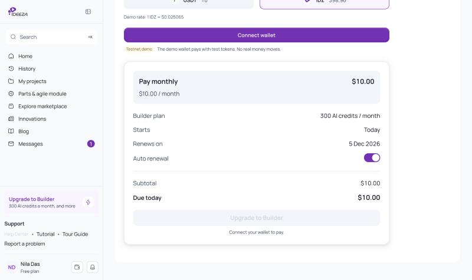 | 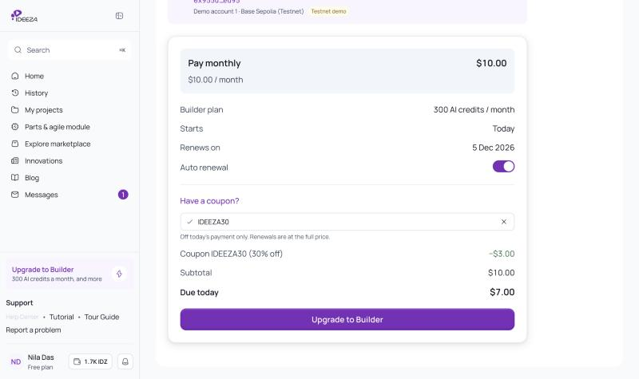 |

---

## CL-005 Each account has its own work; a new account starts fresh

**In the prototype:** 4 November 2026 · **Jira:** none · **Production:** Nothing to build

> **Prototype only.** The prototype keeps every account in one browser, so
> signing out sets that account's work aside and signing in brings it back; a
> new account starts empty. A real backend gives every account its own data
> already, so there is nothing to build here (product owner, 4 Nov 2026).

### Before → After

| Before | After |
| --- | --- |
| 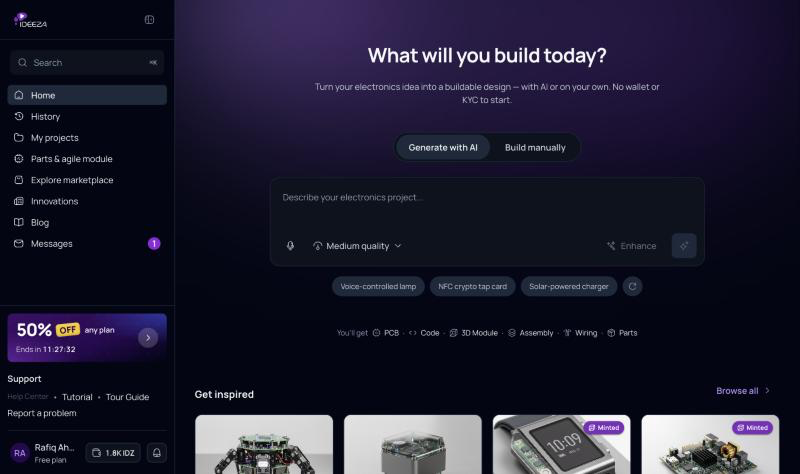 | 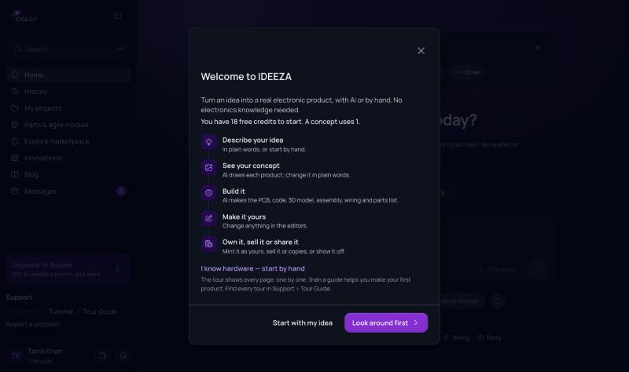 |

---

## CL-004 Welcome offer: 50% off the first payment, for 12 hours

**In the prototype:** 4 November 2026 · **Jira:** [PR-9013](https://ideeza.atlassian.net/browse/PR-9013) · **Production:** Ready for development

**Screen:** Home (a pop-up after the Welcome), the sidebar's Upgrade card,
Settings › Plan & pricing (`/settings/plan`), Checkout and the invoice.

> In the prototype the offer is kept in the browser, per account. Production
> keeps it on the server, per account, so the 12 hours and "already closed" hold
> on every device, and checkout applies the discount on the server.

### What to build

**Who gets it**
- [ ] A new account on Free that has never paid for a plan.
- [ ] Half off the first payment on any paid plan: the first month (Monthly) or the first year (Annual).
- [ ] It lasts 12 hours, counted from the moment the pop-up first shows. One offer per account; it never restarts — a reload or signing in again changes nothing.
- [ ] It ends when the 12 hours run out, or when a plan is bought with it.

**The pop-up (Home)**
- [ ] Opens on Home right after the Welcome closes (after the tour, when the Welcome's *Look around first* starts one), never on top of another dialog.
- [ ] Top band: the pill *A welcome gift, just for you*; the mark — a big **50%** with a yellow **OFF** sticker; *your first month of any plan* (*first year* on Annual); a price tag for the picked plan with its usual price struck through and the offer price under it (*Builder · $10.00 · $5.00 · first month*), changing with the plan and with Monthly · Annual; *Ends in* hh : mm : ss, counting down every second.
- [ ] **Monthly · Annual** switch.
- [ ] The three paid plans as a radio list, Builder picked: the name (*Most popular* on Builder), AI credits a month, the usual price struck through, the offer price and *You save $X.XX*. Monthly: Tinkerer $8.00 → $4.00, Builder $10.00 → $5.00, Disruptor $20.00 → $10.00. Annual: $76.80 → $38.40, $96.00 → $48.00, $192.00 → $96.00.
- [ ] Button **Claim 50% off: Builder for $5.00** (plan and price follow the choice) → checkout for that plan and billing.
- [ ] Under it: *Then $10.00 a month. Cancel any time.* (*a year* on Annual).
- [ ] **Compare all plans** → Plan & pricing. **Maybe later** and ✕ close it.
- [ ] Once closed it never pops up again, not after a reload and not on a later visit to Home.
- [ ] On a phone it rises from the bottom as a sheet; on a very narrow screen (about 320 px) the price tag is left out.

**After it is closed**
- [ ] The sidebar's Upgrade card becomes the offer: **50% OFF** *any plan*, *Ends in 11:42:10*, opening Plan & pricing. In the collapsed sidebar: a **50%** tile.
- [ ] When the offer ends or is used, the card goes back to *Upgrade to …*.

**Plan & pricing**
- [ ] A band at the top: **50% OFF**, *Your welcome gift: half price on any plan*, *Your first month, or your first year. The prices below already include it.* and the *Ends in* clock.
- [ ] Each paid plan card shows the offer price, a **50% OFF** sticker, the usual price struck through and *your first month* / *your first year*. The Compare plans heads show the same.

**Checkout and invoice**
- [ ] Checkout lists *Welcome offer (50% off)* as its own line (−$5.00 for Builder monthly); *Due today* is what is left, and it says when the offer ends.
- [ ] The invoice lists the same line: Subtotal $10.00, Welcome offer (50% off) −$5.00, Total $5.00.
- [ ] Buying a plan uses the offer up.

### Design

- The pop-up's top band, the sidebar card and the Plan & pricing band stand on the brand stage: deep violet (violet 900 → 950) lit by the brand violet and blue, with a faint dot grid. One look in light and dark mode; words on it are white.
- The mark: Display font, extra bold; **50%** at the 8xl size in the pop-up, 6xl on Plan & pricing, 4xl in the sidebar. The **OFF** sticker is yellow 400 with violet 950 text, turned −6°.
- Price tag: a white card, the offer price in violet 700, the usual price in gray with a red 500 line through it.
- Clock: glass chips (white at 12 % with a 20 % ring).
- DS components: Modal (M07; a bottom sheet on a phone), Segmented, Badge (*Most popular* brand, *You save* success), the AI-gradient Button (XL) for the claim, Link, ghost Button.

### Before → After

| Before | After |
| --- | --- |
| 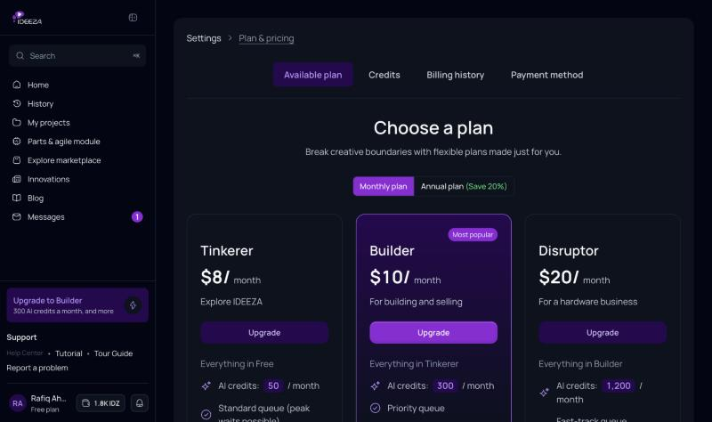 | 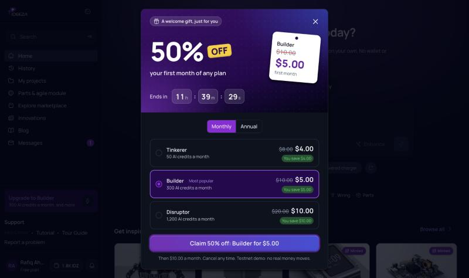 |
| | 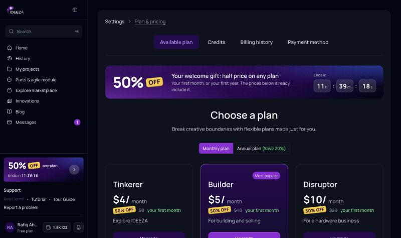 |

---

## CL-003 Landing page, the way into IDEEZA

**In the prototype:** 4 November 2026 · **Jira:** [PR-9009](https://ideeza.atlassian.net/browse/PR-9009) · **Production:** Ready for development

**Screen:** the landing page (`/landing`, and `/` for anyone signed out), built
from the Figma *IDEEZA Website V-2* (frame 18532:46268, 1440 wide, dark mode).
Website and platform live on one domain: the landing page is the front door
and its buttons lead through Sign up / Sign in ([CL-002](#cl-002-sign-up-and-sign-in)) into the app.

### What to build

**One domain**
- [ ] Signed out, `/` (with nothing but `utm_` tags) shows the landing page; any other app page asks you to sign in or sign up and returns you there afterwards.
- [ ] Top bar: **Log in** → Sign in; **Join Us** → Sign up (keeping the visit's `utm_` tags, so the one question is skipped when they answer it).
- [ ] **Start Project**, **Start With AI**, the hero prompt bar, and For Everyone's **Start Creating** and **Explore Engineer Mode** → Sign up, or Sign in once this browser has an account, carrying where they lead (Explore Engineer Mode → My Projects). No button leads back to the landing page.
- [ ] An idea typed in the hero prompt bar arrives in Home's prompt box after sign-up, the code and the one question; an empty send focuses the field.
- [ ] Footer **Sign In** → Sign in.
- [ ] Signed in: **Log in** is gone, **Join Us** and the footer link read **Open IDEEZA**, and every way in goes straight to the app.
- [ ] The landing page itself never asks anyone to sign in.

**Sections, top to bottom (copy as on the page)**
- [ ] **Top bar**, fixed and blurred: logo, Airdrop · NFT Marketplace · I'm Manufacturer · Pricing · ICO · About Us · **Resources** (Tutorials, Blog) · **EN** menu · Log in · Start Project · Join Us; under 1280 px a menu button opens the links and both buttons.
- [ ] **Hero:** *Build Hardware at the Speed of Software*, the line under it, the prompt bar *Describe your hardware idea…* with **Generate**.
- [ ] **Backed by World-Class Programs:** Member of Google AI Startup Program · Member of Microsoft for Startups · Member of NVIDIA Inception (owner confirmed all three).
- [ ] **For Everyone:** *Beginner-Friendly. Engineer-capable.*, For Creators (five points, **Start Creating**) and For Engineers (five points, **Explore Engineer Mode**).
- [ ] **What You Can Do:** AI Design Generation · Engineer Mode · Digital Ownership; a slider with a pager on narrow screens.
- [ ] **The Problem & Solution:** *The Complete Hardware Stack In One Platform.*
- [ ] **Ownership & Monetization:** Secure Digital Ownership · Sell on the Marketplace · Recurring Royalties; **Publish as Digital Product** and **Explore Marketplace**.
- [ ] **Creator Community — The Hardware Creator Feed:** one still picture (no card is a link) — *Worldwide creators*, *Follow creators*, *Get inspired*, *Browse innovations*, *Creators Story* (AI Engineering · VR & Wearables · Aerorobotics), *Share your inventions* — and one **Explore Community** button under it (→ Innovations).
- [ ] **Manufacturing Network:** four step tabs (Your Design · Prototype · Review & Approve · Production), arrow keys move between them.
- [ ] **The Ecosystem:** six stacked cards (AI Engine · Manufacturing Network · Creator Feed · Digital Ownership · Marketplace · $IDZ Token); a click or the arrow keys bring the next to the front; still with reduced motion.
- [ ] **Mobile Application:** *Coming soon to iOS and Android*; both store badges say *(coming soon)*.
- [ ] **Final call:** *The Next Hardware Product Could Be Yours.* with **Start With AI** and **Explore Projects**.
- [ ] **Footer:** Company · Product · Legal · Support columns, **Newsletter** (checks the address, then says *Newsletter sign-up isn't open yet, so your email wasn't saved.* — prototype only: production subscribes the address), © line.
- [ ] Links with no page yet (Airdrop, I'm Manufacturer, About Us, store badges, social and most footer links) show *Coming soon* and lead nowhere, never to a 404.

**Honesty rules (owner, 4 Nov 2026)**
- [ ] No invented people or figures: no creator counts, names, handles, follower or like counts, app downloads or ratings — even where the Figma draws them.
- [ ] Interaction only where it shows something otherwise hidden (tabs, the card deck, the slider); a showcase is a still picture with one clear button.

**Layout**
- [ ] At 1440 every section sits at the Figma's position and height.
- [ ] Below 1280 px the columns stack; no horizontal scroll at 375 px.

### Design

- Dark mode of the design system throughout the page.
- **One look per button kind:** the A01 **primary** (brand violet with the inner highlight) for Join Us, Generate, Start Creating and Publish as Digital Product; the **AI** gradient for Start With AI; and one **secondary** — no fill, a gradient glass ring — for Start Project, Explore Marketplace, Explore Community and Explore Projects. All pill-shaped.
- Type from the DS scale (Display headings, body lg/md); Hugeicons; art that CSS can't draw (glows, star fields, the globe, glass) comes from the Figma file.

### Before → After

| Before | After |
| --- | --- |
| 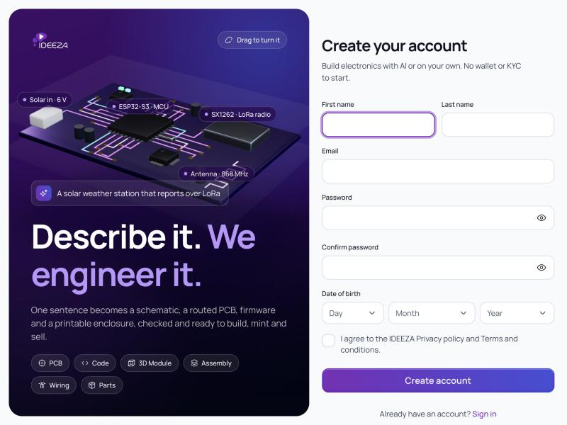 | 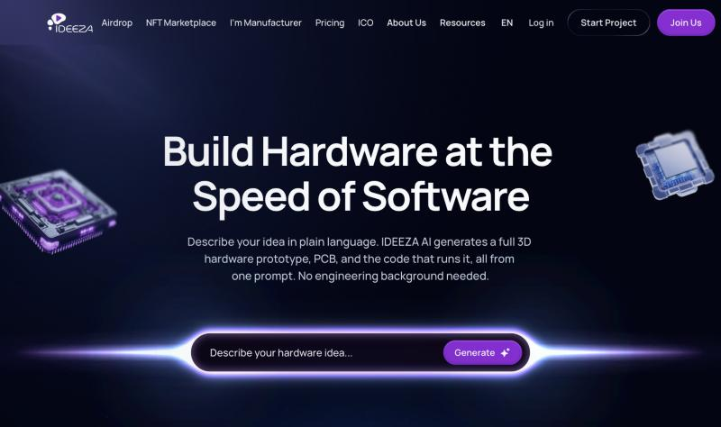 |
| | 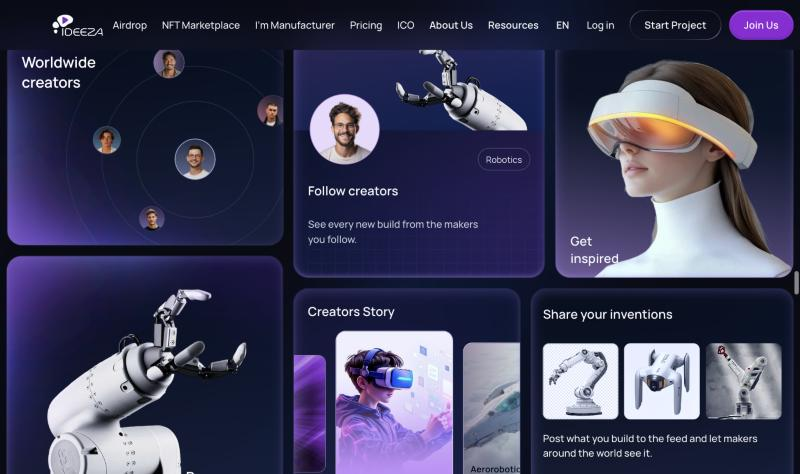 |

---

## CL-002 Sign up and sign in

**In the prototype:** 4 November 2026 · **Jira:** [PR-9011](https://ideeza.atlassian.net/browse/PR-9011) · **Production:** Ready for development

**Screen:** Sign up (`/sign-up`), Check your email (`/sign-up/check-email`), the
one question (`/sign-up/welcome`), Sign in (`/sign-in`, with Forgot password),
Home (Finish your profile card), the account menus and Settings › Account ›
Sign-in and security. The flow is the Notion "Creator Panel Design Proposal",
Part 1, without the waitlist (owner, 4 Nov 2026).

> In the prototype, accounts, sessions, emails and codes are a demo kept in the
> browser: the email arrives as a **Demo** card on the page and the code types
> itself in. Production builds the same screens on a real backend: accounts and
> sessions on the server, real emails with a real one-time code.

### What to build

**Who sees what**
- [ ] Every page needs you signed in, except Sign up and Sign in.
- [ ] Signed out, opening any page goes to **Sign in** when the browser has signed in before, else to **Sign up**; after signing in you land on the page you opened.
- [ ] Signed in, opening Sign up or Sign in goes to Home.
- [ ] A campaign link's `utm_source` is kept as where the person heard of IDEEZA.

**Sign up**
- [ ] Title **Create your account**; line *Build electronics with AI or on your own. No wallet or KYC to start.*
- [ ] Fields: **First name**, **Last name** (side by side; stacked on a phone), **Email**, **Password** and **Confirm password** (each with a show/hide eye), **Date of birth** as Day · Month · Year, and the box *I agree to the IDEEZA Privacy policy and Terms and conditions.*
- [ ] First name is focused when the page opens.
- [ ] Pressing **Create account** with mistakes shows the reason under each field and focuses the first: *Enter your first name.* · *Enter your last name.* · *Enter your email.* / *Enter an email like name@example.com.* · *Type the password again.* / *The passwords don't match.* · *Choose a day.* / *Choose a month.* / *Choose a year.* / *That date doesn't exist.* · *Agree to the Privacy policy and Terms to continue.*
- [ ] Date of birth is required and must be a real, past date; there is no age limit.
- [ ] An email that already has an account: *There's already an account with this email.* with **Sign in instead** (it carries the email).
- [ ] Under the button: *Already have an account?* **Sign in**.

**Password rules**
- [ ] Focusing the password unfolds its rules under it: *At least 8 characters* · *An uppercase letter (A–Z)* · *A lowercase letter (a–z)* · *A number (0–9)* · *A symbol, like ! @ # $*.
- [ ] Each rule ticks green as it is met while typing; a five-step bar fills and reads **Weak**, **Fair**, **Almost there** or **Strong**.
- [ ] The rules stay open while any is unmet; when all are met and focus leaves, they fold away.
- [ ] The account is not created until every rule is met (the unmet rules then show in red).
- [ ] Setting a new password (Forgot password) uses the same checker.

**Check your email**
- [ ] Title **Check your email** with a mail icon; line *Verify it, and you're in. We sent it to* **email** ✎ **Change**.
- [ ] **Change** goes back to Sign up with the names and email filled in, to fix a typo.
- [ ] The email: from IDEEZA, subject **Verify your email**, *Hi {first name}, confirm this is your email to finish creating your IDEEZA account.*, button **Verify email**.
- [ ] **Verify email** opens the code step in its place: **Enter the 6-digit code**, six boxes; then *Checking the code…*, then **Verified**, and on to the next step. A wrong code: *That code doesn't match. Check it and try again.* The boxes take typing, pasting, Backspace and the arrow keys.
- [ ] *Didn't get it?* **Send it again**.
- [ ] Verifying signs the person in at once — they never type the password again.

**The one question**
- [ ] *Your account is ready, {first name}*; title **Where did you hear about IDEEZA?**; line *One tap and you're in. It helps us reach more makers like you.*
- [ ] Six tiles, each with its icon and a hint: YouTube (*A video or a channel*), Friend (*Someone told you*), Google (*You searched*), LinkedIn (*A post or a profile*), Event (*A fair, talk or meetup*), Other (*Somewhere else*). One tap saves and goes on; Other asks *Where? (optional)* with **Continue**.
- [ ] **Skip for now** goes on without an answer.
- [ ] The question is not asked when the campaign link already said where they came from.
- [ ] After a Skip, Home shows a card **Finish your profile** — *Where did you hear about IDEEZA? One tap.* — with the same choices, until they answer or close it.
- [ ] The country is saved to the profile from where the person is (no question); the name is saved to the profile when it has none.

**Sign in**
- [ ] Title **Welcome back**; line *Sign in to pick up where you left off.*; **Email**, **Password** with **Forgot password?** beside its label.
- [ ] A wrong email or password always gives one message: *That email and password don't match.*
- [ ] An account whose email isn't verified yet goes to Check your email.
- [ ] Under the button: *New to IDEEZA?* **Create an account** (it carries the email).
- [ ] After signing out, a green note on top: **You've signed out** — *Your account and your work are saved in this browser.* (the second line is prototype only)

**Forgot password**
- [ ] **Reset your password** — *Enter your account's email and we'll send you a link to set a new one.* — **Send link**.
- [ ] Check your email (with ✎ **Change**) → email **Reset your password** → **Set a new password** → the same code step → **Set a new password** with the checker and a confirmation → **Save and sign in**.
- [ ] An email with no account: **No account for that email** with **Try another email** and *New to IDEEZA?* **Create an account**.
- [ ] **Back to sign in** on every step.

**Sign out**
- [ ] **Sign out** works in the sidebar's account menu, the editors' account menu and Settings › Account › **Sign-in and security** (which shows *Signed in as* the email, **Download your information** and **Sign out**).
- [ ] Signing out keeps the account and the work; signing in again finds everything. (prototype only: a real backend does this already)

**The 3D stage (left of the form)**
- [ ] From 1024 px wide: a dark violet stage fills the left of the window and stays put while the form scrolls; the form sits on the right.
- [ ] On it: the IDEEZA logo, **Drag to turn it**, a live 3D circuit board (traces lit, labelled *ESP32-S3 · MCU*, *SX1262 · LoRa radio*, *Solar in · 6 V*, *Antenna · 868 MHz*, its case opening and closing), the prompt *A solar weather station that reports over LoRa*, the title **Describe it. We engineer it.**, one line, and the build's pieces (PCB · Code · 3D Module · Assembly · Wiring · Parts).
- [ ] It turns slowly by itself and turns with a drag; with reduced motion it stands still.
- [ ] Below 1024 px it is a 300 px band above the form with the logo, the prompt and the title; no horizontal scroll at 375 px.
- [ ] Under the form: *Demo: your account and your work stay in this browser.* (prototype only).

### Design

- Design system components only: Text Input (XL, the eye as its action), Select Menu (date of birth), Checkbox, Button (the **AI** gradient for every main action, Ghost for secondary ones, Secondary), Tag (Home card choices), Badge (warning, "Demo"; prototype only), Banner (good, "You've signed out"), Hugeicons through the app's icon component.
- Tokens: brand violet and blue (the AI button gradient on buttons and the icon tiles), success / warning / error inks for the rules and the code; radius 2xl–3xl; title 4xl, body md, labels sm; the stage's colours are the violet, blue and gray scales; motion 200 ms.
- Light and dark mode; the stage is dark in both.

### Before → After

| Before | After |
| --- | --- |
| 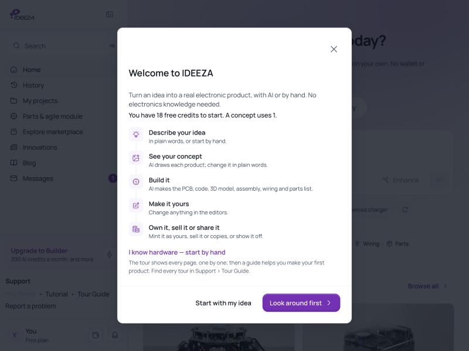 |  |
| 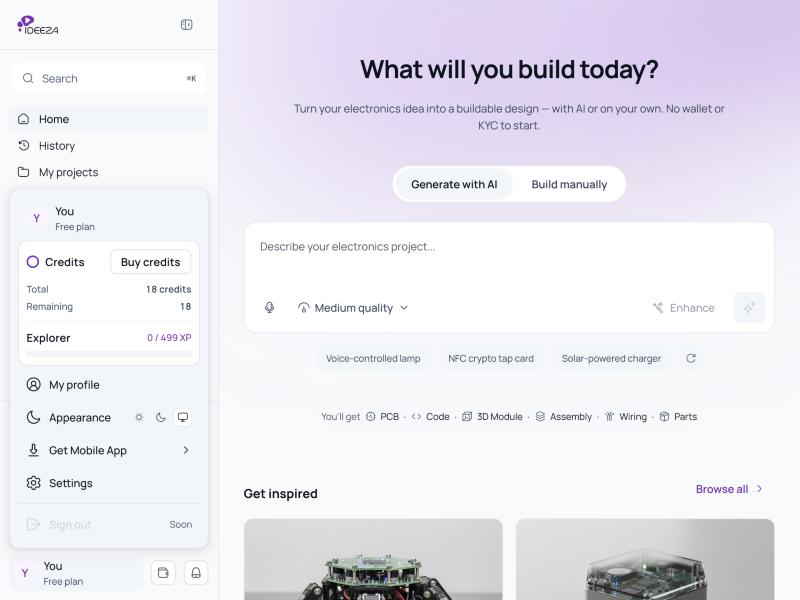 | 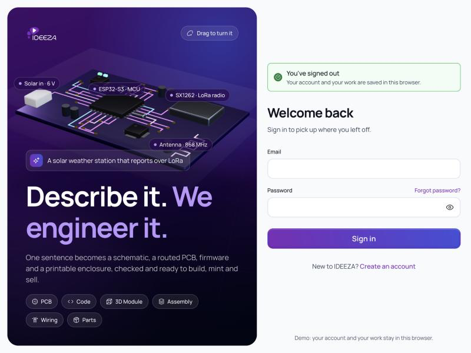 |
| | 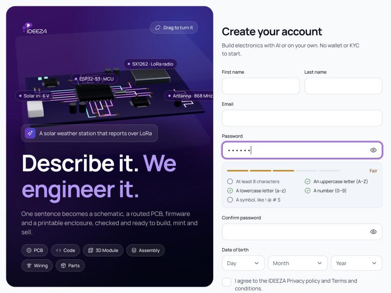 |
| | 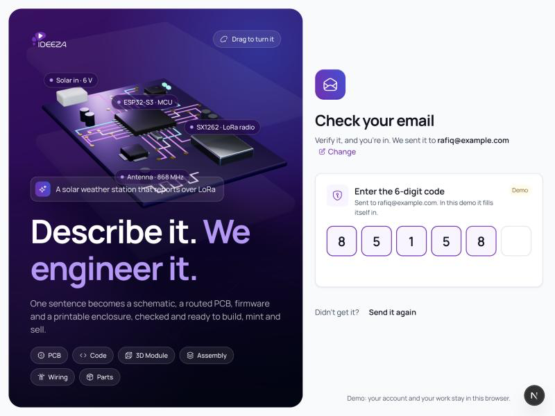 |

---

## CL-001 Products question: the total stays at the bottom of the screen

**In the prototype:** 3 November 2026 · **Jira:** [PR-9012](https://ideeza.atlassian.net/browse/PR-9012) · **Production:** Ready for development

**Screen:** Concept chat › canvas › **What should we build?** (the question
after a prompt that needs more than one product), and the next step, **What
should the project be called?**

### What to build

- [ ] The count, the credits and the button sit in a bar pinned to the bottom of the canvas, spanning its full width, with the button at the right edge.
- [ ] The bar stays in view however long the product list is; a short list leaves it at the bottom edge.
- [ ] The count reads **"{ticked} of {offered} products selected"** (for example "2 of 2 products selected"); with one product offered, **"1 product"**.
- [ ] The button reads **Continue** on "What should we build?" and **Start drawing** on "What should the project be called?" (and when adding to an existing project).

### Design

- A bar with a top border and the page background, padded by the page inset; the credits as the Credit badge; the primary Button.

### Before → After

| Before | After |
| --- | --- |
| 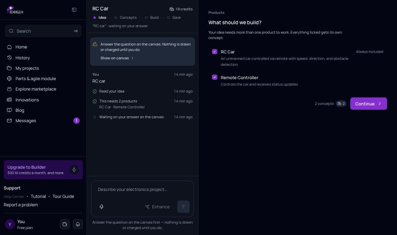 | 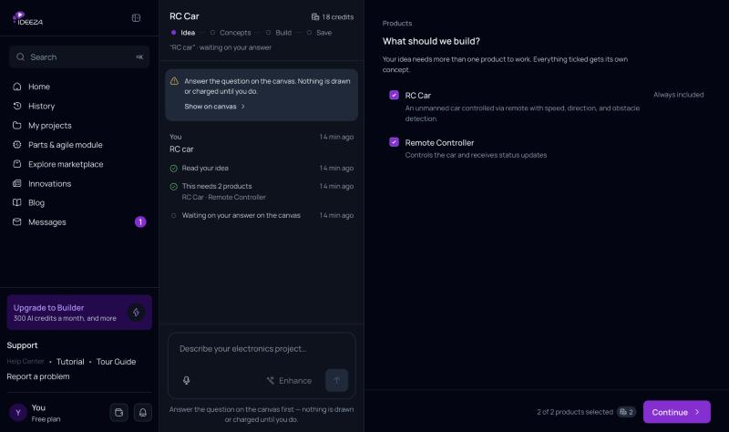 |
